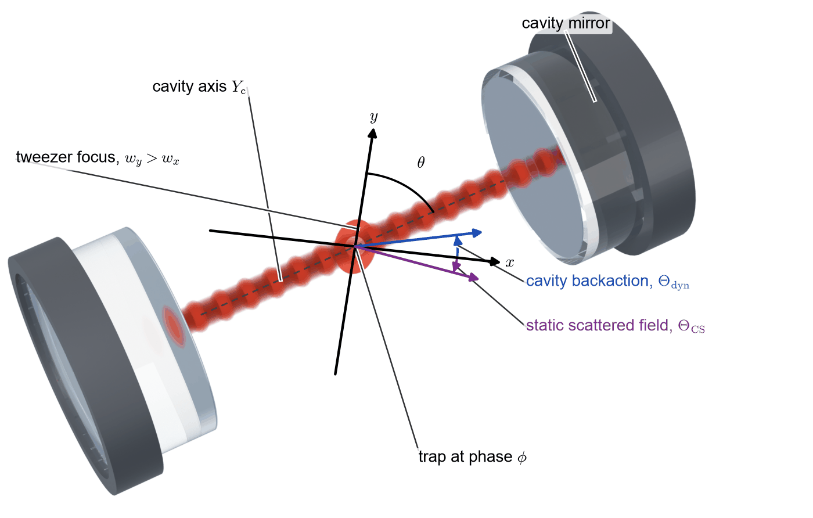
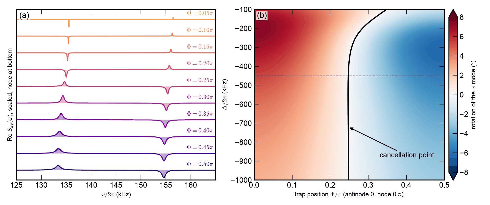
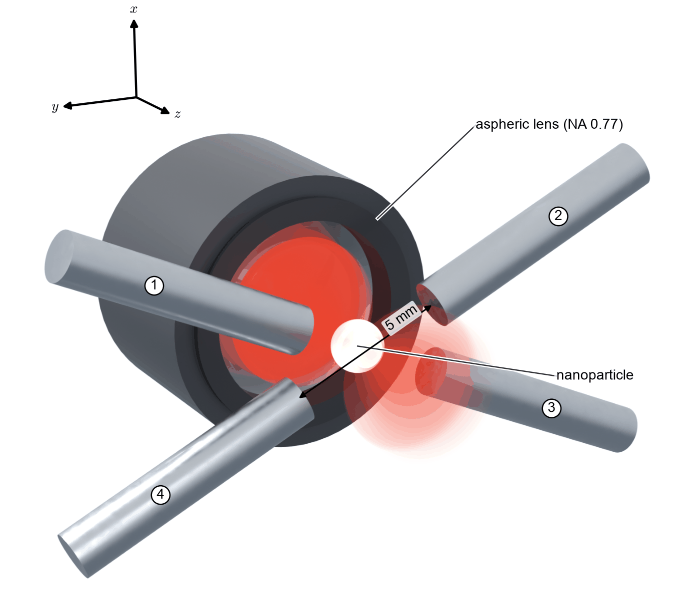
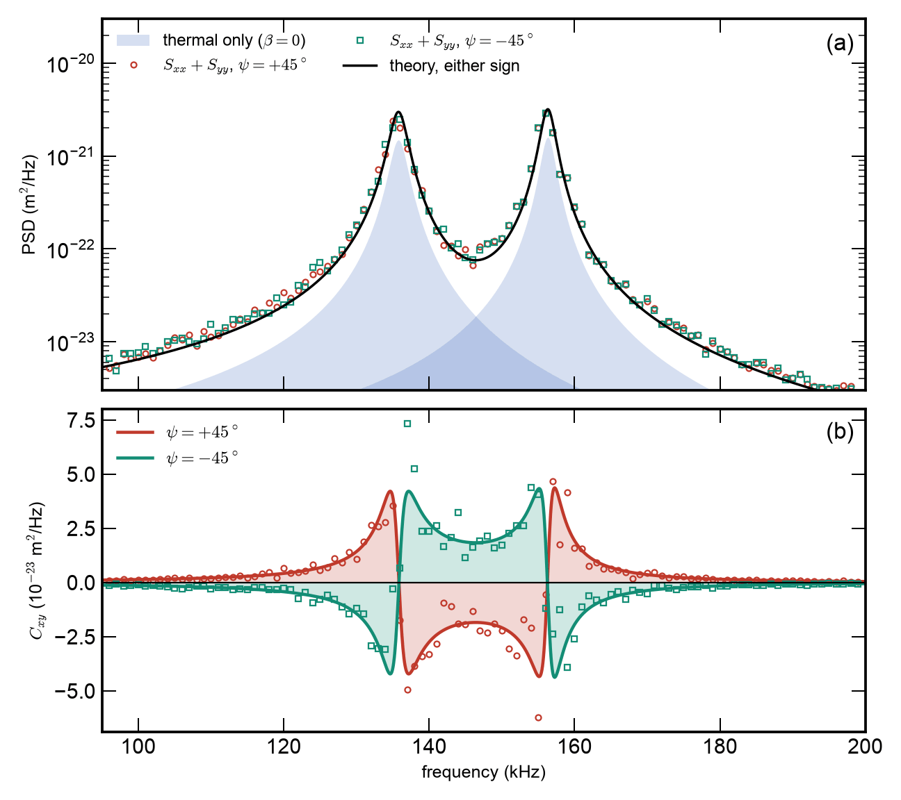
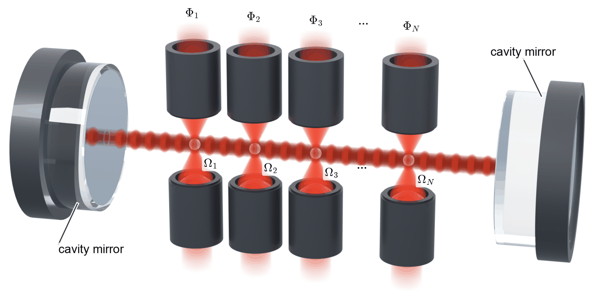
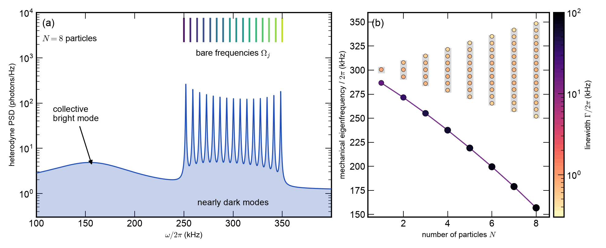
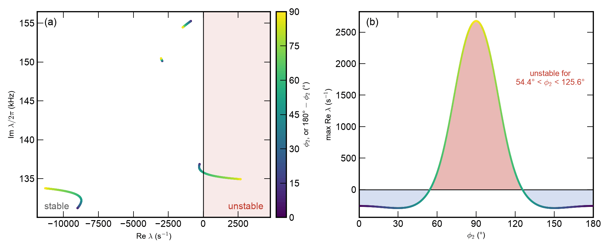
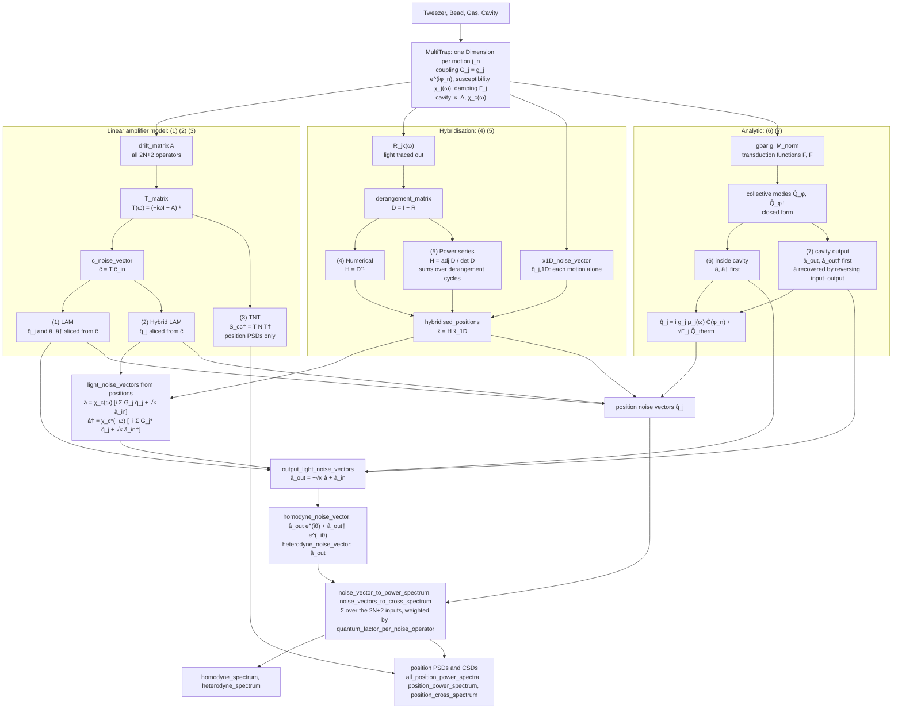
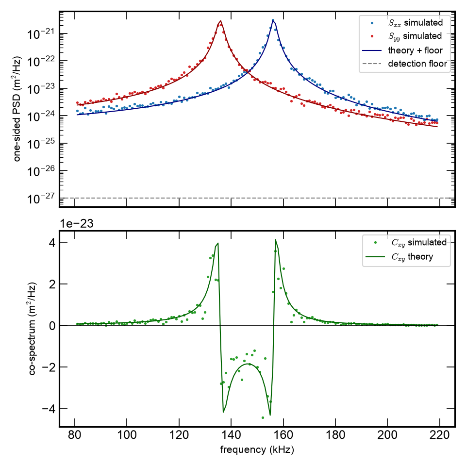

# `levisim`

[](https://pypi.org/project/levisim/)
[](https://pypi.org/project/levisim/)
[](https://github.com/julianiacoponi/levisim/actions/workflows/tests.yml)
[](https://julianiacoponi.github.io/levisim/)
[](LICENSE)

`levisim` simulates levitated optomechanics. Its core is the quantum linear theory (QLT) of several optically levitated nanoparticles coupled by coherent scattering to one shared cavity mode: given the tweezers, the beads, the gas and the cavity, `MultiTrap` calculates the homodyne and heterodyne spectra of the cavity output and the power and cross spectral densities of every particle's motion, by any of seven calculation methods that can be checked against each other. Around that core are a stochastic (Runge-Kutta) simulator of a bead in a free-space tweezer, covariance-matrix tools for steady-state entanglement under a two-tone drive, and a Fortran reference implementation that the Python spectra are tested against.

**Documentation:** <https://julianiacoponi.github.io/levisim/> - a user guide, the calculation methods in full, and an API reference generated from the docstrings.

## Installation

### From PyPI

```sh
pip install levisim              # the latest release
pip install --upgrade levisim    # move to a newer release
python -c "import levisim; print(levisim.__version__)"
```

The package is everything under `levisim/`, including the three small power-series pickles that `load_in_power_series=True` uses; the releases and what changed in each are on [PyPI](https://pypi.org/project/levisim/) and in [`CHANGELOG.md`](CHANGELOG.md).

### From a clone (development, notebooks, tests)

The notebooks, tests and scripts live in the repository, not in the package. To run them, or to work on the code, install from a clone in editable mode, so that changes to the source take effect without reinstalling:

```sh
git clone https://github.com/julianiacoponi/levisim.git
cd levisim
pip install -e ".[dev]"          # editable, with pytest, ruff and the build tools
```

`pip install .` (without `-e`) gives a normal, non-editable install of the clone instead. The notebooks follow `main`; to run them against a release, check out its tag first, e.g. `git checkout v0.1.0`.

### Requirements and extras

Either way this needs Python 3.10 or newer and installs the runtime dependencies (numpy ≥ 2.0, scipy, matplotlib, sympy, loguru, tqdm). Six optional extras add conveniences that nothing in the physics needs: `elk` (the Elasticsearch client, see [Logging](#logging)), `notify` (desktop notifications when a long test run starts and finishes), `video` (OpenCV, for the image-comparison helpers), `notebooks` (JupyterLab and what the notebooks import), `docs` (Sphinx and the theme, to build the documentation) and `dev` (pytest and ruff), e.g. `pip install "levisim[elk]"` or, from a clone, `pip install ".[elk,dev]"`.

**Name shadowing.** Do not start Python or Jupyter in the directory that *contains* your clone. There the repository folder `levisim/`, which has no `__init__.py`, shadows the package, and `import levisim` silently gives an empty namespace package. The repo root itself, or `notebooks/`, is fine.


## Quickstart

Two particles, each moving in $`x`$ and $`y`$, in one red-detuned cavity:

```python
import numpy as np
import matplotlib.pyplot as plt

from levisim.core.plotting import set_plt_rcParams_to_xmgrace_style
from levisim.core.units import degrees, kHz
from levisim.multiphysics.enums import QuantumLinearTheoryMethod
from levisim.multiphysics.multitrap import MultiTrap
from levisim.multiphysics.utils.shelf import DEFAULT_cavity_kwargs, DEFAULT_gas_kwargs

set_plt_rcParams_to_xmgrace_style()

mtrap = MultiTrap(
    num_traps=2,
    Cartesian_axes_per_trap=2,
    gas_kwargs=DEFAULT_gas_kwargs,          # 1e-6 mbar, 300 K
    cavity_kwargs=DEFAULT_cavity_kwargs,    # Δ = -2π × 450 kHz, L = 0.96 cm, finesse 40 000
    φn_dict={2: 30*degrees},                # second tweezer's phase (built-in 90°: unstable, see below)
    ω_range=np.arange(125, 165, 0.02) * kHz,
)
mtrap.info

S_hh = mtrap.homodyne_spectrum(QuantumLinearTheoryMethod.LINEAR_AMPLIFIER_MODEL)

fig, ax = plt.subplots()
ax.semilogy(mtrap.ω_range / kHz, S_hh)
ax.margins(x=0)
ax.set_xlabel(r'$\omega / 2\pi$ (kHz)')
ax.set_ylabel(r'$S_{hh}(\omega)$ (shot-noise units)')
fig.savefig('quickstart_homodyne.png')
```


Frequencies are angular throughout: `kHz` is $`2\pi \times 10^3`$ rad/s, so dividing by it gives ordinary kHz for plotting. The homodyne spectrum is in shot-noise units, tending to 1 far from the mechanical peaks. The dotted lines in the figure (drawn by the full script, `docs/guide/scripts/quickstart_homodyne.py`) mark each motion's bare trap frequency $`\Omega_{j_n}`$. The two $`x`$ peaks, at 150.2 and 155.1 kHz, sit 1.9 and 1.3 kHz below their bare frequencies because of the optical spring. The cavity hybridises the two $`y`$ motions into a broad, bright mode at 131.7 kHz (linewidth 2.8 kHz) and a narrow, nearly dark mode at 136.5 kHz (linewidth 94 Hz).

**Stability.** The tweezer phases matter. With unequal phases the cavity-mediated coupling between the particles gains a non-reciprocal part $`\propto \sin(\phi_2 - \phi_1)`$, which can anti-damp a hybridised mode of near-degenerate motions. For this system a phase difference $`|\phi_2 - \phi_1|`$ between about 54° and 126° (modulo 180°) makes it linearly unstable: with the second tweezer's built-in phase of 90° one $`y`$ mode grows at $`\mathrm{Re}\,\lambda = +2.7 \times 10^3`$ s⁻¹, which is why the quickstart sets 30°. `MultiTrap` logs a WARNING when its drift matrix has an eigenvalue with positive real part, and reports its stability explicitly: `mtrap.is_stable`, `mtrap.max_growth_rate` (the largest $`\mathrm{Re}\,\lambda`$, in s⁻¹), `mtrap.unstable_modes` (frequency and growth rate of each growing mode) and `mtrap.drift_eigenvalues`, all also shown by `mtrap.info`. The stationary spectra of an unstable system are still finite numbers, but they are formal: they describe no physical steady state. The guide page *Linear stability of a system* (`docs/guide/stability.md`) lists which ready-made systems are unstable, and the concepts page *Eigenvalue stability of coupled resonators* (`docs/concepts/stability.md`) explains the theory.

**`MultiTrap` options.** A physical `MultiTrap` can also take its own `tweezers=[...]` and `beads=[...]` (one per particle), extra `Trap` arguments per particle (`trap_kwargs=[...]`, e.g. measured frequencies) and tweezer phases (`φn_dict`). Photon-recoil heating of the scattered tweezer light is added to the bath of each motion by default (`photon_recoil=False` leaves the gas bath alone); it raises the noise but not the drift matrix, so frequencies, linewidths and stability do not depend on it. See the guide page *Spectra of several particles in one cavity*.

<!-- SHOWCASE-START -->
## Three papers in levisim

levisim grew out of the calculations for three of my papers, and each of them is a short example. The schematics are renders of my Blender scenes for the thesis; every figure links to an interactive version on the documentation site, where it is recomputed at each build and where hovering gives the values. The scripts that draw the figures are in [`docs/guide/scripts/showcase/`](docs/guide/scripts/showcase/), and each snippet below is the part of its script that does the physics.

### Mode orientations and the cancellation point (PRR 5, 2023)

A. Pontin, H. Fu, J. H. Iacoponi, P. F. Barker and T. S. Monteiro, *Controlling mode orientations and frequencies in levitated cavity optomechanics*, Phys. Rev. Research **5**, 013013 (2023), [doi:10.1103/PhysRevResearch.5.013013](https://doi.org/10.1103/PhysRevResearch.5.013013).

<p align="center"></p>

The two transverse motions of a nanosphere in a cavity are coupled twice over: through the cavity dynamics, with couplings $`g_x, g_y \propto \sin\Phi`$ that rotate the normal modes away from the tweezer axes, and through the static coherent-scattering field, with a direct coupling $`g_{xy} \propto \cos\Phi`$ that rotates them back. In this paper we found the trap position at which the two cancel, where the modes keep their unperturbed orientation and the $`x`$-$`y`$ cross spectrum $`S_{xy}`$ vanishes while the particle is still cavity-cooled; the analysis of that cancellation point was my part of it. levisim computes $`S_{xy}`$ as the particle moves along the standing wave, and reads the orientation of each normal mode from the eigenvectors of the drift matrix:

```python
import numpy as np
from levisim.core.units import kHz
from levisim.multiphysics.enums import QuantumLinearTheoryMethod
from levisim.multiphysics.multitrap import MultiTrap
from levisim.multiphysics.utils.shelf import DEFAULT_cavity_kwargs, DEFAULT_gas_kwargs
from levisim.physics.bead import Bead

for Φ in np.linspace(0.5, 0.05, 10) * np.pi:       # from the node (π/2) towards the antinode (0)
    mtrap = MultiTrap(
        num_traps=1,
        Cartesian_axes_per_trap=2,
        gas_kwargs=DEFAULT_gas_kwargs,
        cavity_kwargs=DEFAULT_cavity_kwargs,
        beads=[Bead(Φ=Φ)],                          # the trap position on the standing wave
        ω_range=np.arange(125, 165, 0.02) * kHz,
    )
    assert mtrap.is_stable
    S_xy = mtrap.position_cross_spectrum('x1', 'y1', QuantumLinearTheoryMethod.LINEAR_AMPLIFIER_MODEL).real
    eigenvalues, eigenvectors = np.linalg.eig(mtrap.drift_matrix)   # basis (a, a†, b_x, b_x†, b_y, b_y†)
```

[](https://julianiacoponi.github.io/levisim/showcase/prr5_mode_orientations.html)

In (a) the two motions stay anticorrelated, with peaks of opposite sign at 133-136 kHz and 155-156 kHz, and the pattern flips sign between $`\Phi = 0.25\pi`$ and $`0.20\pi`$. In (b) the black contour, where the $`x`$ mode is not rotated at all, is the cancellation point: $`\Phi_\text{c} = 0.248\pi`$ at the default detuning of $`-2\pi \times 450`$ kHz, moving towards the node as the detuning approaches the mechanical frequencies ($`0.313\pi`$ at $`-2\pi \times 150`$ kHz). levisim does not include the static field's shift of the mechanical frequencies, which the paper shows cancelling at the same point, so it reproduces the rotation but not the frequency cancellation.

### Sensing a directional noise bath (PRR 6, 2024)

J. M. H. Gosling, A. Pontin, J. H. Iacoponi, P. F. Barker and T. S. Monteiro, *Sensing directional noise baths in levitated optomechanics*, Phys. Rev. Research **6**, 013129 (2024), [doi:10.1103/PhysRevResearch.6.013129](https://doi.org/10.1103/PhysRevResearch.6.013129).

<p align="center"></p>

A white-noise force along a fixed direction $`\psi`$, applied in the experiment by four electrodes around a feedback-cooled particle, only heats the motion as far as the power spectral densities can tell, by the same amount for $`\psi`$ and $`-\psi`$; the $`x`$-$`y`$ co-spectrum, which thermal noise leaves at zero, shows the force and its quadrant without any calibration. I simulated all of this paper in levisim, including the directed force, which the stochastic Runge-Kutta integrator applies as one random force shared between $`x`$ and $`y`$ in proportion to $`\cos\psi`$ and $`\sin\psi`$, and the error analysis of the spectral estimates in its appendix:

```python
import numpy as np
from levisim.analysis.spectral_density_estimate import SpectralDensityEstimate
from levisim.core.units import degrees, μs
from levisim.data.simulation import Simulation
from levisim.physics.trap import Trap

for ψ in (45, -45):
    trap = Trap(ψ=ψ*degrees)       # a directed force of PSD β²·S_th along ψ, with β = √2
    sim = Simulation(trap=trap, num_samples=400_000, Δt=0.1*μs, seed=2024)
    C_xy = SpectralDensityEstimate(sim, 'xy', num_segments=40)
    C_xy_theory = trap.theory.Cxy(2*np.pi*C_xy.freq_range)
```

[](https://julianiacoponi.github.io/levisim/showcase/prr6_directional_force.html)

The points are the simulations (40 ms each) and the lines the theory. The PSDs in (a) rise above their thermal parts (shaded) identically for $`\psi = \pm 45°`$, while the co-spectra in (b), with lobes of $`\pm 4.3 \times 10^{-23}`$ m²/Hz at the $`y`$ and $`x`$ resonances (135.8 and 156.3 kHz), are mirror images of each other.

### A mechanical mode comb and its collective bright mode (PRR 8, 2026)

J. H. Iacoponi, M. Rademacher and T. S. Monteiro, *Nanoparticle arrays levitated in a cavity for quantum sensing*, Phys. Rev. Research **8**, 033286 (2026), [doi:10.1103/wrd3-t5cf](https://doi.org/10.1103/wrd3-t5cf).

<p align="center"></p>

An array of particles in one cavity mode, with their mechanical frequencies spread into an even comb, is reorganised by the light into one collective bright mode, which takes nearly all of the coupling to the cavity and is pulled far below the comb, and a comb of nearly dark modes that keep the bare frequencies and narrow linewidths. levisim simulates everything in this paper, whose closed-form spectra are its analytic methods (6) and (7):

```python
import numpy as np
from levisim.core.units import kHz
from levisim.multiphysics.enums import QuantumLinearTheoryMethod
from levisim.multiphysics.multitrap import MultiTrap
from levisim.multiphysics.utils.shelf import DEFAULT_cavity_kwargs, DEFAULT_gas_kwargs

mtrap = MultiTrap(
    num_traps=8,
    Cartesian_axes_per_trap=2,
    gas_kwargs=DEFAULT_gas_kwargs,
    cavity_kwargs=DEFAULT_cavity_kwargs,
    toy_params=dict(Ω_model='equal spacing', Ω_mid=300*kHz, Ω_span=100*kHz, toy_gx=-40*kHz, toy_gy=-40*kHz),
    ω_range=np.arange(100, 400, 0.05) * kHz,
)
assert mtrap.is_stable
S_het = mtrap.heterodyne_spectrum(QuantumLinearTheoryMethod.LINEAR_AMPLIFIER_MODEL)
eigenvalues = mtrap.drift_eigenvalues   # the bright mode is the broadest mechanical one
```

[](https://julianiacoponi.github.io/levisim/showcase/prr8_mode_comb.html)

With 16 motions spaced 6.67 kHz apart about 300 kHz and $`g/2\pi = 40`$ kHz each, the bright mode sits at 156.9 kHz with a linewidth of 90.8 kHz, against 286.7 kHz and 17.4 kHz for a single particle, and the narrowest dark mode is 0.42 kHz wide.

## Stability, and the other systems this could model

Underneath every spectrum, levisim solves the linear Langevin equations $`\dot{\hat{\mathbf c}} = \mathbf A\hat{\mathbf c} + \hat{\mathbf c}_\text{in}`$ of a network of damped resonators, and such a network has a steady state only if every eigenvalue $`\lambda`$ of the drift matrix $`\mathbf A`$ has $`\mathrm{Re}\,\lambda < 0`$. Its stationary spectra do not reveal a failure of this condition, since a Lorentzian is the same for a growing mode as for a decaying one, which is why every `MultiTrap` reports them explicitly (see the stability note under the [quickstart](#quickstart)). Unequal tweezer phases are the usual cause, because they give the cavity-mediated coupling between particles a non-reciprocal part $`\propto \sin(\phi_2 - \phi_1)`$ that can anti-damp a hybridised pair of motions:

```python
import numpy as np
from levisim.core.units import degrees
from levisim.multiphysics.multitrap import MultiTrap
from levisim.multiphysics.utils.shelf import DEFAULT_cavity_kwargs, DEFAULT_gas_kwargs

for φ2 in np.arange(0, 180.01, 0.2) * degrees:
    mtrap = MultiTrap(
        num_traps=2,
        Cartesian_axes_per_trap=2,
        gas_kwargs=DEFAULT_gas_kwargs,
        cavity_kwargs=DEFAULT_cavity_kwargs,
        φn_dict={2: φ2},
    )
    eigenvalues, growth_rate = mtrap.drift_eigenvalues, mtrap.max_growth_rate
```

[](https://julianiacoponi.github.io/levisim/showcase/stability_tweezer_phase.html)

For the quickstart's two particles, one hybridised $`y`$ mode near 135 kHz crosses $`\mathrm{Re}\,\lambda = 0`$ at $`\phi_2 = 54.40°`$ and comes back at $`125.60°`$, growing at up to $`+2.68 \times 10^3`$ s⁻¹ at 90°. The concepts page [*Eigenvalue stability of coupled resonators*](docs/concepts/stability.md) derives all of this, from the drift matrix to exceptional points and non-reciprocal coupling.

Nothing in this analysis, nor in levisim's frequency-domain solution, is specific to levitated particles: only the way $`\mathbf A`$ and the noise correlations are filled in is. The same page lists the systems the code could be adapted to, roughly in increasing order of effort: multimode optomechanics (membrane-in-the-middle cavities and arrays of optomechanical crystals), clamped MEMS/NEMS resonator networks, circuit optomechanics and electromechanics, coupled superconducting resonators and parametric amplifiers, trapped ions and atomic ensembles in cavities, non-Hermitian and PT-symmetric lattices, the librational modes of levitated rotors, and cavity magnomechanics.
<!-- SHOWCASE-END -->

## Notebooks

[`notebooks/`](notebooks/) holds worked examples as Jupyter notebooks, indexed with run times in [`notebooks/README.md`](notebooks/README.md):

- [`demos/`](notebooks/demos/): six short walk-throughs of the API - the quickstart system in full, the seven calculation methods side by side, the stochastic free-space simulator, two-tone entanglement, the derangement power series, and parameter sweeps with stability checks;
- [`showcase/`](notebooks/showcase/): a hundred particles in one cavity mode, solved by independent routes;
- [`papers/`](notebooks/papers/): published experiments rebuilt from their stated parameters and compared with the papers' numbers (listed [below](#published-experiments-reproduced-in-levisim)).

These three folders are stored with their outputs and rendered in the documentation's [notebook gallery](https://julianiacoponi.github.io/levisim/notebooks.html) (source: [`docs/notebooks.md`](docs/notebooks.md)). The research notebooks behind the thesis (`multiphysics/`, `physics/`, `archive/`) are stored without outputs.

## Published experiments reproduced in levisim

Each of these notebooks in [`notebooks/papers/`](notebooks/papers/) builds a published experiment from its stated parameters and compares levisim's results with the paper's numbers and figures, ending with a list of the agreements and discrepancies (see [`notebooks/papers/README.md`](notebooks/papers/README.md)):

- U. Delić, M. Reisenbauer, K. Dare, D. Grass, V. Vuletić, N. Kiesel and M. Aspelmeyer, *Cooling of a levitated nanoparticle to the motional quantum ground state*, Science **367**, 892 (2020), [doi:10.1126/science.aba3993](https://doi.org/10.1126/science.aba3993): [`delic2020_ground_state_cooling.ipynb`](notebooks/papers/delic2020_ground_state_cooling.ipynb);
- J. Piotrowski, D. Windey, J. Vijayan, C. Gonzalez-Ballestero, A. de los Ríos Sommer, N. Meyer, R. Quidant, O. Romero-Isart, R. Reimann and L. Novotny, *Simultaneous ground-state cooling of two mechanical modes of a levitated nanoparticle*, Nat. Phys. **19**, 1009 (2023), [doi:10.1038/s41567-023-01956-1](https://doi.org/10.1038/s41567-023-01956-1): [`piotrowski2023_two_mode_ground_state.ipynb`](notebooks/papers/piotrowski2023_two_mode_ground_state.ipynb);
- J. Vijayan, J. Piotrowski, C. Gonzalez-Ballestero, K. Weber, O. Romero-Isart and L. Novotny, *Cavity-mediated long-range interactions in levitated optomechanics*, Nat. Phys. **20**, 859 (2024), [doi:10.1038/s41567-024-02405-3](https://doi.org/10.1038/s41567-024-02405-3): [`vijayan2024_cavity_mediated_interactions.ipynb`](notebooks/papers/vijayan2024_cavity_mediated_interactions.ipynb);
- A. Pontin, Q. Deplano, A. Ranfagni, F. Marino and F. Marin, *Strong coupling and dark modes in the motion of a pair of levitated nanoparticles*, Phys. Rev. Lett. **135**, 073602 (2025), [doi:10.1103/t33b-f1b2](https://doi.org/10.1103/t33b-f1b2): [`pontin2025_pair_dark_modes.ipynb`](notebooks/papers/pontin2025_pair_dark_modes.ipynb);
- A. Pontin, Q. Deplano, F. Marino and F. Marin, *Optical squeezing mediated by levitated oscillators at their quantum ground state*, Phys. Rev. A **114**, 053704 (2026), [doi:10.1103/hms3-yb2h](https://doi.org/10.1103/hms3-yb2h): [`pontin2026_optical_squeezing.ipynb`](notebooks/papers/pontin2026_optical_squeezing.ipynb);
- Q. Deplano, A. Pontin, F. Marino and F. Marin, *Stationary entanglement of a levitated oscillator with an optical field*, Science **394**, 113 (2026), [doi:10.1126/science.aeh1375](https://doi.org/10.1126/science.aeh1375): [`deplano2026_stationary_entanglement.ipynb`](notebooks/papers/deplano2026_stationary_entanglement.ipynb).

## Repository layout

| Path | Contents |
|---|---|
| `levisim/core/` | units (angular: `Hz` is $`2\pi`$), physical constants, plotting style, logging, decorators |
| `levisim/physics/` | single-trap physics: `Bead`, `Tweezer`, `Gas`, `Cavity`, `Trap`, `Kick`, and the focal-field expansion |
| `levisim/multiphysics/` | `MultiTrap` (the multiparticle cavity QLT, a base class and one mixin per family of methods in `multitrap/`), `Dimension`, the hybridisation power series, covariance dynamics, multi-tone and two-tone drives |
| `levisim/multiphysics/enums/` | `QuantumLinearTheoryMethod`, `SpectrumType`, noise-vector and parameter enums |
| `levisim/multiphysics/utils/` | `shelf` (default parameters and lazily built example systems), method comparison, animations |
| `levisim/data/` | `Simulation` (stochastic simulation of a bead in a free-space tweezer), `Trace`, experiment data |
| `levisim/analysis/` | spectral density estimation and theory, Gaussian-state entanglement measures |
| `levisim/web/` | interactive Three.js optical-bench web lab (`levisim-web`) and static assets for GitHub Pages |
| `tests/` | the pytest suite |
| `fortran/` | the Fortran reference implementation and its reference `.dat` output (see `fortran/README.md`) |
| `docs/` | the Sphinx documentation site, and the two-tone entanglement studies |
| `notebooks/` | Jupyter notebooks: demos, a showcase and paper reproductions (stored with their outputs), and the research and archive notebooks (outputs stripped); see `notebooks/README.md` |

## Running the tests

```sh
pip install pytest pytest-xdist
python -m pytest -n auto             # from the repo root
python -m pytest -m "not slow"       # skip the tests that take more than ~10 s
```

`pytest.ini` puts the repo root on the test path, so this works without installing `levisim` or setting `PYTHONPATH`. GitHub Actions runs the suite on every push and pull request. What each test file covers, and how the Fortran comparison works, is on the documentation's *Testing* page.

## Building the docs

```sh
pip install -r docs/requirements.txt
sphinx-build -b html docs docs/_build/html
```

then open `docs/_build/html/index.html`. The pages are Markdown (MyST) under `docs/`, and the API reference is generated from the docstrings at build time.

# Calculation methods

`MultiTrap` solves the linearised quantum Langevin equations of the multiparticle cavity system by seven routes, chosen with the `QuantumLinearTheoryMethod` passed to every spectrum function:

| | Method | Route | Spectra |
|---|---|---|---|
| (1) | `LINEAR_AMPLIFIER_MODEL` | numerical inverse $`\mathbf{T}(\omega) = (-i\omega\mathbf{I} - \mathbf{A})^{-1}`$ of the drift matrix | all |
| (2) | `HYBRID_LINEAR_AMPLIFIER_MODEL` | mechanics from $`\mathbf{T}`$, light rebuilt through $`\chi_\text{c}(\omega)`$ and $`\chi^*_\text{c}(-\omega)`$ | all |
| (3) | `TNT_LINEAR_AMPLIFIER_MODEL` | matrix of all spectra $`\mathbf{T}\mathbf{N}\mathbf{T}^\dagger`$ | position PSDs only |
| (4) | `NUMERICAL_HYBRIDISATION` | light traced out; $`\hat{\mathbf{q}} = \mathbf{D}^{-1}\hat{\mathbf{q}}_\text{1D}`$, inverted numerically | all |
| (5) | `POWER_SERIES_HYBRIDISATION` | as (4), with $`\mathbf{D}^{-1}`$ written out as sums over derangement cycles | all |
| (6) | `ANALYTIC_INSIDE_CAVITY` | closed form in the phase-dependent collective modes, intracavity field first | all |
| (7) | `ANALYTIC_CAVITY_OUTPUT` | as (6), output field first | all |

<!-- QLT-FLOWCHART-START -->
How each method gets from the physical inputs to the spectra (names in `code` font are `MultiTrap` methods and properties; $`j`$ labels a motion, $`n`$ its particle, and $`2N+2`$ counts the input noises):


<!-- QLT-FLOWCHART-END -->

The code pathway of each - which function computes which mathematical object, for each kind of spectrum and noise vector - used to be the body of this README. It now lives, in full, on the documentation's [*Calculation methods*](https://julianiacoponi.github.io/levisim/concepts/calculation_methods.html) page (source: [`docs/concepts/calculation_methods.md`](docs/concepts/calculation_methods.md)), together with which method to use when and how closely they agree. The conventions (detuning sign, Fourier convention, units, spectral-density normalisation) are on the [*Conventions*](docs/concepts/conventions.md) page.

# Stochastic simulations of a bead in a free-space tweezer

`levisim.data.Simulation` integrates the classical Langevin dynamics of a silica bead in a
free-space Gaussian tweezer (`Trap` = `Tweezer` + `Bead` + `Gas`), and
`SpectralDensityEstimate` / `SpectralDensityTheory` analyse the resulting traces. The full guide,
with derivations and a worked example, is [`docs/guide/stochastic_simulations.md`](docs/guide/stochastic_simulations.md).

**Model.** For $`\mathbf{X} = (x, y, z, p_x, p_y, p_z)^\top`$ the Itô equations of motion are

```math
\mathrm{d}\mathbf{X} = \mathbf{F}(t, \mathbf{X})\,\mathrm{d}t + \mathbf{G}\,\mathrm{d}\mathbf{W},
\qquad
\mathrm{d}p_j = \left(F_{\mathrm{tw},j} - \Gamma_j p_j\right)\mathrm{d}t + \mathrm{d}W_{\mathrm{th},j} + \hat{e}_j\!\cdot\!\hat{u}_\psi\,\mathrm{d}W_\mathrm{dir},
```

with the full non-linear Gaussian-beam gradient force $`F_{\mathrm{tw},j} = -\partial_j U_\mathrm{tw}`$,
$`U_\mathrm{tw} = -\tfrac12 \mathrm{Re}(\alpha)|E_\mathrm{tw}|^2`$, total damping
$`\Gamma_j = \Gamma_\mathrm{th} + \Gamma_{\mathrm{fb},j}`$ (Epstein gas damping plus feedback cold damping), and
four independent Wiener processes: thermal $`\mathrm{d}W_{\mathrm{th},j} \sim \mathcal{N}(0, S_\mathrm{th}\,\mathrm{d}t)`$
with the fluctuation–dissipation value $`S_\mathrm{th} = 2 m k_B T \Gamma_\mathrm{th}`$ (two-sided, N²/Hz), and a
directed force $`\mathrm{d}W_\mathrm{dir} \sim \mathcal{N}(0, \beta^2 S_\mathrm{th}\,\mathrm{d}t)`$ along the angle $`\psi`$ in
the $`x`$–$`y`$ plane. The shared directed force correlates $`x`$ and $`y`$:

```math
S_{xy}(\omega) = \chi_x^*(\omega)\,\chi_y(\omega)\,\beta^2 S_\mathrm{th}\cos\psi\sin\psi,
\qquad \chi_j(\omega) = \frac{1}{m(\Omega_j^2 - \omega^2 + i\Gamma_j\omega)},
```

and equipartition gives $`T_{\mathrm{eff},j} = T\,\Gamma_\mathrm{th}(1 + S_{\mathrm{dir},j}/S_\mathrm{th})/\Gamma_j`$ (`Trap.T_eff`).

**Numerics.** The default `RK_method='vector_4'` is Kasdin's stochastic RK4 (Proc. IEEE 83, 802
(1995)): stage $`i`$ draws forces with standard deviation $`\sqrt{q_i S/\Delta t}`$, with noise weights
$`q = (3.9996, 1.6452, 1.5933, 0.2633)`$. `'vector_2'` is the improved-Euler (Heun) scheme with the
same noise. `seed=` makes runs reproducible (`np.random.default_rng`); `seed=None` keeps numpy's
legacy stream, bit-identical to earlier versions. A $`10^5`$-step run takes about 3.4 s.

**Options** (all off by default): `detection_floor=G` adds white measurement noise of one-sided PSD
`G` [m²/Hz] to the recorded traces only; `Trap(photon_recoil=True)` adds the on-axis scattering force,
which moves the equilibrium to `Trap.z_eq_exact` (354.7 nm for the defaults); `gravity=True` adds
$`mg`$ along $`-x`$; `Bead(permittivity_model='Malitson')` uses the fused-silica Sellmeier index;
`store_momenta=True` and `store_radial=True` store $`p_j`$ and $`r = \sqrt{x^2 + y^2}`$ traces; `Kick`s add impulses.

**Example.**

```python
from levisim.analysis.spectral_density_estimate import SpectralDensityEstimate
from levisim.core.units import μs
from levisim.data.simulation import Simulation
from levisim.physics.trap import Trap

trap = Trap()  # 485 mW, 1064 nm tweezer; 60.1 nm bead; 4e-3 mbar; β = √2, ψ = 45°
sim = Simulation(trap=trap, num_samples=400_000, Δt=0.1*μs, seed=2026, detection_floor=1e-27)
Sxx = SpectralDensityEstimate(sim, 'xx', num_segments=40)  # one-sided, fitted automatically
print(trap.T_eff['x'], Sxx.temperature_via_fit)            # 1.235 K vs 1.174 K (one 40 ms run)
```

Estimates are one-sided by default and fit $`S = A\Gamma/((\Omega^2 - \omega^2)^2 + \Gamma^2\omega^2)`$ with
$`A = 2k_BT_\mathrm{eff}/m`$ (two-sided). Use `window='blackmanharris'` when the off-resonance tail matters:
the rectangular window leaks the resonance into it (+51% at 0.3–0.5 MHz in this example; 1.8% with
the window). Frequencies follow `levisim.core.units`, where `Hz = 2π`, so `trap.Ωx / kHz` is
$`\Omega_x/2\pi`$ in kHz.



The figure shows one-sided $`S_{xx}`$, $`S_{yy}`$ and the co-spectrum $`C_{xy}`$, simulated and from
`SpectralDensityTheory`, made by [`docs/guide/scripts/stochastic_example.py`](docs/guide/scripts/stochastic_example.py)
(about 25 s). Tests: `tests/test_simulation.py`, `tests/test_trap_physics.py`,
`tests/test_spectral_density_estimate.py`.

**Limitations.** The dynamics are classical, with ideal cold damping and no rotation. Photon recoil
includes only the on-axis scattering force, with no recoil heating. The bead is a point dipole.

# Steady-state entanglement of the transverse motions (two-tone drive)

Four modules add covariance-matrix (time-domain) dynamics to `MultiTrap`:
- `levisim.analysis.gaussian_states`: two-mode Gaussian-state measures, including the PPT test and log-negativity, discord, and the Duan and Hillery–Zubairy witnesses.
- `levisim.multiphysics.covariance`: the Lyapunov steady state of any setup.
- `levisim.multiphysics.multitone`: several coherently scattering tweezer tones, solved exactly as a periodic (Floquet) problem.
- `levisim.multiphysics.two_tone`: the two-tone scheme itself.

[`docs/two_tone_entanglement/README.md`](docs/two_tone_entanglement/README.md) uses them to work out whether a second, blue-detuned tweezer tone can entangle a particle's $`x`$ and $`y`$ motions at the parameters of Deplano et al., Nat. Commun. **16**, 4215 (2025). In short: not at the published heating rates. It needs them roughly halved (÷2.1 with balanced couplings), and a trap that does not see the tones' intensity beat.

Two more modules build such traps from the actual tweezer geometry:
- `levisim.physics.focal_expansion`: the second-order expansion of the Richards–Wolf focal field, including the interference of two tones of any polarisations.
- `levisim.multiphysics.two_tone_traps`: multi-tone traps built from each tone's polarisation, the cavity axis and the node position, for one or several tweezers in one cavity.

[`docs/two_tone_entanglement/polarisation_and_two_particles.md`](docs/two_tone_entanglement/polarisation_and_two_particles.md) uses them to answer four follow-up questions: orthogonally polarised tones, mech-mech coupling, the node position, and a second particle. In short:
- Orthogonal tones remove the intensity beat. What is left is a polarisation beat that squeezes $`x`$ and $`y`$ coherently, which lowers the required heating reduction to ÷1.5.
- A static mech-mech coupling does not help, and neither does leaving the node.
- A second particle in the same cavity needs its sidebands kept apart. It is more useful as the other half of an inter-particle pair, with one tone per tweezer.

# Logging

`levisim` logs with [loguru](https://loguru.readthedocs.io). The console (stderr) shows WARNING and above: set `LEVISIM_LOG_LEVEL=INFO` (or `DEBUG`, `TRACE`, `OFF`) before importing `levisim`, or call `set_console_level('INFO')`, imported from `levisim.core.logger`, at any time. Every record from DEBUG up also goes to a rotating JSON-lines file, `~/.levisim/logs/levisim.jsonl` (`LEVISIM_LOG_DIR` moves it, `LEVISIM_LOG_FILE=0` turns it off), which `jq` reads directly.

To browse the logs in Kibana without Docker, on an Apple-silicon Mac or on Linux:

```sh
levisim-logs install     # Elasticsearch + Kibana 9.5.6 into ~/.levisim/elk/, SHA-512 checked
levisim-logs up          # start both, load the log file, create the Kibana data view
levisim-logs open        # the Kibana Discover URL
levisim-logs down        # stop both
pip install ".[elk]"     # optional: also send each record to Elasticsearch as it is made
```

On an Intel Mac or on Windows, start the same stack with `docker compose up -d` (see [`docker-compose.yaml`](docker-compose.yaml)) and use `levisim-logs ingest` and `levisim-logs open` with it. The documentation's [*Logging*](docs/guide/logging.md) page covers both setups in full, the level each kind of message uses, and the file's fields.

<!-- MIXINS-START -->
# Architecture of `MultiTrap`: a base class and three mixins

`MultiTrap` lives in the package `levisim/multiphysics/multitrap/`, assembled as `class MultiTrap(LinearAmplifierMixin, HybridisationMixin, AnalyticMixin, MultiTrapBase)`, so that each family of calculation methods sits in its own module instead of being one branch inside every calculation function. `from levisim.multiphysics.multitrap import MultiTrap, ΩModel` works as before.

| Module | Class | Owns |
|---|---|---|
| `base.py` | `MultiTrapBase` | construction (trap physics or toy parameters, `dimensions`, `cavity`, `ω_range`, `quantum_factor_per_noise_operator`), the `info` functions, `noise_vector_to_power_spectrum` / `noise_vectors_to_cross_spectrum`, the spectrum entry points (`homodyne_spectrum`, `all_position_power_spectra`, `position_cross_spectrum`, ...) and the method dispatch (`light_noise_vectors`, `output_light_noise_vectors`, `hybridised_positions`, `hybridised_position_noise_vector`) |
| `linear_amplifier_mixin.py` | `LinearAmplifierMixin` | methods `(1)`-`(3)`: `drift_matrix`, `T_matrix`, `c_noise_vector`, the positions and light operators sliced from $`\hat{\mathbf{c}}`$, and the TNT-only `quantum_operator_spectral_density_array` / `position_power_spectra_array` / `position_cross_spectra_array` |
| `hybridisation_mixin.py` | `HybridisationMixin` | methods `(4)`, `(5)`: `derangement_matrix`, `hybridisation_matrix`, the hybridisation functions, `deranged_determinant`, `deranged_adjugate_matrix_entry`, `x1D_noise_vector` and the power-series loading; numerical and power series differ only in _how_ $`\mathbf{D}^{-1}`$ is obtained, so they are two branches of one mixin |
| `analytic_mixin.py` | `AnalyticMixin` | methods `(6)`, `(7)`: `gbar`, `analytic_kernel`, `D`, `P`, `M_norm`, the $`\mathbb{F}`$ / $`\overline{\mathbb{F}}`$ transduction functions, the closed-form response matrix and noise vectors |
| `omega_model.py` | `ΩModel` | the toy-parameter mechanical frequency models |

The dispatch lives on the base class because the light and the positions call each other across mixins: for the methods that solve for the positions first, the light comes from the positions (`light_noise_vectors_from_positions`), whereas for Analytic Cavity Output the intracavity light is obtained by reversing the input-output relations on the closed-form output light. The split moved code without changing any arithmetic: every spectrum, drift matrix and trap quantity of the physical and shelf systems by all seven methods is bit-identical to the single-module version.
<!-- MIXINS-END -->

# Use of LLMs

Parts of this repository were written by Claude (Anthropic) at the owner's request; [`DISCLAIMER.md`](DISCLAIMER.md) records which parts, and the owner's own statement.

# License

GNU General Public License v3.0 (see [`LICENSE`](LICENSE)), chosen through [choosealicense.com](https://choosealicense.com).
