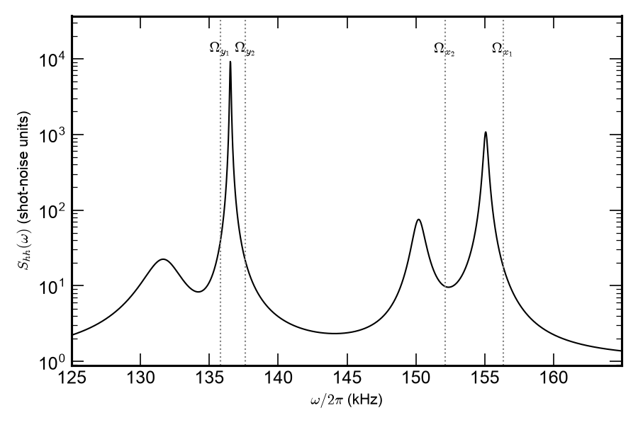

# `levisim`

`levisim` simulates levitated optomechanics. Its core is the quantum linear theory (QLT) of several optically levitated nanoparticles coupled by coherent scattering to one shared cavity mode: given the tweezers, the beads, the gas and the cavity, `MultiTrap` calculates the homodyne and heterodyne spectra of the cavity output and the power and cross spectral densities of every particle's motion, by any of seven calculation methods that can be checked against each other. Around that core are a stochastic (Runge-Kutta) simulator of a bead in a free-space tweezer, covariance-matrix tools for steady-state entanglement under a two-tone drive, and a Fortran reference implementation that the Python spectra are tested against.

**Documentation:** <https://julianiacoponi.github.io/levisim/> - a user guide, the calculation methods in full, and an API reference generated from the docstrings.

## Installation

```sh
git clone https://github.com/julianiacoponi/levisim.git
cd levisim
pip install .        # or `pip install -e .` to work on the code in place
```

This needs Python 3.10 or newer and installs the runtime dependencies (numpy, scipy, matplotlib, sympy, loguru, tqdm). Four optional extras add conveniences that nothing in the physics needs: `elk` (the Elasticsearch client, see [Logging](#logging)), `notify` (desktop notifications when a long test run starts and finishes), `video` (OpenCV, for the image-comparison helpers) and `dev` (pytest and ruff), e.g. `pip install ".[elk,dev]"`.

**Name shadowing.** Do not start Python or Jupyter in the directory that *contains* your clone. There the repository folder `levisim/`, which has no `__init__.py`, shadows the package, and `import levisim` silently gives an empty namespace package. The repo root itself, or `notebooks/`, is fine.


## Quickstart

Two particles, each moving in $`x`$ and $`y`$, in one red-detuned cavity:

```python
import numpy as np
import matplotlib.pyplot as plt

from levisim.core.plotting import set_plt_rcParams_to_xmgrace_style
from levisim.core.units import kHz
from levisim.multiphysics.enums import QuantumLinearTheoryMethod
from levisim.multiphysics.multitrap import MultiTrap
from levisim.multiphysics.utils.shelf import DEFAULT_cavity_kwargs, DEFAULT_gas_kwargs

set_plt_rcParams_to_xmgrace_style()

mtrap = MultiTrap(
    num_traps=2,
    Cartesian_axes_per_trap=2,
    gas_kwargs=DEFAULT_gas_kwargs,          # 1e-6 mbar, 300 K
    cavity_kwargs=DEFAULT_cavity_kwargs,    # Δ = -2π × 450 kHz, L = 0.96 cm, finesse 40 000
    ω_range=np.arange(125, 165, 0.02) * kHz,
)
mtrap.info

S_hh = mtrap.homodyne_spectrum(QuantumLinearTheoryMethod.LINEAR_AMPLIFIER_MODEL)

fig, ax = plt.subplots()
ax.semilogy(mtrap.ω_range / kHz, S_hh)
ax.set_xlabel(r'$\omega / 2\pi$ (kHz)')
ax.set_ylabel(r'$S_{hh}(\omega)$ (shot-noise units)')
fig.savefig('quickstart_homodyne.png')
```



Frequencies are angular throughout: `kHz` is $`2\pi \times 10^3`$ rad/s, so dividing by it gives ordinary kHz for plotting. The homodyne spectrum is in shot-noise units, tending to 1 far from the mechanical peaks. The dotted lines in the figure (drawn by the full script, `docs/guide/scripts/quickstart_homodyne.py`) mark each motion's bare trap frequency $`\Omega_{j_n}`$; the peaks sit below them because of the optical spring, and the two $`y`$ motions show as one peak because the cavity hybridises them.

## Repository layout

| Path | Contents |
|---|---|
| `levisim/core/` | units (angular: `Hz` is $`2\pi`$), physical constants, plotting style, logging, decorators |
| `levisim/physics/` | single-trap physics: `Bead`, `Tweezer`, `Gas`, `Cavity`, `Trap`, `Kick`, and the focal-field expansion |
| `levisim/multiphysics/` | `MultiTrap` (the multiparticle cavity QLT), `Dimension`, the hybridisation power series, covariance dynamics, multi-tone and two-tone drives |
| `levisim/multiphysics/enums/` | `QuantumLinearTheoryMethod`, `SpectrumType`, noise-vector and parameter enums |
| `levisim/multiphysics/utils/` | `shelf` (default parameters and lazily built example systems), method comparison, animations |
| `levisim/data/` | `Simulation` (stochastic simulation of a bead in a free-space tweezer), `Trace`, experiment data |
| `levisim/analysis/` | spectral density estimation and theory, Gaussian-state entanglement measures |
| `tests/` | the pytest suite |
| `fortran/` | the Fortran reference implementation and its reference `.dat` output (see `fortran/README.md`) |
| `docs/` | the Sphinx documentation site, and the two-tone entanglement studies |
| `notebooks/` | local notebooks - git-ignored |

## Running the tests

```sh
pip install pytest pytest-xdist
python -m pytest -n auto             # from the repo root
python -m pytest -m "not slow"       # skip the tests that take more than ~10 s
```

`pytest.ini` puts the repo root on the test path, so this works without installing `levisim` or setting `PYTHONPATH`. GitHub Actions runs the suite on every push and pull request. What each test file covers, and how the Fortran comparison works, is on the documentation's *Testing* page.

## Building the docs

```sh
pip install -r docs/requirements.txt
sphinx-build -b html docs docs/_build/html
```

then open `docs/_build/html/index.html`. The pages are Markdown (MyST) under `docs/`, and the API reference is generated from the docstrings at build time.

# Calculation methods

`MultiTrap` solves the linearised quantum Langevin equations of the multiparticle cavity system by seven routes, chosen with the `QuantumLinearTheoryMethod` passed to every spectrum function:

| | Method | Route | Spectra |
|---|---|---|---|
| (1) | `LINEAR_AMPLIFIER_MODEL` | numerical inverse $`\mathbf{T}(\omega) = (-i\omega\mathbf{I} - \mathbf{A})^{-1}`$ of the drift matrix | all |
| (2) | `HYBRID_LINEAR_AMPLIFIER_MODEL` | mechanics from $`\mathbf{T}`$, light rebuilt through $`\chi_\text{c}(\omega)`$ and $`\chi^*_\text{c}(-\omega)`$ | all |
| (3) | `TNT_LINEAR_AMPLIFIER_MODEL` | matrix of all spectra $`\mathbf{T}\mathbf{N}\mathbf{T}^\dagger`$ | position PSDs only |
| (4) | `NUMERICAL_HYBRIDISATION` | light traced out; $`\hat{\mathbf{q}} = \mathbf{D}^{-1}\hat{\mathbf{q}}_\text{1D}`$, inverted numerically | all |
| (5) | `POWER_SERIES_HYBRIDISATION` | as (4), with $`\mathbf{D}^{-1}`$ written out as sums over derangement cycles | all |
| (6) | `ANALYTIC_INSIDE_CAVITY` | closed form in the phase-dependent collective modes, intracavity field first | all |
| (7) | `ANALYTIC_CAVITY_OUTPUT` | as (6), output field first | all |

The code pathway of each - which function computes which mathematical object, for each kind of spectrum and noise vector - used to be the body of this README. It now lives, in full, on the documentation's [*Calculation methods*](https://julianiacoponi.github.io/levisim/concepts/calculation_methods.html) page (source: [`docs/concepts/calculation_methods.md`](docs/concepts/calculation_methods.md)), together with which method to use when and how closely they agree. The conventions (detuning sign, Fourier convention, units, spectral-density normalisation) are on the [*Conventions*](docs/concepts/conventions.md) page.

# Stochastic simulations of a bead in a free-space tweezer

`levisim.data.Simulation` integrates the classical Langevin dynamics of a silica bead in a
free-space Gaussian tweezer (`Trap` = `Tweezer` + `Bead` + `Gas`), and
`SpectralDensityEstimate` / `SpectralDensityTheory` analyse the resulting traces. The full guide,
with derivations and a worked example, is [`docs/guide/stochastic_simulations.md`](docs/guide/stochastic_simulations.md).

**Model.** For $`\mathbf{X} = (x, y, z, p_x, p_y, p_z)^\top`$ the Itô equations of motion are

```math
\mathrm{d}\mathbf{X} = \mathbf{F}(t, \mathbf{X})\,\mathrm{d}t + \mathbf{G}\,\mathrm{d}\mathbf{W},
\qquad
\mathrm{d}p_j = \left(F_{\mathrm{tw},j} - \Gamma_j p_j\right)\mathrm{d}t + \mathrm{d}W_{\mathrm{th},j} + \hat{e}_j\!\cdot\!\hat{u}_\psi\,\mathrm{d}W_\mathrm{dir},
```

with the full non-linear Gaussian-beam gradient force $`F_{\mathrm{tw},j} = -\partial_j U_\mathrm{tw}`$,
$`U_\mathrm{tw} = -\tfrac12 \mathrm{Re}(\alpha)|E_\mathrm{tw}|^2`$, total damping
$`\Gamma_j = \Gamma_\mathrm{th} + \Gamma_{\mathrm{fb},j}`$ (Epstein gas damping plus feedback cold damping), and
four independent Wiener processes: thermal $`\mathrm{d}W_{\mathrm{th},j} \sim \mathcal{N}(0, S_\mathrm{th}\,\mathrm{d}t)`$
with the fluctuation–dissipation value $`S_\mathrm{th} = 2 m k_B T \Gamma_\mathrm{th}`$ (two-sided, N²/Hz), and a
directed force $`\mathrm{d}W_\mathrm{dir} \sim \mathcal{N}(0, \beta^2 S_\mathrm{th}\,\mathrm{d}t)`$ along the angle $`\psi`$ in
the $`x`$–$`y`$ plane. The shared directed force correlates $`x`$ and $`y`$:

```math
S_{xy}(\omega) = \chi_x^*(\omega)\,\chi_y(\omega)\,\beta^2 S_\mathrm{th}\cos\psi\sin\psi,
\qquad \chi_j(\omega) = \frac{1}{m(\Omega_j^2 - \omega^2 + i\Gamma_j\omega)},
```

and equipartition gives $`T_{\mathrm{eff},j} = T\,\Gamma_\mathrm{th}(1 + S_{\mathrm{dir},j}/S_\mathrm{th})/\Gamma_j`$ (`Trap.T_eff`).

**Numerics.** The default `RK_method='vector_4'` is Kasdin's stochastic RK4 (Proc. IEEE 83, 802
(1995)): stage $`i`$ draws forces with standard deviation $`\sqrt{q_i S/\Delta t}`$, with noise weights
$`q = (3.9996, 1.6452, 1.5933, 0.2633)`$. `'vector_2'` is the improved-Euler (Heun) scheme with the
same noise. `seed=` makes runs reproducible (`np.random.default_rng`); `seed=None` keeps numpy's
legacy stream, bit-identical to earlier versions. A $`10^5`$-step run takes about 3.4 s.

**Options** (all off by default): `detection_floor=G` adds white measurement noise of one-sided PSD
`G` [m²/Hz] to the recorded traces only; `Trap(photon_recoil=True)` adds the on-axis scattering force,
which moves the equilibrium to `Trap.z_eq_exact` (354.7 nm for the defaults); `gravity=True` adds
$`mg`$ along $`-x`$; `Bead(permittivity_model='Malitson')` uses the fused-silica Sellmeier index;
`store_momenta=True` and `store_radial=True` store $`p_j`$ and $`r = \sqrt{x^2 + y^2}`$ traces; `Kick`s add impulses.

**Example.**

```python
from levisim.analysis.spectral_density_estimate import SpectralDensityEstimate
from levisim.core.units import μs
from levisim.data.simulation import Simulation
from levisim.physics.trap import Trap

trap = Trap()  # 485 mW, 1064 nm tweezer; 60.1 nm bead; 4e-3 mbar; β = √2, ψ = 45°
sim = Simulation(trap=trap, num_samples=400_000, Δt=0.1*μs, seed=2026, detection_floor=1e-27)
Sxx = SpectralDensityEstimate(sim, 'xx', num_segments=40)  # one-sided, fitted automatically
print(trap.T_eff['x'], Sxx.temperature_via_fit)            # 1.235 K vs 1.174 K (one 40 ms run)
```

Estimates are one-sided by default and fit $`S = A\Gamma/((\Omega^2 - \omega^2)^2 + \Gamma^2\omega^2)`$ with
$`A = 2k_BT_\mathrm{eff}/m`$ (two-sided). Use `window='blackmanharris'` when the off-resonance tail matters:
the rectangular window leaks the resonance into it (+51% at 0.3–0.5 MHz in this example; 1.8% with
the window). Frequencies follow `levisim.core.units`, where `Hz = 2π`, so `trap.Ωx / kHz` is
$`\Omega_x/2\pi`$ in kHz.


The figure shows one-sided $`S_{xx}`$, $`S_{yy}`$ and the co-spectrum $`C_{xy}`$, simulated and from
`SpectralDensityTheory`, made by [`docs/guide/scripts/stochastic_example.py`](docs/guide/scripts/stochastic_example.py)
(about 25 s). Tests: `tests/test_simulation.py`, `tests/test_trap_physics.py`,
`tests/test_spectral_density_estimate.py`.

**Limitations.** The dynamics are classical, with ideal cold damping and no rotation. Photon recoil
includes only the on-axis scattering force, with no recoil heating. The bead is a point dipole.

# Steady-state entanglement of the transverse motions (two-tone drive)

Four modules add covariance-matrix (time-domain) dynamics to `MultiTrap`:
- `levisim.analysis.gaussian_states`: two-mode Gaussian-state measures, including the PPT test and log-negativity, discord, and the Duan and Hillery–Zubairy witnesses.
- `levisim.multiphysics.covariance`: the Lyapunov steady state of any setup.
- `levisim.multiphysics.multitone`: several coherently scattering tweezer tones, solved exactly as a periodic (Floquet) problem.
- `levisim.multiphysics.two_tone`: the two-tone scheme itself.

[`docs/two_tone_entanglement/README.md`](docs/two_tone_entanglement/README.md) uses them to work out whether a second, blue-detuned tweezer tone can entangle a particle's $`x`$ and $`y`$ motions at the parameters of Deplano et al., Nat. Commun. **16**, 4215 (2025). In short: not at the published heating rates. It needs them roughly halved (÷2.1 with balanced couplings), and a trap that does not see the tones' intensity beat.

Two more modules build such traps from the actual tweezer geometry:
- `levisim.physics.focal_expansion`: the second-order expansion of the Richards–Wolf focal field, including the interference of two tones of any polarisations.
- `levisim.multiphysics.two_tone_traps`: multi-tone traps built from each tone's polarisation, the cavity axis and the node position, for one or several tweezers in one cavity.

[`docs/two_tone_entanglement/polarisation_and_two_particles.md`](docs/two_tone_entanglement/polarisation_and_two_particles.md) uses them to answer four follow-up questions: orthogonally polarised tones, mech-mech coupling, the node position, and a second particle. In short:
- Orthogonal tones remove the intensity beat. What is left is a polarisation beat that squeezes $`x`$ and $`y`$ coherently, which lowers the required heating reduction to ÷1.5.
- A static mech-mech coupling does not help, and neither does leaving the node.
- A second particle in the same cavity needs its sidebands kept apart. It is more useful as the other half of an inter-particle pair, with one tone per tweezer.

<!-- MIXINS-START -->
# Planned refactor: mixins for `multitrap`

`MultiTrap` currently branches on `method` inside each calculation function, which is why `multitrap.py` is over 2,000 lines. Mapping the branches out while documenting the above, the split falls fairly cleanly into three mixins plus the parts that are genuinely shared:

- **`LinearAmplifierMixin`** - `(1)`, `(2)`, `(3)`. Owns `drift_matrix`, `T_matrix`, `c_noise_vector`, and the TNT-only `quantum_operator_spectral_density_array` / `position_power_spectra_array`. Takes positions and light operators by slicing $`\hat{\mathbf{c}}`$.
- **`HybridisationMixin`** - `(4)`, `(5)`. Owns `derangement_matrix`, `hybridisation_matrix`, `deranged_determinant`, `deranged_adjugate_matrix` and `x1D_noise_vector`. Numerical and Power Series differ only in _how_ $`\mathbf{D}^{-1}`$ is obtained, so they are two methods on one mixin rather than two mixins.
- **`AnalyticMixin`** - `(6)`, `(7)`. Owns `gbar`, `M_norm`, the $`\mathbb{F}`$ / $`\overline{\mathbb{F}}`$ transduction functions and `Q_phi`. Inside-cavity and cavity-output differ only in which end of the input-output relations is solved first.
- **Shared on the base class** - `dimensions`, `cavity`, `ω_range`, `quantum_factor_per_noise_operator`, `noise_vector_to_power_spectrum`, `noise_vectors_to_cross_spectrum`, and the spectrum entry points that dispatch to a mixin.

The one real obstacle is that `hybridised_position_noise_vector` and `light_noise_vectors` are mutually recursive across mixins for the analytic methods - a position needs the light operators, which for Analytic Cavity Output come from the output operators, which need the collective modes. So the dispatch has to live on the base class rather than inside any one mixin.
<!-- MIXINS-END -->

# Use of LLMs

Parts of this repository were written by Claude (Anthropic) at the owner's request; [`DISCLAIMER.md`](DISCLAIMER.md) records which parts, and the owner's own statement.

# License

GNU General Public License v3.0 (see [`LICENSE`](LICENSE)), chosen through [choosealicense.com](https://choosealicense.com).
