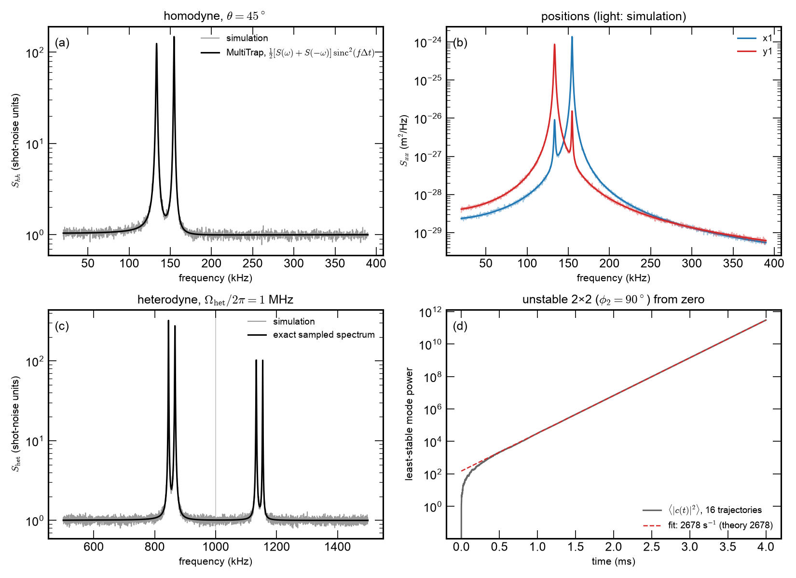

# Time traces of particles in a cavity

This page describes `levisim.CavitySimulation`, which simulates the light leaving a cavity
(homodyne, heterodyne and photon-flux records) together with the positions of the particles that
scatter into it, from the same linear model that `MultiTrap` uses for spectra. The usual entry point
is `MultiTrap.simulate`, which returns a `CavitySimulation` holding the `MultiTrap` by composition;
one `MultiTrap` serves any number of runs.

## A worked example

```python
from levisim import MultiTrap, DEFAULT_cavity_kwargs, DEFAULT_gas_kwargs
from levisim.core.units import Hz, μs
from levisim.simulation import Heterodyne, Homodyne, Position
from levisim.analysis.spectral_density_estimate import SpectralDensityEstimate

mtrap = MultiTrap(num_traps=1, Cartesian_axes_per_trap=2,
                  cavity_kwargs=DEFAULT_cavity_kwargs, gas_kwargs=DEFAULT_gas_kwargs)
sim = mtrap.simulate(num_samples=2**20, Δt=0.1*μs, seed=2026, num_trajectories=16,
                     detection=[Homodyne(), Heterodyne(Ωhet=1e6*Hz), Position('x1'), Position('y1')])

sim.homodyne                     # Trace of trajectory 0, as for Experiment data
sim.records['homodyne']          # array (16, 2**20): every trajectory
f, S = sim.averaged_psd('homodyne', num_segments=16)        # averaged over all trajectories
S_theory = sim.record_spectrum('homodyne', f)                # exact spectrum of the sampled record
SpectralDensityEstimate(sim, ('homodyne', 'homodyne'), num_segments=16)   # the Experiment path
```

The script `docs/guide/scripts/cavity_simulation_example.py` runs this for the shelf 1×2 system
($\kappa/2\pi = 390.35$ kHz, $\Delta/2\pi = -450$ kHz, $\theta_\mathrm{hom} = 45^\circ$;
$\Omega_x/2\pi = 156.34$ kHz, $\Omega_y/2\pi = 135.80$ kHz) and produces the figure below. With 16
trajectories of $2^{20}$ samples ($\Delta t = 0.1$ μs) and 16 Hann-windowed segments per trajectory,
the simulated PSDs divided by the symmetrised `MultiTrap` spectra times $\mathrm{sinc}^2(f\Delta t)$,
over 20-390 kHz, have median ratios 1.0001 (homodyne), 0.9983 ($x_1$) and 0.9966 ($y_1$), against an
expected scatter of ±0.062 per frequency bin. The heterodyne record matches its exact sampled
spectrum with median ratio 0.9993 over 0.5-1.5 MHz. The run took 7-11 s with the compiled loop
(0.4-0.6 μs per sample and trajectory).



*Simulated records of the shelf 1×2 system against theory. (a) Homodyne at $\theta = 45^\circ$ against
the symmetrised `MultiTrap.homodyne_spectrum`. (b) Positions $x_1$, $y_1$ against the symmetrised
`position_power_spectrum`, scaled by $x_\mathrm{zpf}^2$. (c) Heterodyne record at
$\Omega_\mathrm{het}/2\pi = 1$ MHz: the two mechanical sidebands of each mode have different weights
(20.33 and 6.891 for $x_1$). (d) The unstable 2×2 system started at zero: the fitted growth rate is
2677.8 s⁻¹ against `max_growth_rate` = 2677.5 s⁻¹.*

## The linear model

The state is the real quadrature vector $u$ of `QuadratureSystem.from_multitrap`: the cavity
quadratures $(A, P)$, then $(X, P)$ of every dimension, with $X = b + b^\dagger$ and
$P = i(b^\dagger - b)$, so that the vacuum covariance is the identity. It obeys

$$
\mathrm{d}u = A\,u\,\mathrm{d}t + B\,\mathrm{d}W, \qquad \tfrac{1}{2}\langle\{\mathrm{d}W, \mathrm{d}W^\top\}\rangle = N\,\mathrm{d}t,
$$

with $A$ levisim's drift matrix in quadratures and $B N B^\top$ levisim's diffusion matrix. A
`QuadratureSystem` can also be passed directly, for example two cavity modes from
`levisim.multiphysics.output_modes.stack_cavity_modes`, which no single `MultiTrap` describes.

### Records are part of the linear system

Each record adds auxiliary integrals $Y$ to the state,

$$
\mathrm{d}Y = (C u)\,\mathrm{d}t + D\,\mathrm{d}W + E\,\mathrm{d}V + R\,Y\,\mathrm{d}t,
$$

driven by the *same* increments $\mathrm{d}W$ as the cavity ($\mathrm{d}V$ are vacuum noises private
to a detector, for example from an efficiency $\eta < 1$). The correlation between the output and
the noise that drove the cavity is what produces ponderomotive squeezing and sideband asymmetry, so
it must not be lost. $Y$ restarts from zero in every sample interval, and the stored sample is
$\Delta Y/\Delta t$, the average of the output over the interval, which is what a digitiser
records. The response of this average is $\mathrm{sinc}^2(f\Delta t)$, and white noise is not
aliased: a white input of level $S$ is sampled at level $S$ exactly, up to the Nyquist frequency.

### Exact discretisation

The augmented system $z = (u, Y)$ is advanced over each sample interval with

$$
z_{k+1} = \Phi\,(u_k, 0) + \xi_k, \qquad \Phi = e^{\tilde{A}\Delta t}, \qquad
\xi_k \sim \mathcal{N}\Big(0, \int_0^{\Delta t} e^{\tilde{A}s}\,\tilde{B}\tilde{N}\tilde{B}^\top e^{\tilde{A}^\top s}\,\mathrm{d}s\Big),
$$

with $\Phi$ and the covariance of $\xi_k$ from one matrix exponential of Van Loan's block matrix
(C. F. Van Loan, IEEE Transactions on Automatic Control 23, 395 (1978),
doi:10.1109/tac.1978.1101743). There is no time-step error at any $\Delta t$: the steady state is a
fixed point of one step to round-off (tested at $\Delta t$ = 0.1, 1 and 10 μs). For large
$\kappa\Delta t$ the step is computed over $\Delta t/2^s$ and doubled exactly $s$ times, which keeps
the cancellation inside the block exponential harmless.

### Initial state and unstable systems

`initial_state='steady'` (the default) draws $u_0$ from `steady_state_covariance`. A linearly
unstable system has no steady state, so it raises `ValueError` there; with `initial_state='zero'`
(or a given array) its growth is simulated faithfully, as in panel (d). The linearisation stops
being physical long before the amplitudes in panel (d) are reached; the nonlinear model of the
design plan will show where the growth saturates.

## Records and their conventions

| Record | What it records | Default units |
|---|---|---|
| `Homodyne(θ, η)` | $h = X_\mathrm{out}\cos\theta + P_\mathrm{out}\sin\theta$ | shot-noise units |
| `Heterodyne(Ωhet, η)` | $h(t)$ with $\theta(t) = \Omega_\mathrm{het}t + \phi_0$ | shot-noise units |
| `PhotonNumber(η)` | flux fluctuation $\lvert\bar\alpha_\mathrm{out}\rvert\, h(\theta_\alpha)$, $\theta_\alpha = -\arg\bar\alpha_\mathrm{out}$ | shot-noise units, or photons/s |
| `Position(label)` | $x = x_\mathrm{zpf}\,(b + b^\dagger)$ | m (or `units='zpf'`) |

- Output field: $a_\mathrm{out} = -\sqrt{\kappa}\,a + a_\mathrm{in}$, with quadratures
  $X_\mathrm{out} = a_\mathrm{out} + a_\mathrm{out}^\dagger$ and
  $P_\mathrm{out} = i(a_\mathrm{out} - a_\mathrm{out}^\dagger)$, the convention of
  `MultiTrapBase.homodyne_quadrature`. Note that $P_\mathrm{out}$ is minus the phase quadrature
  $i(a^\dagger - a)$ of the state vector. `Homodyne(θ)` therefore has the spectrum of
  `MultiTrap.homodyne_spectrum` at `cavity.θhom = θ`; the tests check that the record follows
  $+\theta$ and not $-\theta$.
- Spectra: levisim's convention is two-sided, $\int S\,\mathrm{d}\omega/2\pi = \langle h^2\rangle$,
  not symmetrised. A classical record has a symmetric spectrum, so it is compared with
  $\tfrac{1}{2}[S(\omega) + S(-\omega)]$. The vacuum has the two-sided level 1; a one-sided
  `SpectralDensityEstimate` (its default) shows it at 2.
- `sim.averaged_psd` cuts every trajectory into non-overlapping segments, applies a window
  normalised to unit mean square (Hann by default) and averages the periodograms over segments and
  trajectories; it is two-sided by default. Its relative scatter per bin is
  $1/\sqrt{\text{segments}\times\text{trajectories}}$. Around a peak much narrower than the bin width
  the window biases the comparison, so segments must be long enough to resolve the narrowest mode.
- `sim.record_spectrum(label, f)` is the exact spectrum of the sampled record, from the discretised
  augmented system (it includes the sinc² response and the aliasing of everything beyond the Nyquist
  frequency). `kind='continuous'` gives the continuous-time symmetrised spectrum times
  $\mathrm{sinc}^2(f\Delta t)$, which equals `MultiTrap`'s to round-off (a test); the two differ only
  by aliasing, about 0.5% at 390 kHz and 3% at 1 MHz for $\Delta t = 0.1$ μs.

### Heterodyne

`MultiTrap.heterodyne_spectrum` is $S_{a_\mathrm{out}a_\mathrm{out}}(\omega)$, the spectrum of
$a_\mathrm{out}$ in the frame of the local oscillator. A heterodyne record beats the output with a
local oscillator detuned by $\Omega_\mathrm{het}$ (`cavity.Ωhet` by default, which must then be
non-zero). With levisim's Fourier convention $h(\omega) = e^{i\phi_0}a_\mathrm{out}(\omega + \Omega_\mathrm{het}) + e^{-i\phi_0}a^\dagger_\mathrm{out}(\omega - \Omega_\mathrm{het})$,
so the record shows both sidebands,

$$
S_h(\omega) = S_{a_\mathrm{out}a_\mathrm{out}}(\omega + \Omega_\mathrm{het}) + S_{a^\dagger_\mathrm{out}a^\dagger_\mathrm{out}}(\omega - \Omega_\mathrm{het}),
$$

symmetrised in $\omega$. The rotation inside each sample interval is integrated exactly (the
auxiliary integrals rotate at $\Omega_\mathrm{het}$), so $\Omega_\mathrm{het}$ may be a sizeable
fraction of the sample rate.

## Fabry-Perot ports

`Cavity` takes optional per-port rates: `κ_ports=(κ_1, κ_2)` for the two mirrors and `κ_loss` for
everything else (scattering, absorption), so that $\kappa = \kappa_1 + \kappa_2 + \kappa_\mathrm{loss}$
(κ is then set from them; an explicit κ must agree). Each port and the loss channel has its own
vacuum input. `detected_port` (default 0) is the port whose output the `MultiTrap` spectra describe.
The default is one port carrying all of κ, which is what every spectrum assumed before; with it no
number changes (checked bit for bit against the previous version, see the pull request).

The output of port $j$ is $a_{\mathrm{out},j} = -\sqrt{\kappa_j}\,a + a_{\mathrm{in},j}$. Writing the
total input noise as $\sqrt{\kappa}\,a_\mathrm{in} = \sum_j \sqrt{\kappa_j}\,a_{\mathrm{in},j}$, port
$j$'s output is $\sqrt{\eta_j}\,a_\mathrm{out} + \sqrt{1 - \eta_j}\,v$ with $\eta_j = \kappa_j/\kappa$
and a vacuum $v$ independent of the single-port output $a_\mathrm{out}$. A port therefore acts on
every output spectrum as a detection efficiency, $S \to \eta_j S + (1 - \eta_j)$, which is what
`MultiTrap.at_detected_port` applies to `homodyne_spectrum`, `heterodyne_spectrum` and
`homodyne_and_heterodyne_spectra` (and `quadrature_squeezing.output_quadrature_spectra` to its
spectral matrix). `QuadratureSystem.from_multitrap` instead keeps one pair of noise columns per port
and loss channel, so that a simulation can record several ports at once, with their correlations:

```python
mtrap = MultiTrap(..., cavity_kwargs={**DEFAULT_cavity_kwargs, 'κ_ports': (0.6*κ, 0.3*κ), 'κ_loss': 0.1*κ})
sim = mtrap.simulate(detection=[Homodyne(port=0, label='transmitted'), Homodyne(port=1, label='reflected')])
```

The tests check that each port's simulated record matches `MultiTrap.homodyne_spectrum` with that
port detected, and that `output_modes` (filtered output modes, `stack_cavity_modes`) sees the
detected port.

## Detection realism

Every optical record takes:

- `η`: detection efficiency. The detected field is $\sqrt{\eta}\,a_\mathrm{out} + \sqrt{1-\eta}\,a_\mathrm{vac}$
  with a vacuum private to the record, so the shot-noise-normalised signal scales as
  $S - 1 \to \eta\,(S - 1)$.
- `phase_noise`: a `PhaseNoise` of the local oscillator, added to the detection phase and held
  constant over each sample: `PhaseNoise.white(S_φ)` (one-sided PSD in rad²/Hz),
  `PhaseNoise.random_walk(D)` (phase diffusion, rad²/s) or `PhaseNoise.ornstein_uhlenbeck(σ, τ)`. A
  phase that is slow against the spectral features averages the spectrum over its distribution:
  with a static Gaussian error of variance $\sigma^2$ per trajectory, the ensemble-averaged spectrum
  is `quadrature_squeezing.phase_noise_averaged(..., σ²)` (a test, with $\sigma = 0.5$ rad and 256
  trajectories). Only the detected fluctuations are rotated; the term that LO phase noise makes from
  a static output field, $\propto \lvert\bar\alpha_\mathrm{out}\rvert\,\delta\phi$, is not part of the
  linearised record.
- `electronic_noise`: white noise added to the record, as a one-sided PSD in the record's final
  units (the same one-sided convention as `detection_floor`).
- `volts`: a `VoltageConversion(power, responsivity, transimpedance_gain)`. The record becomes
  $V = G\sqrt{e\,\mathcal{R}P}\,h$, whose one-sided shot-noise level is $2eIG^2$ with $I = \mathcal{R}P$,
  $P$ the local-oscillator power (or, for `PhotonNumber`, the mean detected power). The efficiency,
  including the photodiode's quantum efficiency, is set by `η`; $\mathcal{R}$ only sets the shot-noise
  current.

A record in volts goes through the same analysis as measured data. `sim.save_matfile(path)` writes
the records of one trajectory in the layout that `levisim.data.Experiment` loads (`Length`,
`Tinterval`, one column per channel) and returns the channel map:

```python
channels = sim.save_matfile('run.mat')                 # {'homodyne': 'A', ...}
experiment = Experiment('run.mat', channel_dict=channels)
SpectralDensityEstimate(experiment, ('homodyne', 'homodyne'), num_segments=8)
```

`sim.record_spectrum` includes η, the electronic noise, the detection floor and the conversion to
volts; it does not include LO phase noise.

## Validation

`tests/test_cavity_simulation.py` holds the fast versions of the validation ladder:

- the Van Loan step against the closed form of an Ornstein-Uhlenbeck process, and the steady state as
  a fixed point of one step;
- the equal-time covariance of the simulated state against `steady_state_covariance`;
- homodyne and position PSDs against the symmetrised `MultiTrap` spectra for 1×1, 1×2 and 2×2 at the
  stable phase $\phi_2 = 30^\circ$, and for a stacked two-mode system against
  `output_modes._output_transfer`;
- the heterodyne sidebands, shot noise alone (flat at 1, also with $\eta < 1$), squeezing below
  shot noise at the optimal quadrature of the strongly coupled system of
  `tests/test_quadrature_squeezing.py` (0.915 measured against 0.916 predicted in a longer run), and
  the growth rate of the unstable 2×2 system (within 0.01%).

## Performance

`num_trajectories=K` advances $K$ trajectories as one array, the cheap way to smooth averaged
spectra. The time loop is compiled with numba when it is installed (`pip install levisim[fast]`)
and the run has at least $2^{15}$ samples; it consumes the same random numbers as the NumPy loop,
and the trajectories agree to round-off. Measured on an 8-core arm64 machine, per step of one
trajectory with one homodyne record: state dimension $n = 4$, NumPy 3.6 μs and numba 0.35 μs;
$n = 34$, 10.0 and 4.5 μs; $n = 66$, 16.4 and 8.8 μs; $n = 130$, 31.9 and 31.6 μs. Above $n = 128$
the cost is the BLAS products, so `backend='auto'` uses NumPy there. With several trajectories the
compiled loop runs one thread per trajectory (0.4-0.7 μs per sample and trajectory for the 1×2
system).
