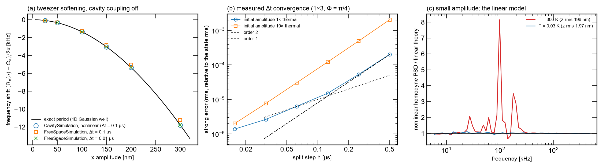
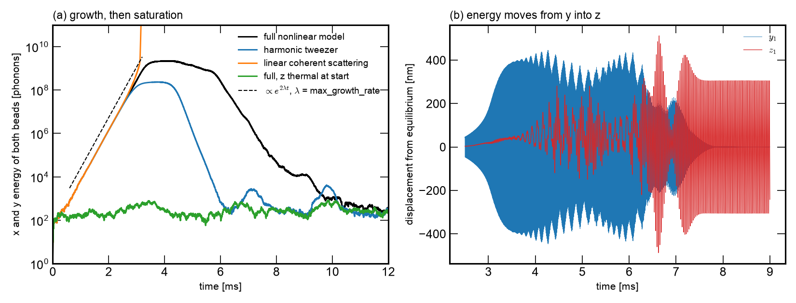
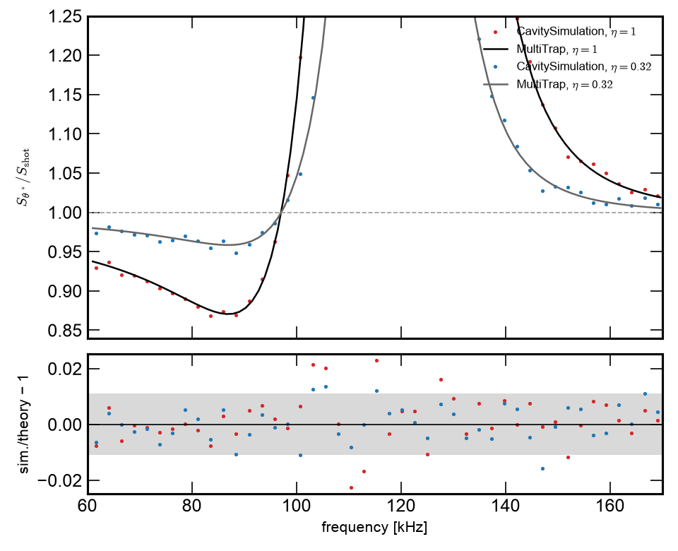

# Time traces of particles in a cavity

This page describes `levisim.CavitySimulation`, which simulates the light leaving a cavity
(homodyne, heterodyne and photon-flux records) together with the positions of the particles that
scatter into it, from the same linear model that `MultiTrap` uses for spectra. The usual entry point
is `MultiTrap.simulate`, which returns a `CavitySimulation` holding the `MultiTrap` by composition;
one `MultiTrap` serves any number of runs. With `model='nonlinear'` the same class integrates the
full, un-linearised tweezer and coherent-scattering potential instead (see
[the nonlinear model](#the-nonlinear-model)), with the same records.

## A worked example

```python
from levisim import MultiTrap, DEFAULT_cavity_kwargs, DEFAULT_gas_kwargs
from levisim.core.units import Hz, μs
from levisim.simulation import Heterodyne, Homodyne, Position
from levisim.analysis.spectral_density_estimate import SpectralDensityEstimate

mtrap = MultiTrap(num_traps=1, Cartesian_axes_per_trap=2,
                  cavity_kwargs=DEFAULT_cavity_kwargs, gas_kwargs=DEFAULT_gas_kwargs)
sim = mtrap.simulate(num_samples=2**20, Δt=0.1*μs, seed=2026, num_trajectories=16,
                     detection=[Homodyne(), Heterodyne(Ωhet=1e6*Hz), Position('x1'), Position('y1')])

sim.homodyne                     # Trace of trajectory 0, as for Experiment data
sim.records['homodyne']          # array (16, 2**20): every trajectory
f, S = sim.averaged_psd('homodyne', num_segments=16)        # averaged over all trajectories
S_theory = sim.record_spectrum('homodyne', f)                # exact spectrum of the sampled record
SpectralDensityEstimate(sim, ('homodyne', 'homodyne'), num_segments=16)   # the Experiment path
```

The script `docs/guide/scripts/cavity_simulation_example.py` runs this for the shelf 1×2 system
($\kappa/2\pi = 390.35$ kHz, $\Delta/2\pi = -450$ kHz, $\theta_\mathrm{hom} = 45^\circ$;
$\Omega_x/2\pi = 156.34$ kHz, $\Omega_y/2\pi = 135.80$ kHz) and produces the figure below. With 16
trajectories of $2^{20}$ samples ($\Delta t = 0.1$ μs) and 16 Hann-windowed segments per trajectory,
the simulated PSDs divided by the symmetrised `MultiTrap` spectra times $\mathrm{sinc}^2(f\Delta t)$,
over 20-390 kHz, have median ratios 1.0001 (homodyne), 0.9983 ($x_1$) and 0.9966 ($y_1$), against an
expected scatter of ±0.062 per frequency bin. The heterodyne record matches its exact sampled
spectrum with median ratio 0.9993 over 0.5-1.5 MHz. The run took 7-11 s with the compiled loop
(0.4-0.6 μs per sample and trajectory).


*Simulated records of the shelf 1×2 system against theory. (a) Homodyne at $\theta = 45^\circ$ against
the symmetrised `MultiTrap.homodyne_spectrum`. (b) Positions $x_1$, $y_1$ against the symmetrised
`position_power_spectrum`, scaled by $x_\mathrm{zpf}^2$. (c) Heterodyne record at
$\Omega_\mathrm{het}/2\pi = 1$ MHz: the two mechanical sidebands of each mode have different weights
(20.33 and 6.891 for $x_1$). (d) The unstable 2×2 system started at zero: the fitted growth rate is
2677.8 s⁻¹ against `max_growth_rate` = 2677.5 s⁻¹.*

## The linear model

The state is the real quadrature vector $u$ of `QuadratureSystem.from_multitrap`: the cavity
quadratures $(A, P)$, then $(X, P)$ of every dimension, with $X = b + b^\dagger$ and
$P = i(b^\dagger - b)$, so that the vacuum covariance is the identity. It obeys

$$
\mathrm{d}u = A\,u\,\mathrm{d}t + B\,\mathrm{d}W, \qquad \tfrac{1}{2}\langle\{\mathrm{d}W, \mathrm{d}W^\top\}\rangle = N\,\mathrm{d}t,
$$

with $A$ levisim's drift matrix in quadratures and $B N B^\top$ levisim's diffusion matrix. A
`QuadratureSystem` can also be passed directly, for example two cavity modes from
`levisim.multiphysics.output_modes.stack_cavity_modes`, which no single `MultiTrap` describes.

### Records are part of the linear system

Each record adds auxiliary integrals $Y$ to the state,

$$
\mathrm{d}Y = (C u)\,\mathrm{d}t + D\,\mathrm{d}W + E\,\mathrm{d}V + R\,Y\,\mathrm{d}t,
$$

driven by the *same* increments $\mathrm{d}W$ as the cavity ($\mathrm{d}V$ are vacuum noises private
to a detector, for example from an efficiency $\eta < 1$). The correlation between the output and
the noise that drove the cavity is what produces ponderomotive squeezing and sideband asymmetry, so
it must not be lost. $Y$ restarts from zero in every sample interval, and the stored sample is
$\Delta Y/\Delta t$, the average of the output over the interval, which is what a digitiser
records. The response of this average is $\mathrm{sinc}^2(f\Delta t)$, and white noise is not
aliased: a white input of level $S$ is sampled at level $S$ exactly, up to the Nyquist frequency.

### Exact discretisation

The augmented system $z = (u, Y)$ is advanced over each sample interval with

$$
z_{k+1} = \Phi\,(u_k, 0) + \xi_k, \qquad \Phi = e^{\tilde{A}\Delta t}, \qquad
\xi_k \sim \mathcal{N}\Big(0, \int_0^{\Delta t} e^{\tilde{A}s}\,\tilde{B}\tilde{N}\tilde{B}^\top e^{\tilde{A}^\top s}\,\mathrm{d}s\Big),
$$

with $\Phi$ and the covariance of $\xi_k$ from one matrix exponential of Van Loan's block matrix
(C. F. Van Loan, IEEE Transactions on Automatic Control 23, 395 (1978),
doi:10.1109/tac.1978.1101743). There is no time-step error at any $\Delta t$: the steady state is a
fixed point of one step to round-off (tested at $\Delta t$ = 0.1, 1 and 10 μs). For large
$\kappa\Delta t$ the step is computed over $\Delta t/2^s$ and doubled exactly $s$ times, which keeps
the cancellation inside the block exponential harmless.

### Initial state and unstable systems

`initial_state='steady'` (the default) draws $u_0$ from `steady_state_covariance`. A linearly
unstable system has no steady state, so it raises `ValueError` there; with `initial_state='zero'`
(or a given array) its growth is simulated faithfully, as in panel (d). The linearisation stops
being physical long before the amplitudes in panel (d) are reached; the nonlinear model below
shows where the growth saturates.

## Records and their conventions

| Record | What it records | Default units |
|---|---|---|
| `Homodyne(θ, η)` | $h = X_\mathrm{out}\cos\theta + P_\mathrm{out}\sin\theta$ | shot-noise units |
| `Heterodyne(Ωhet, η)` | $h(t)$ with $\theta(t) = \Omega_\mathrm{het}t + \phi_0$ | shot-noise units |
| `PhotonNumber(η)` | flux fluctuation $\lvert\bar\alpha_\mathrm{out}\rvert\, h(\theta_\alpha)$, $\theta_\alpha = -\arg\bar\alpha_\mathrm{out}$ | shot-noise units, or photons/s |
| `Position(label)` | $x = x_\mathrm{zpf}\,(b + b^\dagger)$ | m (or `units='zpf'`) |

Every record is the average over its sample interval by default. `Position(label,
sampling='instantaneous')` records the position at the sample time $t_k$ instead, as
`FreeSpaceSimulation` does: no $\mathrm{sinc}^2(f\Delta t)$ response, and everything beyond the
Nyquist frequency aliases. The instantaneous sample is a copy of the state and draws no random
numbers, so the other records of a seeded run are unchanged by adding it; `trace_label` names it,
so one mode can be recorded both ways:

```python
sim = mtrap.simulate(detection=[Position('x1'), Position('x1', sampling='instantaneous', trace_label='x1_inst')])
```

For it, `sim.record_spectrum(label, f)` is the exact spectrum of the sampled state,
$\Delta t\,[M^{-1}Q_{uu}M^{-\dagger}]_{ii}$ with $M = e^{-i\omega\Delta t}I - \Phi_u$, whose integral
over the Nyquist band is the steady-state variance (a test), and `kind='continuous'` is the
symmetrised `MultiTrap` spectrum without the $\mathrm{sinc}^2$ factor. With `model='nonlinear'` the
samples come from the stored states, which are then kept internally during the run (memory
$\propto$ samples × trajectories × state size).

- Output field: $a_\mathrm{out} = -\sqrt{\kappa}\,a + a_\mathrm{in}$, with quadratures
  $X_\mathrm{out} = a_\mathrm{out} + a_\mathrm{out}^\dagger$ and
  $P_\mathrm{out} = i(a_\mathrm{out} - a_\mathrm{out}^\dagger)$, the convention of
  `MultiTrapBase.homodyne_quadrature`. Note that $P_\mathrm{out}$ is minus the phase quadrature
  $i(a^\dagger - a)$ of the state vector. `Homodyne(θ)` therefore has the spectrum of
  `MultiTrap.homodyne_spectrum` at `cavity.θhom = θ`; the tests check that the record follows
  $+\theta$ and not $-\theta$.
- Spectra: levisim's convention is two-sided, $\int S\,\mathrm{d}\omega/2\pi = \langle h^2\rangle$,
  not symmetrised. A classical record has a symmetric spectrum, so it is compared with
  $\tfrac{1}{2}[S(\omega) + S(-\omega)]$. The vacuum has the two-sided level 1; a one-sided
  `SpectralDensityEstimate` (its default) shows it at 2.
- `sim.averaged_psd` cuts every trajectory into non-overlapping segments, applies a window
  normalised to unit mean square (Hann by default) and averages the periodograms over segments and
  trajectories; it is two-sided by default. It is a thin wrapper of
  `SpectralDensityEstimate(sim, (label, label), ensemble=True, subtract_segment_mean=sim.zero_mean)`,
  which also gives cross-spectra and the per-segment arrays (see the stochastic-simulations guide). Its relative scatter per bin is
  $1/\sqrt{\text{segments}\times\text{trajectories}}$. Around a peak much narrower than the bin width
  the window biases the comparison, so segments must be long enough to resolve the narrowest mode.
- `sim.record_spectrum(label, f)` is the exact spectrum of the sampled record, from the discretised
  augmented system (it includes the sinc² response and the aliasing of everything beyond the Nyquist
  frequency). `kind='continuous'` gives the continuous-time symmetrised spectrum times
  $\mathrm{sinc}^2(f\Delta t)$, which equals `MultiTrap`'s to round-off (a test); the two differ only
  by aliasing, about 0.5% at 390 kHz and 3% at 1 MHz for $\Delta t = 0.1$ μs.

### Heterodyne

`MultiTrap.heterodyne_spectrum` is $S_{a_\mathrm{out}a_\mathrm{out}}(\omega)$, the spectrum of
$a_\mathrm{out}$ in the frame of the local oscillator. A heterodyne record beats the output with a
local oscillator detuned by $\Omega_\mathrm{het}$ (`cavity.Ωhet` by default, which must then be
non-zero). With levisim's Fourier convention $h(\omega) = e^{i\phi_0}a_\mathrm{out}(\omega + \Omega_\mathrm{het}) + e^{-i\phi_0}a^\dagger_\mathrm{out}(\omega - \Omega_\mathrm{het})$,
so the record shows both sidebands,

$$
S_h(\omega) = S_{a_\mathrm{out}a_\mathrm{out}}(\omega + \Omega_\mathrm{het}) + S_{a^\dagger_\mathrm{out}a^\dagger_\mathrm{out}}(\omega - \Omega_\mathrm{het}),
$$

symmetrised in $\omega$. The rotation inside each sample interval is integrated exactly (the
auxiliary integrals rotate at $\Omega_\mathrm{het}$), so $\Omega_\mathrm{het}$ may be a sizeable
fraction of the sample rate.

## Fabry-Perot ports

`Cavity` takes optional per-port rates: `κ_ports=(κ_1, κ_2)` for the two mirrors and `κ_loss` for
everything else (scattering, absorption), so that $\kappa = \kappa_1 + \kappa_2 + \kappa_\mathrm{loss}$
(κ is then set from them; an explicit κ must agree). Each port and the loss channel has its own
vacuum input. `detected_port` (default 0) is the port whose output the `MultiTrap` spectra describe.
The default is one port carrying all of κ, which is what every spectrum assumed before; with it no
number changes (checked bit for bit against the previous version, see the pull request).

The output of port $j$ is $a_{\mathrm{out},j} = -\sqrt{\kappa_j}\,a + a_{\mathrm{in},j}$. Writing the
total input noise as $\sqrt{\kappa}\,a_\mathrm{in} = \sum_j \sqrt{\kappa_j}\,a_{\mathrm{in},j}$, port
$j$'s output is $\sqrt{\eta_j}\,a_\mathrm{out} + \sqrt{1 - \eta_j}\,v$ with $\eta_j = \kappa_j/\kappa$
and a vacuum $v$ independent of the single-port output $a_\mathrm{out}$. A port therefore acts on
every output spectrum as a detection efficiency, $S \to \eta_j S + (1 - \eta_j)$, which is what
`MultiTrap.at_detected_port` applies to `homodyne_spectrum`, `heterodyne_spectrum` and
`homodyne_and_heterodyne_spectra` (and `quadrature_squeezing.output_quadrature_spectra` to its
spectral matrix). `QuadratureSystem.from_multitrap` instead keeps one pair of noise columns per port
and loss channel, so that a simulation can record several ports at once, with their correlations:

```python
mtrap = MultiTrap(..., cavity_kwargs={**DEFAULT_cavity_kwargs, 'κ_ports': (0.6*κ, 0.3*κ), 'κ_loss': 0.1*κ})
sim = mtrap.simulate(detection=[Homodyne(port=0, label='transmitted'), Homodyne(port=1, label='reflected')])
```

The tests check that each port's simulated record matches `MultiTrap.homodyne_spectrum` with that
port detected, and that `output_modes` (filtered output modes, `stack_cavity_modes`) sees the
detected port.

## Detection realism

Every optical record takes:

- `η`: detection efficiency. The detected field is $\sqrt{\eta}\,a_\mathrm{out} + \sqrt{1-\eta}\,a_\mathrm{vac}$
  with a vacuum private to the record, so the shot-noise-normalised signal scales as
  $S - 1 \to \eta\,(S - 1)$.
- `phase_noise`: a `PhaseNoise` of the local oscillator, added to the detection phase and held
  constant over each sample: `PhaseNoise.white(S_φ)` (one-sided PSD in rad²/Hz),
  `PhaseNoise.random_walk(D)` (phase diffusion, rad²/s) or `PhaseNoise.ornstein_uhlenbeck(σ, τ)`. A
  phase that is slow against the spectral features averages the spectrum over its distribution:
  with a static Gaussian error of variance $\sigma^2$ per trajectory, the ensemble-averaged spectrum
  is `quadrature_squeezing.phase_noise_averaged(..., σ²)` (a test, with $\sigma = 0.5$ rad and 256
  trajectories). By default only the detected fluctuations are rotated; the term that LO phase noise
  makes from a static output field, $\propto \lvert\bar\alpha_\mathrm{out}\rvert\,\delta\phi$, is not
  part of the linearised record (see `static_carrier`).
- `static_carrier` (default `False`; `Homodyne` and `Heterodyne`): adds the static output field
  $\bar\alpha_\mathrm{out} = -\sqrt{\kappa_j}\,\alpha$ of the port to the record, i.e. the sample
  average of $2\sqrt{\eta}\,\lvert\bar\alpha_\mathrm{out}\rvert\cos(\theta(t) + \phi_k - \theta_\alpha)$ with
  $\theta_\alpha = -\arg\bar\alpha_\mathrm{out}$. This is the DC term of a homodyne record (the beat note at
  $\Omega_\mathrm{het}$ of a heterodyne, averaged exactly over each interval) and, with phase noise
  $\phi$, its conversion $\approx -2\sqrt{\eta}\,\lvert\bar\alpha_\mathrm{out}\rvert\sin(\theta - \theta_\alpha)\,\phi$
  into the record. At $\theta = \theta_\alpha + \pi/2$, white phase noise of one-sided PSD $S_\phi$
  raises the two-sided record PSD by $2\eta\lvert\bar\alpha_\mathrm{out}\rvert^2 S_\phi$ (a test); at the
  amplitude quadrature $\theta_\alpha$ the conversion is second order. The static field comes from the
  `MultiTrap` (or the nonlinear equilibrium); for a `QuadratureSystem` pass `α=`. The carrier draws
  no random numbers, so the fluctuations of a seeded run are unchanged. `sim.records` keep the DC
  term; traces subtract their mean when `zero_mean=True` (the default).
- `electronic_noise`: white noise added to the record, as a one-sided PSD in the record's final
  units (the same one-sided convention as `detection_floor`).
- `volts`: a `VoltageConversion(power, responsivity, transimpedance_gain)`. The record becomes
  $V = G\sqrt{e\,\mathcal{R}P}\,h$, whose one-sided shot-noise level is $2eIG^2$ with $I = \mathcal{R}P$,
  $P$ the local-oscillator power (or, for `PhotonNumber`, the mean detected power). The efficiency,
  including the photodiode's quantum efficiency, is set by `η`; $\mathcal{R}$ only sets the shot-noise
  current.

A record in volts goes through the same analysis as measured data. `sim.save_matfile(path)` writes
the records of one trajectory in the layout that `levisim.data.Experiment` loads (`Length`,
`Tinterval`, one column per channel) and returns the channel map:

```python
channels = sim.save_matfile('run.mat')                 # {'homodyne': 'A', ...}
experiment = Experiment('run.mat', channel_dict=channels)
SpectralDensityEstimate(experiment, ('homodyne', 'homodyne'), num_segments=8)
```

`sim.record_spectrum` includes η, the electronic noise, the detection floor and the conversion to
volts; it does not include LO phase noise or the static carrier.

## The nonlinear model

```python
sim = mtrap.simulate(model='nonlinear', num_samples=2**20, Δt=0.1*μs, seed=1,
                     detection=[Homodyne(), Position('z1')])
sim.nonlinear_model.r_eq      # equilibrium displacement of every particle [m]
sim.nonlinear_model.α_eq      # static intracavity amplitude there [√photons]
```

`model='nonlinear'` needs a `MultiTrap` with physical parameters. It keeps the records, ports,
detection and ensembles of the linear model, but it integrates the full potential of every
particle in three dimensions.

### One energy for the drive and the force

In this chapter I write everything from one classical energy: the dipole energy of every particle
in its tweezer and in the cavity field, which is `levisim.physics.coherent_scattering.optical_potential`
(the function whose second derivatives already give `Trap.kj`, the couplings $g_j$, $g_{xy}$,
$g_{xz}$, $g_{yz}$ and the static cavity shifts) plus the free cavity:

$$
H = -\hbar\Delta|\alpha|^2 + \sum_n \Big[\frac{p_n^2}{2m_n} + U_{\mathrm{tw}}(r_n)
    - 2E_{d,n}\,\mathrm{Re}\big(\alpha_n^* D_n(r_n)\big)
    - \alpha_{\mathrm{pol}} E_0^2 |\alpha|^2 \cos^2(k\,\mathbf{d}\cdot r_n + \Phi_n)\Big],
$$

with $\alpha_n = \alpha e^{-i\phi_n}$ the cavity amplitude in the frame of tweezer $n$ and

$$
D_n(r) = \sin\theta\; f(r)\, \cos(k\,\mathbf{d}\cdot r + \Phi_n)\, e^{i\psi(z)},\qquad
\psi(z) = kz - \arctan(z/z_R),
$$

the amplitude with which the particle scatters its tweezer light into the cavity mode
(`scattering_amplitude`): the standing wave, the tweezer envelope $f$, and the tweezer phase
including the Gouy phase. The classical equations $\dot\alpha = -(i/\hbar)\,\partial H/\partial\alpha^*$
and $\dot p_n = -\nabla_n H$ give, with cavity decay and the baths,

$$
\dot\alpha = (i\Delta - \kappa/2)\,\alpha + \sum_n i\,\omega_{d,n} e^{i\phi_n} D_n(r_n)
  + \sum_n i\,\delta_n \cos^2(k\,\mathbf{d}\cdot r_n + \Phi_n)\,\alpha + \sum_j \sqrt{\kappa_j}\,\alpha_{\mathrm{in},j},
$$

$$
\dot p_n = F_{\mathrm{elements}}(r_n) + 2E_{d,n}\,\mathrm{Re}\big(\alpha_n^*\nabla D_n\big)
  - \alpha_{\mathrm{pol}} E_0^2 |\alpha|^2 k \sin\big(2(k\,\mathbf{d}\cdot r_n + \Phi_n)\big)\,\mathbf{d}
  + \sum_m F_{nm} - \Gamma_n p_n + \text{noise},
$$

with $\omega_d = E_d/\hbar$ (`Trap.ωd`) and $\delta = \alpha_{\mathrm{pol}}E_0^2/\hbar$, the pull of
the cavity frequency by one particle (a few Hz for a 60 nm bead, which `MultiTrap` leaves out). The
drive (`cavity_drive`) and the back-action force (`optical_force`) are therefore conjugate by
construction. Expanding $H$ to second order about the trap centre reproduces `MultiTrap`'s
linearised Hamiltonian: the term linear in $r$ of $-2E_d\mathrm{Re}(\alpha_n^* D_n)$ gives
$g_x, g_y \propto -\sin\Phi$ on the amplitude quadrature and $g_z \propto (k - 1/z_R)\cos\Phi$ on the
phase quadrature, rotated by $e^{i\phi_n}$ into $G_j$ (`Dimension.G`), and the quadratic terms give
$g_{xy}$, $g_{xz}$, $g_{yz}$ and the static shifts. `F_elements` is every force element of the trap
(the Gaussian-beam tweezer force of `Tweezer.force`, `PhotonRecoil`, `Gravity`,
`HarmonicPotential`, ...), and $F_{nm}$ the pair forces of optional `interactions=[...]`
(objects with `forces(positions, particles, t)`, the round-5 interaction interface).

The state is kept in levisim's quadratures ($\alpha = (A + iP)/2$, $r_j = x_{\mathrm{zpf},j} X_j$),
with $\Omega_j$ and $x_{\mathrm{zpf},j}$ those of `Dimension` (including the static shifts), so
that the linearised model *is* a `QuadratureSystem` with the labels `cavity, x1, y1, z1, x2, ...`.
Two forms of damping are available: `damping='velocity'` (default, $-\Gamma p$ with momentum
diffusion, the physical Langevin form, as in `FreeSpaceSimulation`) and `damping='symmetric'`
(both quadratures damped at $\Gamma/2$, the rotating-wave form of `MultiTrap`'s drift matrix). The
bath occupation includes the photon-recoil heating of `Trap.photon_recoil_heating_rates` when
`MultiTrap(photon_recoil=True)` (the default).

### The equilibrium

The simulation does not start at the trap centre but at the equilibrium of the full drift, found
by Newton's method (with a trust region of 20 nm per step, which the strongly driven systems need)
and kept as `sim.nonlinear_model.u_eq`, `r_eq` and `α_eq`. The state, `initial_state` arrays and
the `Position` records are deviations from it. `initial_state='equilibrium'` (or `'zero'`) starts
exactly there; `'steady'` (the default) draws from the steady state of the model linearised there.

At the node the static field vanishes and the equilibrium is the trap centre. There, the Jacobian
of the nonlinear drift (with `damping='symmetric'`) equals `MultiTrap.drift_matrix` in quadratures
to $1.5\times10^{-13}$ of its largest entry for 1×2, 2×2, 1×3, 2×3 and 3×2: the nonlinear model and
the frequency-domain theory are the same physics at linear order.

Off the node they differ, because `MultiTrap` linearises at the trap centre while the scattering
force moves the particle. For one 60.1 nm bead at $\Phi = \pi/4$ in the shelf cavity the
equilibrium is $(-2.8, -3.8, 34.5)$ nm, consistent with the ~33 nm estimate of
`static_cavity_force`; the static field there is $|\alpha| = 1401$ (`MultiTrap`: 1359) with its
phase rotated by 11°, through the scattering phase $\psi(z_{\mathrm{eq}})$. The table below
(`docs/guide/tables/cavity_nonlinear_off_node.csv`) compares the linearisation at the true
equilibrium with `MultiTrap`'s:

| system | $r_{\mathrm{eq}}$ [nm] | drift-matrix difference | mode frequency shifts [kHz] | max growth rate [s⁻¹], `MultiTrap` → equilibrium (all three axes) |
|---|---|---|---|---|
| 1×2, Φ = 45° | (−2.8, −3.8, 34.5) | 1.4% | +0.093, +0.078 | −1639 → −1564 (−1522) |
| 1×3, Φ = 45° | (−2.8, −3.8, 34.5) | 3.5% | −0.011, +0.093, +0.078 | −1597 → −1522 |
| 1×3, Φ = 30° | (−2.4, −3.2, 50.5) | 6.0% | −0.023, +0.037, +0.036 | −713 → −669 |
| 2×2, Φ = 45°, 52°, φ₂ = 0° | (−5.4, −7.2, 67.2); (−6.3, −7.7, 63.6) | 2.8% | +0.375, +0.159, +0.281, +0.227 | −365 → −387 (−35) |
| 2×2, Φ = 45°, 52°, φ₂ = 90° | (−3.6, −4.8, 112.1); (−6.2, −7.5, −8.6) | 4.3% | −1.095, +0.570, +0.178, −0.593 | −404 → −903 (**+323**) |
| 3×2, Φ = 45°, 52°, 59°, φₙ = 0° | z ≈ 87–96 | 4.0% | +0.26 to +0.91 | −386 → −434 (−59) |

The mode frequencies move by 0.01–1.1 kHz and the optical damping by up to a factor of 2. The
largest effect is in the last column: `MultiTrap` with two axes per particle leaves out z, which
off the node is coupled to the light ($g_z \propto \cos\Phi$). With every axis included, the
2×2 system at $\phi_2 = 90°$, which `MultiTrap` (2 axes) reports as stable, is *unstable*
(+323 s⁻¹). That is a statement about the choice of modelled axes as much as about the
linearisation point, and the nonlinear simulation, which always has all three axes, shows it.

### The split-step integrator

The cavity is the fast part ($|\Delta|\Delta t = 0.28$ at Δt = 0.1 μs), and it is linear. Each
step therefore advances the system linearised at the equilibrium *exactly*, with the Van Loan
propagator and noise of the linear model (including the record integrals), and integrates only the
nonlinear remainder $R(u) = F(u_{\mathrm{eq}} + u) - J u$ with a Runge-Kutta step, in a Strang
splitting $L(h/2)\,N(h)\,L(h/2)$ with $h = \Delta t/$`substeps`. With every term linearised
(`linearised_terms=('elements', 'coherent_scattering', 'cavity')`) the remainder is identically
zero and the scheme is the exact linear model. `integrator='heun'` integrates the same equations
with Heun's scheme as a cross-check; at Δt = 0.1 μs its stationary variance is wrong by up to 7.5%
(1×3, Φ = π/4) from the linear part alone, and by 0.1% at 0.025 μs, while the split step has no
error in the linear part at any Δt.

The order of the scheme was measured, not assumed (panel b below): on a shared Brownian path (fine
exact increments composed exactly, reference h = 7.8 ns), the strong error at 10× the thermal
amplitude falls as $h^{1.96}$ to $h^{2.03}$ over h = 0.016–0.5 μs, the second order of the Strang
splitting. At the thermal amplitude the error is 50× smaller (1.5 × 10⁻⁵ of the state's rms at
h = 0.125 μs) and the slope drops to 1.1 at small h, where the splitting error no longer dominates
the rounding of the noise composition.

### Validation



(a) With the cavity coupling off (`terms=('elements',)`), a bead released at amplitude $a$ along
x oscillates at the frequency of the exact period of the 1D Gaussian well, a Duffing-like softening
of 5.4 kHz at 200 nm and 11.8 kHz at 300 nm: the split step at Δt = 0.1 μs is within 2 × 10⁻⁵
(150.9872 kHz against the exact 150.9859 kHz at 200 nm), and `FreeSpaceSimulation` of the same trap
agrees once its Kasdin RK4 step is small enough (150.9862 kHz at Δt = 0.01 μs; at 0.1 μs it gives
151.31 kHz). The spectra cannot show this amplitude dependence. (b) The measured convergence order
described above. (c) The ratio of the simulated homodyne PSD (1×2 at the node, `damping='symmetric'`,
16 trajectories × 2¹⁷ samples) to the exact linear theory: at 300 K the z motion has an rms of
196 nm, comparable to the optical wavelength, and the nonlinear terms mix it into the light
(features at 2Ω_z, Ω_x ± Ω_z, ...; band medians 1.13 at 1-100 kHz); at 30 mK (rms 2 nm) the median
ratio is within 1.2% of 1 in every band. The relative pathwise difference from the linear model
scales with the amplitude, a factor 10 per 100× in temperature (0.0146 at 3 K, 0.0011 at 30 mK).

### Beyond the spectra: an unstable system saturates



The default 2×2 system (tweezer phases 0° and 90°) is linearly unstable, max_growth_rate =
2677.5 s⁻¹. Started at the equilibrium, the x and y energy grows at the fitted rate
2677.6 ± 20.5 s⁻¹ (4 trajectories) until about 4.3 ms, where y reaches 400–460 nm, a phase
$k\,\mathbf{d}\cdot r \approx 1.7$–1.9 rad along the standing wave (panel a). What limits it is
the standing wave: with the coherent-scattering and cavity terms linearised, every trajectory
leaves the trap; with them kept and only the tweezer made harmonic, the growth still stops, at a
lower energy. The tweezer's Gaussian anharmonicity shapes the peak (10^9.35 against 10^8.37
phonons), but it is not what stops the growth. Past the peak the energy moves from y into z
(panel b), whose
coupling to the light is a nonlinear function of the large y excursion, and the x-y energy decays
back to the bath level over ~8 ms. With the z motion started from its thermal state instead of
exactly at the equilibrium, the instability never develops beyond a few hundred phonons: the
nonlinear mixing with a thermal z already saturates it. None of this is visible in a spectrum,
which for this system is formal (`MultiTrap` warns that there is no steady state).

`python docs/guide/scripts/cavity_nonlinear_example.py` regenerates both figures, the table and
every number above (seeded; about a minute with numba).

## Validation

`tests/test_cavity_simulation.py` holds the fast versions of the validation ladder:

- the Van Loan step against the closed form of an Ornstein-Uhlenbeck process, and the steady state as
  a fixed point of one step;
- the equal-time covariance of the simulated state against `steady_state_covariance`;
- homodyne and position PSDs against the symmetrised `MultiTrap` spectra for 1×1, 1×2 and 2×2 at the
  stable phase $\phi_2 = 30^\circ$, and for a stacked two-mode system against
  `output_modes._output_transfer`;
- the heterodyne sidebands, shot noise alone (flat at 1, also with $\eta < 1$), squeezing below
  shot noise at the optimal quadrature of the strongly coupled system of
  `tests/test_quadrature_squeezing.py` (0.915 measured against 0.916 predicted in a longer run), and
  the growth rate of the unstable 2×2 system (within 0.01%).

### Squeezing with the parameters of Pontin et al.

The strongly coupled test system squeezes the output by only about 9%. With the parameters fitted by
Deplano, Pontin, Ranfagni, Marino and Marin, Nat. Commun. 16, 4215 (2025),
doi:10.1038/s41467-025-59213-3 (Table 1: $\Omega/2\pi$ = 122.17 and 109.37 kHz, $g/2\pi$ = 14.13 and
10.37 kHz, heating rates $\Gamma/2\pi$ = 4.03 and 3.05 kHz; $\kappa/2\pi$ = 57 kHz,
$\Delta/2\pi$ = −111 kHz, $\eta$ = 0.32), the system whose optical squeezing Pontin, Deplano,
Marino and Marin analyse in Phys. Rev. A 114, 053704 (2026), doi:10.1103/hms3-yb2h, the symmetrised
homodyne spectrum at the optimal angle $\theta^*$ = −1.5228 rad dips to 0.8707 at 87 kHz (12.9%
squeezing) for $\eta = 1$, and to 0.9586 for $\eta$ = 0.32. The toy `MultiTrap` is that of
`notebooks/papers/pontin2026_optical_squeezing.ipynb` (fitted total heating imposed on the gas bath).



*Homodyne records at $\theta^*$ of a `CavitySimulation` with the Pontin parameters
(16 runs × 8 trajectories × $2^{20}$ samples of 0.1 μs; 16384 periodograms, $\Delta f$ = 1.22 kHz)
against the symmetrised `MultiTrap.homodyne_spectrum`, mixed with vacuum as $\eta S + 1 - \eta$ and
multiplied by $\mathrm{sinc}^2(f\Delta t)$. Lower panel: relative residual; the grey band is
±2 standard errors of a plotted point.*

Over 60-170 kHz the mean ratio of simulation to theory is 1.0016 ± 0.0008 ($\eta = 1$) and
1.0004 ± 0.0008 ($\eta$ = 0.32); within ±5 kHz of the dip it is 0.9993 ± 0.0028 and 0.9963 ± 0.0028.
At $\Delta t$ = 0.1 μs the $\mathrm{sinc}^2$ form differs from the exact discrete spectrum
(`record_spectrum`) by at most $9.4\times10^{-4}$. A much coarser $\Delta t$ is not suited to this
comparison: the sample average does not alias white noise, so the sampled vacuum stays at 1 while
$\mathrm{sinc}^2(f\Delta t)$ would pull it down (by 5% at 120 kHz for $\Delta t$ = 1 μs); there
`record_spectrum` is the reference. `python docs/guide/scripts/cavity_pontin_squeezing.py`
regenerates the figure and these numbers (seeded; about two minutes with numba), and
`tests/test_cavity_records.py` runs the same comparison at reduced statistics.

## Performance

`num_trajectories=K` advances $K$ trajectories as one array, the cheap way to smooth averaged
spectra. The time loop is compiled with numba when it is installed (`pip install levisim[fast]`)
and the run has at least $2^{15}$ samples; it consumes the same random numbers as the NumPy loop,
and the trajectories agree to round-off. Measured on an 8-core arm64 machine, per step of one
trajectory with one homodyne record: state dimension $n = 4$, NumPy 3.6 μs and numba 0.35 μs;
$n = 34$, 10.0 and 4.5 μs; $n = 66$, 16.4 and 8.8 μs; $n = 130$, 31.9 and 31.6 μs. Above $n = 128$
the cost is the BLAS products, so `backend='auto'` uses NumPy there. With several trajectories the
compiled loop runs one thread per trajectory (0.4-0.7 μs per sample and trajectory for the 1×2
system).

The nonlinear model has its own compiled kernel (`levisim.simulation.backends.numba_nonlinear`),
which runs the same split step on the same random numbers as the NumPy loop (agreement to
7 × 10⁻¹⁵ relative). It also evaluates the pair interactions (Coulomb, NewtonianGravity, Casimir and
one OpticalBinding) and the static elements with a compiled force (`MagneticTrap`,
`UniformElectricField`); a `PaulTrap`, whose force depends on time, or other elements and
interactions run the NumPy loop. Per sample (one step, `substeps=1`), on the same machine under shared load
(three runs; individual entries varied by up to 10× between runs, so the ranges are indicative only):

| particles (state dimension) | trajectories | NumPy | numba |
|---|---|---|---|
| 1 (8) | 1 | 360–800 μs | 0.9–1.4 μs |
| 1 (8) | 64 | 7–27 μs per trajectory | 0.45–1.5 μs per trajectory |
| 8 (50) | 1 | 390–1000 μs | 8–12 μs |
| 8 (50) | 64 | 13–34 μs per trajectory | 2.8–7.0 μs per trajectory |
| 64 (386) | 1 | 690–750 μs | 256–910 μs |
| 64 (386) | 64 | 180–1740 μs per trajectory | 540–760 μs per trajectory |

The NumPy loop is dominated by Python overhead for small systems; for 64 particles the dense
386 × 386 linear flow dominates. `backend='auto'` uses NumPy above state dimension 128, the
threshold measured for the linear model; for the nonlinear model at 64 particles the two backends
were within the run-to-run spread of these measurements, so that choice is not benchmark-proven
here. Traps with force elements other than one tweezer, its `PhotonRecoil`, `Gravity`,
`HarmonicPotential` and `Feedback`, and runs with `interactions`, use the NumPy loop.
