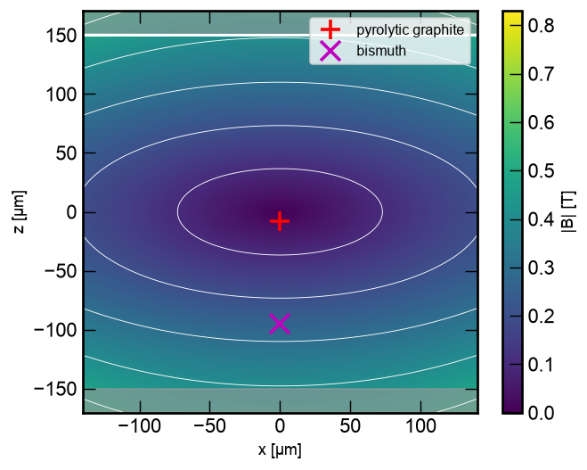
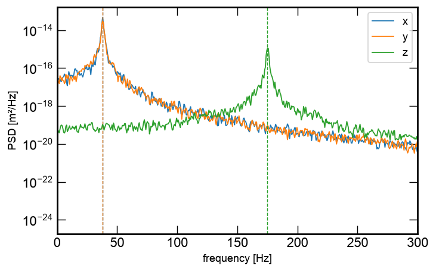

# Magnetic levitation

A diamagnetic particle (silica, graphite, bismuth, water, diamond) is pushed out of strong magnetic
fields. With gravity, a static field with a minimum of $|\mathbf{B}|$ can hold it with no light and no
feedback, at frequencies of tens to hundreds of Hz. levisim describes the field as one more force
element, `MagneticTrap`, in a `Trap(fields=[...])` (see [Traps as sums of fields](../concepts/traps_as_fields.md)),
so the same `Trap` gives the equilibrium, the stiffness tensor and the frequencies, feeds `MultiTrap`, and
runs in `FreeSpaceSimulation`. This page covers stage 1, induced magnetisation in a static field; a
magnet or a superconductor as the levitated particle (stage 2) is described at the end. The worked
example is the notebook for
[Slezak et al. (2018)](https://github.com/julianiacoponi/levisim/blob/main/notebooks/papers/slezak2018_magneto_gravitational_trap.ipynb);
the figures on this page come from `docs/guide/scripts/magnetic_levitation_example.py`.

## The energy of a magnetisable particle

A particle of volume $V$ and small volume susceptibility ($|\chi| \ll 1$) in a static field
$\mathbf{B}$ (the field without the particle) carries the moment $\mathbf{m}_B = V\chi_\mathrm{eff}\mathbf{B}/\mu_0$
and has the energy

$$
U = -\frac{V}{2\mu_0}\,\mathbf{B}\cdot\chi_\mathrm{eff}\,\mathbf{B},
$$

which for a diamagnet ($\chi < 0$) is lowest where $|\mathbf{B}|$ is smallest (Simon and Geim,
J. Appl. Phys. 87, 6200 (2000), doi:10.1063/1.372654). The susceptibility is the particle material's
`Material.χ_m` (a scalar, or a 3×3 tensor in the body frame, such as `PYROLYTIC_GRAPHITE`'s
$-85, -85, -450 \times 10^{-6}$ with the c axis along body $z$). By default `MagneticTrap` corrects it for
the particle's own demagnetising field,

$$
\chi_\mathrm{eff} = \chi\,(\mathbb{1} + N\chi)^{-1}, \qquad N = \mathrm{diag}(N_x, N_y, N_z),
$$

with the demagnetising factors of the shape, which for an ellipsoid equal the depolarisation factors of
electrostatics (`levisim.physics.shapes`; 1/3 for a sphere, 1 along the normal of a thin disk). For a
diamagnet the correction is of relative size $|\chi|/3 \sim 10^{-5}$; `shape_correction=False` uses the
bare χ, as the papers do. The tensor is turned into the lab frame by the particle's (fixed)
orientation, $R\chi_\mathrm{eff}R^\mathsf{T}$, and an anisotropic particle also feels the torque
$\mathbf{m}_B\times\mathbf{B}$ (`MagneticTrap.torque`, for the rotation work).

The force and the stiffness tensor follow from the field $B_i$, its Jacobian $J_{ij} = \partial B_i/\partial r_j$
and its second derivatives $H_{ijk}$:

$$
F_k = \frac{V}{\mu_0}\sum_{ij} J_{ik}\,\chi_{ij} B_j, \qquad
K_{kl} = -\frac{\partial F_k}{\partial r_l} = -\frac{V}{\mu_0}\Big[(J^\mathsf{T}\chi J)_{kl} + \sum_i (\chi\mathbf{B})_i H_{ikl}\Big].
$$

Both are analytic, so `Trap.stiffness_tensor` needs no finite differences of the force. Its off-diagonal
part (a field whose principal axes are tilted against the trap axes) becomes `Trap.intra_trap_couplings`,
which `MultiTrap` carries as $g_{xy}$, $g_{xz}$, $g_{yz}$.

## Field sources

A field is any `MagneticFieldSource` (module `levisim.physics.fields.magnetic_sources`): an object with
`B(r)`, `gradB(r)` and `hessB(r)`, vectorised over points of shape `(..., 3)`, placed by `centre` and
`rotation`. Sources that know only their field get the derivatives from fourth-order central differences
with steps of $10^{-3}$ and $3\times10^{-3}$ of their `length_scale`.

| Source | Field | Derivatives |
|---|---|---|
| `LocalFieldExpansion(B0, gradient, curvature)` | $B_i = B_{0,i} + G_{ij}u_j + \tfrac12 C_{ijk}u_ju_k$; warns unless $G$ and $C$ are symmetric and traceless (∇·B = ∇×B = 0); `.axisymmetric(B0, B1, B2, axis)` builds the consistent form from an on-axis profile | exact |
| `MultipoleField({(l, m): a_lm}, r0)` | $\mathbf{B} = -\mu_0\nabla\Phi$, $\Phi = \sum (a_{lm} r_0/l\mu_0)(r/r_0)^l Y_{lm}$ with real solid harmonics (`real_solid_harmonic`), the form of Hsu et al., Sci. Rep. 6, 30125 (2016), Eq. (1)-(4) | exact |
| `CurrentLoop(radius, current, centre, axis)` | exact, complete elliptic integrals; an on-axis series within $10^{-3}a$ of the axis | differences |
| `CoilPair(radius, current, separation, anti=True)`, `.anti_helmholtz`, `.helmholtz` | two coaxial loops | differences |
| `CuboidMagnet(dimensions, magnetisation= or remanence=, direction, centre, rotation)` | a uniformly magnetised block, exact closed form from its surface-charge sheets | exact Jacobian; Hessian by differences |
| `FieldSum([...])`, or `source_a + source_b` | sum of sources (magnet assemblies) | sums |
| `CallableField(B, gradB=None, hessB=None, length_scale)` | a user function | given, or differences |

The tests check ∇·B = 0, ∇×B = 0 and the symmetry and harmonicity of `hessB` for every source, the loop
against Biot-Savart quadrature (to $10^{-12}$) and its on-axis formula, the anti-Helmholtz gradient
$3\mu_0 I a^2 (d/2)/(a^2 + d^2/4)^{5/2}$, the block against its on-axis closed form (to $10^{-13}$) and the
dipole far field, and the derivatives of every source against differences of its field.

## Levitation condition and the report

Against gravity $g$ along $-\hat{h}$, an isotropic diamagnet levitates where

$$
B\,\frac{\partial B}{\partial h} = \frac{\mu_0 \rho g}{|\chi_\mathrm{eff}|},
$$

independent of its size (`MagneticTrap.required_B_gradB`; for an anisotropic particle give the field
direction). levisim gives 2403.5 T²/m for silica, 1361.7 for water and 1229.5 for mineral oil, against
2400, 1360 and 1230 T²/m in Table 1 of Houlton et al., Rev. Sci. Instrum. 89, 125107 (2018),
doi:10.1063/1.5051667; bismuth needs 707 T²/m and pyrolytic graphite with the field along its c axis
60 T²/m. The trap frequencies $\Omega_j^2 = K_{jj}/m_n$ are likewise independent of the particle size.

`Trap.magnetic_trap_report(r_guess=..., scan_range=...)` (and `magnetic_trap_report_str`) works on
every static element of the trap (the magnetic field, gravity, a tweezer, ...) and returns:

- `equilibrium`: the root of the total static force, by Newton's method on the analytic stiffness,
  after a scan of the vertical line through `r_guess` for the stable force balance (the origin of a
  magnetic trap is usually the field zero, not the levitation point). `Trap.find_equilibrium` and
  `Trap(..., linearisation_point='equilibrium', equilibrium_guess=...)` use the same solver for a trap
  with a `MagneticTrap`.
- `B`, `B_magnitude`, `gradB`, `χ_eff`, `χ_along_B`, `magnetic_force`, `weight` at the equilibrium;
- `required_B_gradB` and the actual `B_gradB` there, and `levitation_margin`, the largest upward
  magnetic force on the vertical line through the equilibrium (± `scan_range`) over the weight;
- `stiffness` (all static elements) and `magnetic_stiffness`; `Ω_axes` $= \sqrt{K_{jj}/m_n}$; the normal
  modes `Ω_normal_modes`, `normal_modes`; `stable`; `coupling_stiffness`, the off-diagonal part;
- `trap_depth`: the lowest barrier along rays from the equilibrium in the ± normal-mode and ± vertical
  directions, an upper bound on the true saddle-point barrier, flagged `trap_depth_is_lower_bound`
  when the barrier lies beyond `scan_range`;
- `eddy_damping_rates` for a conducting particle (below).

### Example: a graphite or bismuth microsphere between two magnets

Two 500 μm NdFeB cubes magnetised towards each other, 300 μm apart, make a field zero between them
with gradients of 1.4 and 2.7 × 10³ T/m. A 5 μm pyrolytic-graphite sphere (c axis vertical) sinks
8.1 μm below the zero, where $|B|$ = 0.022 T, and oscillates at 38.0 Hz horizontally and 175.1 Hz
vertically; a bismuth sphere, which needs twelve times the field-gradient product, hangs 95 μm below it at
26.4 and 50.0 Hz (levitation margin 1.7: it would fall out of a slightly weaker trap).

```python
from levisim.physics import Sphere, Trap
from levisim.physics.fields import CuboidMagnet, FieldSum, Gravity, MagneticTrap
from levisim.physics.materials import PYROLYTIC_GRAPHITE
from levisim.core.units import μm

L, gap, B_r = 500*μm, 300*μm, 1.23
source = FieldSum([
    CuboidMagnet((L, L, L), remanence=B_r, direction=(0, 0, 1), centre=(0, 0, -(gap + L)/2)),
    CuboidMagnet((L, L, L), remanence=B_r, direction=(0, 0, -1), centre=(0, 0, (gap + L)/2)),
])
trap = Trap(fields=[MagneticTrap(source), Gravity(direction=(0, 0, -1))],
            particle=Sphere(r=5*μm, material=PYROLYTIC_GRAPHITE))
print(trap.magnetic_trap_report_str(r_guess=(0, 0, 0), scan_range=100*μm))
```



## Time domain

`FreeSpaceSimulation` integrates the full nonlinear force of every element, so a magnetic trap, a
magneto-gravitational trap and a hybrid magneto-optical trap (`fields=[Tweezer(...), MagneticTrap(...),
Gravity(...)]`) all run with the NumPy loop (the compiled numba kernel covers tweezer traps only;
`backend='auto'` falls back). Start the particle at its equilibrium (`X0`) and set `linearisation_point`
there, so that `Trap.Ωj` and the theory spectra are those of the equilibrium. For the graphite sphere at
0.1 mbar the simulated PSD peaks at 37.91, 37.95 and 175.37 Hz against 37.99, 37.99 and 175.07 Hz from
the stiffness (40 000 steps of 0.2 ms; the tests check the same for a quadrupole with gravity to 2 %).
In the Slezak et al. trap the thermal axial amplitude at room temperature (22 μm rms) is no longer small
against the field scale and the simulated axial line sits 0.7 % below the harmonic value.



## Eddy-current damping

A conducting sphere of radius $R$ and conductivity $\sigma$ moving with velocity $\mathbf{v}$ through the
field sees the uniform change $\dot{\mathbf{B}} = J\mathbf{v}$; the induced field
$\mathbf{E} = -\tfrac12\dot{\mathbf{B}}\times\mathbf{r}$ dissipates $P = (2\pi/15)\sigma R^5|\dot{\mathbf{B}}|^2$,
the quasi-static eddy-current loss of a sphere in a uniform, slowly varying field (derived in the
`EddyCurrentDamping` docstring). In levisim's $F = -\Gamma p$ form,

$$
\Gamma = \frac{\sigma R^2}{10\rho}\,J^\mathsf{T}J .
$$

`EddyCurrentDamping(source, position, conductivity=None, temperature=300 K)` adds the diagonal of Γ to
`Trap.Γx`, `Γy`, `Γz` and, in the simulation, the matching thermal force noise $2k_BT\gamma$. It needs a
conductivity, from the material or given: the library's `BISMUTH` has $8.7 \times 10^5$ S/m. The
formula holds for an isotropic conductor, when the skin depth is much larger than $R$ and the field
changes little across the particle. For an anisotropic conductor such as `PYROLYTIC_GRAPHITE`,
`EddyCurrentDamping` asks for an explicit `conductivity=`; the dissipation
$\min_\phi \int \mathbf e\cdot\boldsymbol\sigma\,\mathbf e\,dV$ grows with every principal
conductivity, so the smallest and the largest principal values bound the damping from below and
above, and `magnetic_trap_report` returns these bounds as `eddy_damping_rate_bounds`.

## What was checked

- Sources: the identities and closed forms listed above.
- Levitation condition: the analytic value for bismuth and silica, with and without the shape
  correction; pyrolytic graphite along and across its c axis, and after a rotation; Houlton et al.'s
  Table 1 (five materials within 0.4 %).
- Frequencies in a pure quadratic field, $\Omega_j^2 = |\chi_\mathrm{eff}|\,(G^\mathsf{T}G)_{jj}/\mu_0\rho$,
  exact and independent of the size; the paramagnetic case is expelled.
- Force against the gradient of the potential and stiffness against differences of the force, for an
  isotropic sphere and a tilted graphite spheroid in a coil-pair field; the torque $\mathbf{m}_B\times\mathbf{B}$.
- Equilibrium with gravity: an axisymmetric field built to balance the weight at a chosen point, its
  stiffness in closed form; `find_equilibrium` and `linearisation_point='equilibrium'`.
- Hsu et al. (2016): their published multipole coefficients give (106.1, 130.3, 9.56) Hz and
  $y_\mathrm{eq}$ = −18.9 μm against their (104, 130, 9.6) Hz and −19 μm (diamond χ assumed).
- The simulated PSD peaks against the stiffness, with gravity; a hybrid tweezer + magnetic trap.

## Stage 2 (planned): magnets and superconductors

A permanent-magnet particle above a superconducting plane (image-dipole model) and a superconducting
sphere in a quadrupole field bring a remanent moment, torques that set the orientation, and librational
modes. They follow the rotational dynamics and will build on the same `MagneticFieldSource` interface
(`B`, `gradB`, `hessB`). Until then `MagneticTrap` rejects a particle whose material has a remanent
magnetisation. Targets: Vinante et al., Phys. Rev. Applied 13, 064027 (2020),
doi:10.1103/physrevapplied.13.064027; Timberlake et al., Appl. Phys. Lett. 115, 224101 (2019),
doi:10.1063/1.5129145.
