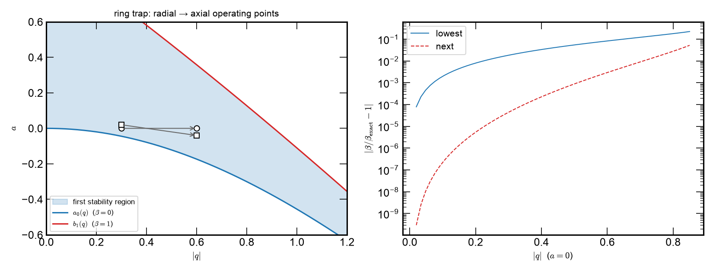
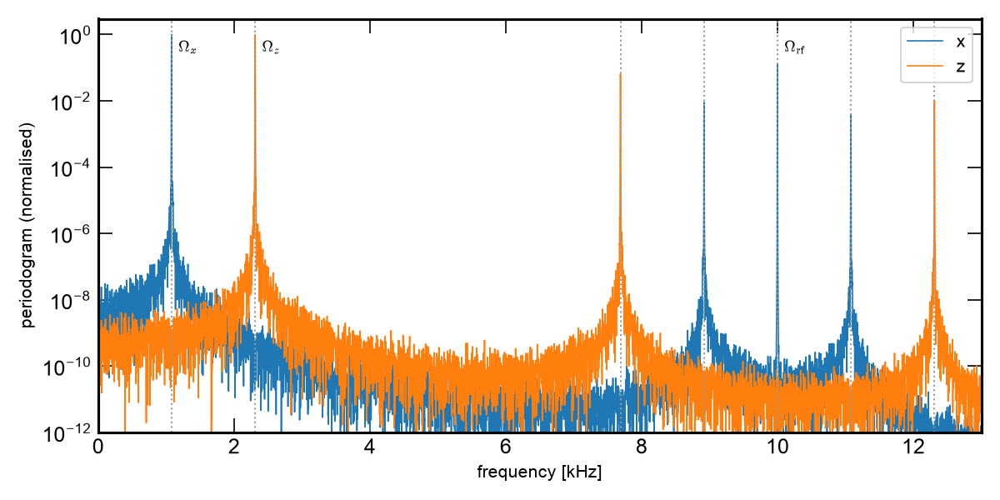

# Paul and hybrid traps

A charged particle can be held by a radio-frequency (Paul) trap, alone or together with an optical
tweezer. levisim describes the Paul trap as one more force element, `PaulTrap`, in a
`Trap(fields=[...])` (see [Traps as sums of fields](../concepts/traps_as_fields.md)). This page
describes the model, its two levels of description (the full time-dependent force for the
simulations and the secular stiffness for `MultiTrap`), the Mathieu analysis, the noise, and how the
pieces were checked. The worked examples are the notebooks for
[Conangla et al. (2020)](https://github.com/julianiacoponi/levisim/blob/main/notebooks/papers/conangla2020_hybrid_paul_optical.ipynb)
(a hybrid Paul-optical trap) and
[Dania et al. (2024)](https://github.com/julianiacoponi/levisim/blob/main/notebooks/papers/dania2024_paul_trap_ultrahigh_q.ipynb)
(a linear Paul trap in ultrahigh vacuum); the figures on this page come from
`docs/guide/scripts/paul_trap_example.py`.

## The ideal quadrupole

About the trap centre $\mathbf{c}$ the electric potential is

$$
\phi(\mathbf{r}, t) = \kappa_\mathrm{dc} U_\mathrm{dc} \sum_j \frac{a^\mathrm{dc}_j (r_j - c_j)^2}{2 r_\mathrm{dc}^2}
+ \kappa_\mathrm{geom} V_\mathrm{rf} \cos(\Omega_\mathrm{rf} t + \varphi_\mathrm{rf}) \sum_j \frac{a_j (r_j - c_j)^2}{2 r_0^2},
\qquad \sum_j a_j = \sum_j a^\mathrm{dc}_j = 0,
$$

where the curvatures $a_j$ satisfy Laplace's equation (`PaulTrap` raises a `ValueError` otherwise)
and $\kappa_\mathrm{geom}$ is the geometric efficiency of real electrodes relative to ideal hyperbolic
ones at the same $r_0$. With `dc_geometry=None` the dc voltage acts on the rf geometry, which is the
form $\phi = (U_\mathrm{dc} + V_\mathrm{rf}\cos\Omega_\mathrm{rf}t)(a_x x^2 + a_y y^2 + a_z z^2)/(2r_0^2)$.
The force on a particle of charge $Q$ (`Particle.charge` in elementary charges; a neutral particle
raises a clear error) is

$$
F_j = -Q\left[c^\mathrm{dc}_j + c^\mathrm{rf}_j \cos(\Omega_\mathrm{rf} t + \varphi_\mathrm{rf})\right](r_j - c_j),
\qquad c^\mathrm{dc}_j = \frac{\kappa_\mathrm{dc} U_\mathrm{dc} a^\mathrm{dc}_j}{r_\mathrm{dc}^2},\quad
c^\mathrm{rf}_j = \frac{\kappa_\mathrm{geom} V_\mathrm{rf} a_j}{r_0^2}.
$$

Two presets cover the usual geometries:

| Preset | rf curvatures | dc curvatures | Notes |
|---|---|---|---|
| `PaulTrap.ring(V_rf, Ω_rf, r0, U_dc, axis='z')` (alias `endcap`) | $(1, 1, -2)$ | the same | the ideal ring trap with $r_0^2 = 2z_0^2$; $q_\mathrm{axis} = -2q_\mathrm{radial}$ |
| `PaulTrap.linear(V_rf, Ω_rf, r0, U_endcap, z0, axis='z')` | $(1, -1, 0)$ | $(-\tfrac12, -\tfrac12, 1)$ at $z_0$ | axial frequency $\sqrt{Q\kappa U_\mathrm{endcap}/(m_n z_0^2)}$; the endcaps defocus radially |

`axis` puts the symmetry axis along any lab axis, e.g. `axis='x'` for a trap whose axis is
perpendicular to a tweezer along $z$. `centre` offsets the trap from the tweezer focus.

## Mathieu parameters and stability

Each axis obeys Mathieu's equation (Leibfried et al., Rev. Mod. Phys. 75, 281 (2003),
doi:10.1103/revmodphys.75.281, Eqs. 3-5),

$$
\frac{\mathrm{d}^2 r_j}{\mathrm{d}\tau^2} + (a_j + 2q_j\cos 2\tau)\,r_j = 0,\qquad \tau = \frac{\Omega_\mathrm{rf} t}{2},\qquad
a_j = \frac{4Q c^\mathrm{dc}_j}{m_n\Omega_\mathrm{rf}^2},\quad q_j = \frac{2Q c^\mathrm{rf}_j}{m_n\Omega_\mathrm{rf}^2},
$$

(`PaulTrap.mathieu_parameters`). The bounded solutions have the characteristic exponent $\beta_j$ and
the secular frequency $\Omega_j = \beta_j\Omega_\mathrm{rf}/2$. levisim computes $\beta$ three ways
(`mathieu_secular_beta`, `PaulTrap.secular_frequencies(particle, order)`):

- `'lowest'`: $\beta^2 = a + q^2/2$, the pseudopotential (Leibfried et al., Eq. 6);
- `'next'`: the first two terms of the continued-fraction expansion,
  $\beta^2 = a - \frac{(a-1)q^2}{2(a-1)^2 - q^2} - \frac{(5a+7)q^4}{32(a-1)^3(a-4)}$;
- `'exact'`: from the Floquet monodromy matrix over one drive period, $\cos\pi\beta = \Delta/2$, with
  $\Delta$ its trace (`mathieu_characteristic_exponent`).

The stability flag (`is_stable`, `stable_axes`) tests the first stability region exactly,
$a_0(q) < a < b_1(q)$, with Mathieu's characteristic values from `scipy.special.mathieu_a` and
`mathieu_b`; at $a = 0$ it ends at $|q| = 0.908046$. Outside it the motion grows by the Floquet
multiplier $|\lambda|$ (`mathieu_floquet_multiplier`) every rf period.



Left: the first stability region; a ring trap maps a radial point $(a, q)$ to $(-2a, -2q)$ on its
axis. Right: at $a = 0$ the pseudopotential underestimates $\beta$ by 0.2 % at $q = 0.1$, 0.8 % at
0.2, 3.3 % at 0.4 and 12 % at 0.7; the next order is better by two to four orders of magnitude
($5 \times 10^{-6}$ at $q$ = 0.2, $2 \times 10^{-4}$ at 0.4). The tests check both edges of the
region against the Floquet multiplier and the small-$q$ limit for $a = -0.01, 0, 0.01$.

## Two levels of description

**Secular stiffness (frequency domain).** `PaulTrap.stiffness(r0, particle)` returns the
time-averaged stiffness diag$(k_x, k_y, k_z)$,

$$
k_j = Q c^\mathrm{dc}_j + \frac{Q^2 (c^\mathrm{rf}_j)^2}{2 m_n \Omega_\mathrm{rf}^2} = \frac{m_n\Omega_\mathrm{rf}^2}{4}\left(a_j + \frac{q_j^2}{2}\right),
$$

i.e. the curvature of the pseudopotential $U_\mathrm{sec} = Q^2|\nabla\phi_\mathrm{rf}|^2/(4m_n\Omega_\mathrm{rf}^2) + Q\phi_\mathrm{dc}$
(`secular_force`, `potential`). This is what `Trap` sums with the other elements, so $\Omega_j$, the
`MultiTrap` frequencies and the gravitational sag $g/\Omega_j^2$ (`Trap.find_equilibrium`, which uses
the time-averaged force of every element with `is_time_dependent`) come from it.

The lowest order is the default for a reason beyond simplicity: it is additive. In a hybrid trap the
lowest-order Mathieu result with the tweezer's stiffness folded into $a_j$ ($a_j \to a_j +
4K_{\mathrm{tw},jj}/(m_n\Omega_\mathrm{rf}^2)$) is exactly $\sqrt{(k_j + K_{\mathrm{tw},jj})/m_n}$,
whereas $\beta$ at higher order is not additive in $a$. `secular_order='exact'` makes `stiffness`
return $m_n(\beta_j\Omega_\mathrm{rf}/2)^2$ of the Paul trap on its own; for a hybrid trap at higher
order use `Trap.paul_trap_report()`, which folds the stiffness of all other elements into $a_j$ and
returns $a$, $q$, the stability flag, the three orders of secular frequency, the depth and the heating
rates. Note also that the static response to a constant force is the pseudopotential one: under gravity
the exact periodic orbit at $q = 0.3$ sags by 220.49 nm, the pseudopotential predicts 220.80 nm, and
$g/\Omega_\mathrm{exact}^2$ would give 212.9 nm.

**Full rf force (time domain).** `PaulTrap.force(r, t, particle)` is the force above at time $t$.
`FreeSpaceSimulation` evaluates every force at the integrator's stage times ($t + c_i\Delta t$ for
Kasdin's RK4, $t$ and $t + \Delta t$ for Heun), so an explicitly time-dependent force needs no change
to the integrators, only a step that resolves the drive. The simulation warns when
$\Delta t > 1/(20 f_\mathrm{rf})$ (`PaulTrap.max_time_step`). For noise-free Mathieu motion at $q$ = 0.3
the secular frequency of the integrated motion is within $2.3 \times 10^{-4}$ of the Floquet value at 20
steps per rf period and $2.5 \times 10^{-5}$ at 40 with Kasdin's RK4 ('vector_4', third order in
practice here); Heun ('vector_2', second order) is off by 1.6 % at 20 steps and 0.1 % at 80, so with Heun
the simulation also warns below 100 steps per period. A trap with a `PaulTrap` runs the NumPy loop
(about 35 μs per step); the numba kernels cover the single-tweezer traps only.

A hybrid trap is one more element in the list:

```python
from levisim import PaulTrap, Trap, Tweezer, Bead
from levisim.core.units import kHz, mm

paul = PaulTrap.ring(V_rf=900, Ω_rf=20*kHz, r0=1*mm, axis='x', κ_geom=0.5)
hybrid = Trap(tweezer=Tweezer(), bead=Bead(charge=150), extra_fields=[paul])
# in MultiTrap: MultiTrap(..., beads=[Bead(charge=150)], trap_kwargs=[{'extra_fields': [paul]}])
```

`extra_fields` appends elements to either constructor form of `Trap`, which is how a Paul trap enters
`MultiTrap` through `trap_kwargs`.

## Micromotion, sag and stray fields

A particle displaced by $u_j$ from the rf null (by gravity, a stray field, an offset tweezer) is
driven at $\Omega_\mathrm{rf}$ with the excess-micromotion amplitude $|q_j|u_j/2$ (Leibfried et al.,
Eqs. 10, 13; `excess_micromotion_amplitude`). `UniformElectricField(E)` adds a uniform field, $F = Q\mathbf{E}$,
to a trap; with a Paul trap it displaces the particle by $QE_j/k_j$.



The figure is a simulated ring trap ($q_x$ = 0.3, $q_z$ = −0.6, $f_\mathrm{rf}$ = 10 kHz, a 100 nm silica sphere
with 500 e, gravity along $-x$, $10^{-9}$ mbar, 40 steps per rf period). The secular peaks are at 1080.3 and
2311.2 Hz, the Floquet values to 0.1 Hz (the pseudopotential gives 1060.7 and 2121.3 Hz). The micromotion
sidebands sit at $f_\mathrm{rf} \mp \Omega_j/2\pi$, with relative amplitudes $q/((\beta \mp 2)^2 - a)$ from
the Floquet recursion (25 % above the textbook $q/4$ for the lower sideband at $q$ = 0.3), and the line at
$f_\mathrm{rf}$ in $x$ is the excess micromotion of the gravitational sag: mean position −220.47 nm, amplitude
33.12 nm, against 220.49 and 33.12 nm for the exact periodic orbit.

## Electrode noise and heating

Voltage noise on the electrodes is a white electric field noise at the particle. `PaulTrap` takes the
one-sided voltage spectral density $S_V$ (`voltage_noise_psd`, V²/Hz) and an effective distance $d_j$
per axis (`noise_distances`, $E_j = V_\mathrm{noise}/d_j$), so that

$$
S_{E,j} = \frac{S_V}{d_j^2},\qquad \Gamma_j = \frac{Q^2 S_{E,j}}{4 m_n\hbar\Omega_j}\ \text{phonons/s},\qquad
\hbar\Omega_j\Gamma_j = \frac{Q^2 S_{E,j}}{4 m_n},
$$

(`electric_field_noise_psd`, `heating_rate`; Turchette et al., Phys. Rev. A 61, 063418 (2000); the
$S_{ff} = 4m\hbar\Omega\Gamma$ of Dania et al. 2024). `noise(particle)` returns the two-sided force
spectral density $Q^2 S_{E,j}/2$, the convention of `ForceElement.noise`, and `FreeSpaceSimulation` adds
it as extra independent white noises (one per principal axis, `field_noise_modes`) for every element
with `noise_in_simulation`. Traps without such elements keep the noise matrix and the random-number
stream they always had. With Dania et al.'s 38 nV/√Hz at 0.92 mm, a charge of 300 e and 4.3 × 10⁻¹⁷ kg,
levisim gives $S_{EE}$ = 1.71 × 10⁻⁹ (V/m)²/Hz and 2.7 × 10⁴ phonons/s at 1.28 kHz, against the measured
3.1(8) × 10⁴ (dark); in the notebook a simulation with the full rf force heats the axial motion at 0.91 of
this rate (eight runs, 1σ scatter about 0.35).

The trap depth (`trap_depth`) is the pseudopotential energy at the electrodes, $\tfrac12 k_j d_j^2$ minimised
over the axes, with $d_j = r_0/\sqrt{|a_j|}$ for ideal electrodes (or `electrode_distances`). It is an upper
estimate: real fields are anharmonic near the electrodes, and the pseudopotential fails at large $q$.

## What the tests check

`tests/test_paul_trap.py`:

- Mathieu: $q_\mathrm{max}$ = 0.908046 at $a = 0$; both edges of the first region against the Floquet
  multiplier for five $q$; the small-$q$ limit and the next order;
- presets: $a$ and $q$ of the ring and linear traps, the axial frequency of the linear trap, radial
  defocusing; Laplace and neutral-particle errors; the force, its rf average, the pseudopotential
  stiffness and the sign of the charge;
- `Trap` and `MultiTrap`: the secular stiffness gives $\Omega_j$; in a hybrid trap stiffnesses add and
  `paul_trap_report` folds them into $a$; a `MultiTrap` built with `extra_fields` has
  $\Omega_j = \sqrt{(k_\mathrm{tw} + k_\mathrm{ps})/m_n}$, and the simulated motion of the same trap
  oscillates at the exact frequencies to $10^{-3}$ (at the lowest-order ones within their 0.9 % error);
- time domain: simulated secular frequencies within $10^{-3}$ of Floquet; sidebands at
  $f_\mathrm{rf} \mp \Omega$ with the Floquet amplitudes; growth at the Floquet rate beyond the boundary
  ($q$ = 0.95) and bounded motion at $q$ = 0.85; the sag and its micromotion on the exact periodic orbit;
  stray-field displacement;
- noise: the Dania et al. chain; the electrode noise raising the simulated variance by
  $1 + S_\mathrm{el}/S_x$; the time-step warnings.

## Limitations

- The trap axes are the lab axes (no rotated quadrupole), and the fields are ideal quadrupoles:
  no higher multipoles, no axial rf component in the linear trap.
- The secular stiffness in `MultiTrap` is lowest order; for $|q| \gtrsim 0.3$ use `paul_trap_report`
  for the frequencies. Electrode noise is white and additive; rf amplitude noise (parametric heating)
  is not modelled.
- `Trap.Utw` and `Trap.U_depth` are the peak dipole energy, twice the cycle-averaged potential whose
  gradient is the tweezer force; for a Gibbs density of a hybrid trap use `Utw/2` (as the Conangla
  notebook does).
