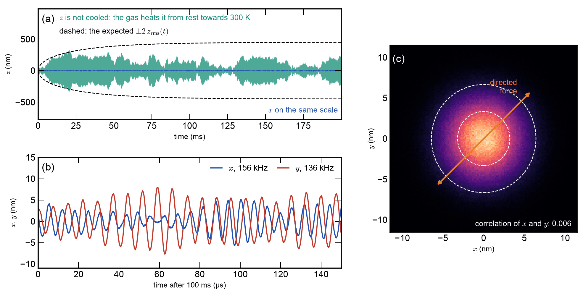
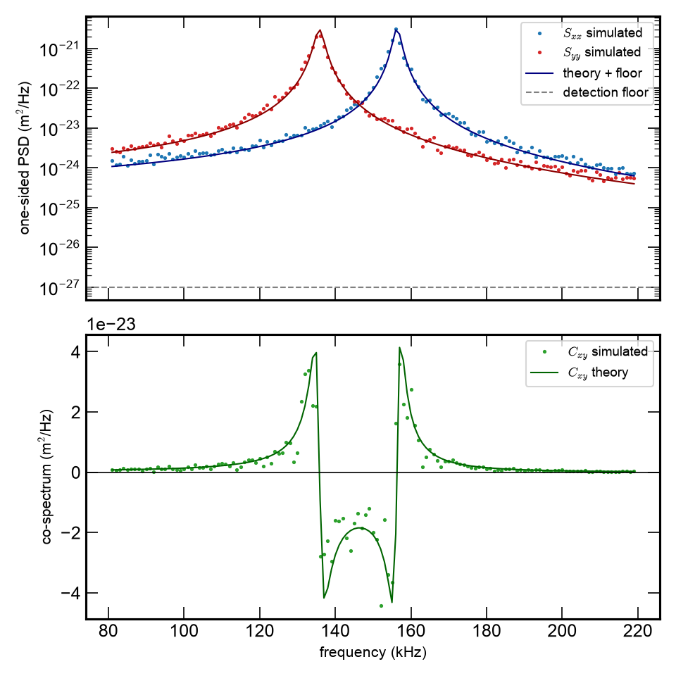
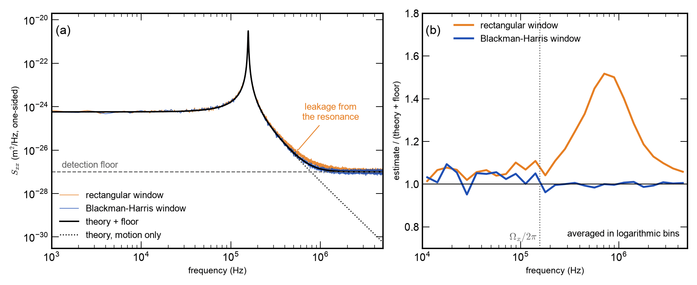

# Stochastic simulations of a bead in a free-space tweezer

This page describes the classical, stochastic (Langevin) simulation of a dielectric nanoparticle
("bead") held by a free-space optical tweezer in a dilute gas, as implemented in
`levisim.FreeSpaceSimulation`, together with the spectral tools used to analyse it
(`SpectralDensityEstimate`, `SpectralDensityTheory`). It follows the notation of the
*Stochastic Tweezer Bead Code Summary* (J. Iacoponi, October 2023); where the code has moved on
since those notes, the differences are pointed out.

The physics is set up by four classes: `Tweezer` (an elliptical Gaussian beam), `Bead` (a
silica sphere), `Gas` (the background gas) and `Trap`, which combines them and adds feedback
damping, a directed stochastic force and optional kicks. `FreeSpaceSimulation` integrates the equations of
motion of a `Trap` and returns position traces.

`FreeSpaceSimulation` is built on `levisim.simulation.StochasticSimulation`, which holds what every
time-domain simulation shares: the time axis, the random numbers and their seeding, the chunked noise
generation, the integrators of `levisim.simulation.integrators` and the recording into `Trace`
objects. The class used to be called `Simulation` (`levisim.data.simulation.Simulation`); that name
still works, with the same keyword arguments and the same numbers, but emits a `DeprecationWarning`
and will be removed in levisim 2.0, the next major release; new code should use `FreeSpaceSimulation`.

## Physical model

### Equations of motion

The state is $\mathbf{X} = (x, y, z, p_x, p_y, p_z)^\top$, with $z$ along the tweezer axis. The
equations of motion are a set of Itô stochastic differential equations,

$$
\mathrm{d}\mathbf{X} = \mathbf{F}(t, \mathbf{X})\,\mathrm{d}t + \mathbf{G}\,\mathrm{d}\mathbf{W},
$$

with the deterministic part (Hamilton's equations for $H = |\mathbf{p}|^2/2m + U_\mathrm{tw}(\mathbf{r})$, plus damping)

$$
\mathbf{F} = \begin{pmatrix} p_x/m \\ p_y/m \\ p_z/m \\ F_{\mathrm{tw},x} - \Gamma_x p_x + F_{\mathrm{kick},x} \\ F_{\mathrm{tw},y} - \Gamma_y p_y + F_{\mathrm{kick},y} \\ F_{\mathrm{tw},z} - \Gamma_z p_z \end{pmatrix},
\qquad
\mathbf{G} = \begin{pmatrix} 0 & 0 & 0 & 0 \\ 0 & 0 & 0 & 0 \\ 0 & 0 & 0 & 0 \\ 1 & 0 & 0 & \cos\psi \\ 0 & 1 & 0 & \sin\psi \\ 0 & 0 & 1 & 0 \end{pmatrix},
\qquad
\mathrm{d}\mathbf{W} = \begin{pmatrix} \mathrm{d}W_{\mathrm{th},x} \\ \mathrm{d}W_{\mathrm{th},y} \\ \mathrm{d}W_{\mathrm{th},z} \\ \mathrm{d}W_\mathrm{dir} \end{pmatrix}.
$$

The four Wiener processes are independent and carry their physical variances,
$\mathrm{d}W_{\mathrm{th},j} \sim \mathcal{N}(0, S_\mathrm{th}\,\mathrm{d}t)$ and
$\mathrm{d}W_\mathrm{dir} \sim \mathcal{N}(0, S_\mathrm{dir}\,\mathrm{d}t)$, so they have units of momentum.
Because $\mathbf{G}$ does not depend on $\mathbf{X}$ the noise is additive, and the Itô and
Stratonovich readings of the equations coincide.

### Gaussian-beam potential and its anharmonicity

The tweezer field (complex amplitude, in the polarisation direction) is

$$
E_\mathrm{tw}(\mathbf{r}) = \frac{E_0}{w(z)} \exp\!\left[-\left(\frac{x^2}{w_x^2(z)} + \frac{y^2}{w_y^2(z)}\right)\right],
\qquad w(z) = \sqrt{1 + z^2/z_R^2},
$$

with $E_0 = \sqrt{4P/(\pi w_0^2 \varepsilon_0 c)}$, $w_0 = \sqrt{w_{x_0} w_{y_0}}$, $z_R = \pi w_0^2/\lambda$,
$w_j(z) = w_{j_0} w(z)$ and $w_{z_0} = \sqrt{2} z_R$. The bead's potential is
$U_\mathrm{tw} = -\tfrac{1}{2}\mathrm{Re}(\alpha_\mathrm{eff}) |E_\mathrm{tw}|^2$, and after averaging the optical
oscillation (a factor $\tfrac12$) the gradient forces are

$$
F_{\mathrm{tw},x} = \frac{2x}{w_x^2(z)} U_\mathrm{tw}, \qquad
F_{\mathrm{tw},y} = \frac{2y}{w_y^2(z)} U_\mathrm{tw}, \qquad
F_{\mathrm{tw},z} = \frac{2z}{w_z^2(z)} U_\mathrm{tw}\left[1 - 2\left(\frac{x^2}{w_x^2} + \frac{y^2}{w_y^2}\right)\right].
$$

The simulation uses these full, non-linear forces. Linearising them gives the spring constants
$k_j = \mathrm{Re}(\alpha_\mathrm{eff}) E_0^2 / w_{j_0}^2$ and the frequencies $\Omega_j = \sqrt{k_j/m}$ reported by
`Trap.Ωj`; for the defaults $\Omega_{x,y,z}/2\pi = 156.34,\ 135.80,\ 35.06$ kHz. The anharmonic terms
(the Gaussian's quartic terms and the $x$–$z$, $y$–$z$ cross terms) matter only for amplitudes that
are a sizeable fraction of the waist; at the sub-kelvin effective temperatures of a feedback-cooled
bead (rms amplitudes of a few nm against $w_0 \approx 1\ \mu$m) they are negligible. Set
`Trap(override_Ω_dict={'x': ..., 'y': ..., 'z': ...})` to replace the tweezer by purely harmonic forces.

### Gas damping and the fluctuation–dissipation theorem

In the free-molecular (Epstein) regime the gas damps the motion at the rate (Cavalleri et al. 2010)

$$
\Gamma_\mathrm{th} = \left(1 + \frac{\pi}{8}\right)\frac{1}{\rho r}\,\frac{m_\mathrm{gas} \bar{v} P}{k_B T},
\qquad \bar{v} = \sqrt{\frac{8 k_B T}{\pi m_\mathrm{gas}}},
$$

where $\bar v$ is the *mean* molecular speed, because the momentum transfer is set by the molecular
flux $n\bar v/4$ onto the surface. For the defaults ($P = 4\times10^{-3}$ mbar, $T = 300$ K)
$\Gamma_\mathrm{th}/2\pi = 4.332$ Hz. The fluctuation–dissipation theorem fixes the accompanying
white thermal force,

$$
\langle F_\mathrm{th}(t) F_\mathrm{th}(t')\rangle = S_\mathrm{th}\,\delta(t - t'), \qquad
S_\mathrm{th} = f_\mathrm{th}^2 = 2 m k_B T \Gamma_\mathrm{th},
$$

a *two-sided* force PSD per unit (linear) frequency [N²/Hz]; the one-sided equivalent is
$G_\mathrm{th} = 2 S_\mathrm{th}$. A force noise $f = \sqrt{S}$ [N/√Hz] is an amplitude spectral density,
not a force: independent forces add in quadrature.

### Feedback cold damping

Feedback adds damping without adding force noise: $\Gamma_j = \Gamma_\mathrm{th} + \Gamma_{\mathrm{fb},j}$
(defaults $\Gamma_{\mathrm{fb},x}/2\pi = 2.1$ kHz, $\Gamma_{\mathrm{fb},y}/2\pi = 2.5$ kHz, $\Gamma_{\mathrm{fb},z} = 0$).
The motion therefore equilibrates at an effective temperature lower than the gas,

$$
T_{\mathrm{eff},j} = T\,\frac{\Gamma_\mathrm{th}}{\Gamma_\mathrm{th} + \Gamma_{\mathrm{fb},j}}\left(1 + \frac{S_{\mathrm{dir},j}}{S_\mathrm{th}}\right),
$$

where the last factor accounts for the directed force below (`Trap.T_eff`). Note that with the default
$\Gamma_{\mathrm{fb},z} = 0$, the $z$ motion relaxes on $1/\Gamma_\mathrm{th} \approx 37$ ms, so short runs
starting from rest have not thermalised in $z$.

### The directed stochastic force and $x$–$y$ correlations

A second white force, of strength $f_\mathrm{dir} = \beta f_\mathrm{th}$ (default $\beta = \sqrt2$), acts along
the direction $\psi$ in the $x$–$y$ plane (default $45^\circ$; $\Psi$ in the notes). Because *the same*
$\mathrm{d}W_\mathrm{dir}$ drives $x$ and $y$, it correlates them, while the thermal forces do not. With
$\chi_j(\omega) = [m(\Omega_j^2 - \omega^2 + i\Gamma_j\omega)]^{-1}$:

$$
S_{xx} = |\chi_x|^2 S_\mathrm{th}(1 + \beta^2\cos^2\psi), \qquad
S_{yy} = |\chi_y|^2 S_\mathrm{th}(1 + \beta^2\sin^2\psi), \qquad
S_{xy}(\omega) = \chi_x^*(\omega)\chi_y(\omega)\,S_\mathrm{dir}\cos\psi\sin\psi .
$$

The co-spectrum $C_{xy} = \mathrm{Re}\,S_{xy}$ changes sign between the two resonances, because the
phases of $\chi_x$ and $\chi_y$ differ by up to $\pi$ there; its sign outside the resonances follows
$\sin 2\psi$. This is what makes the angle of a force recoverable from cross-correlation spectra.
`SpectralDensityTheory` implements these, together with the quadrature spectrum
$Q_{xy} = -\mathrm{Im}\,S_{xy}$, the phase and Bendat–Piersol error estimates.

### Kicks

`Kick` objects (`generate_kick_list`) apply a constant force $F_0 = K p_\mathrm{th}/\tau$ along the angle
$\theta$ in the $x$–$y$ plane for a duration $\tau$, delivering the impulse $K p_\mathrm{th}$, where
$p_\mathrm{th} = m_\mathrm{gas}\bar v$ is a gas molecule's mean momentum.

### Detection floor

`FreeSpaceSimulation(detection_floor=G_floor)` adds white measurement (imprecision) noise to the *recorded*
traces only; the integrated state is untouched. `G_floor` is the one-sided displacement PSD [m²/Hz]
of that noise, i.e. the flat level it produces far from resonance in a one-sided estimate. White
samples of variance $\sigma^2$ every $\Delta t$ have one-sided PSD $2\sigma^2\Delta t$, so the code adds
$\mathcal{N}(0, G_\mathrm{floor}/2\Delta t)$ to every sample. A dict gives different floors per axis.

### Optional physics (all off by default)

- **Photon recoil (scattering force)**, `Trap(photon_recoil=True)`: adds the dissipative part of the
  dipole force along the beam axis (taken to propagate along $+z$),
  $F_{\mathrm{scat},z} = \tfrac12 \mathrm{Im}(\alpha_\mathrm{eff})|E_\mathrm{tw}|^2\,\partial_z[kz - \arctan(z/z_R)] = \sigma_\mathrm{scat} I(\mathbf{r})/c\,[1 - z_R/(k(z_R^2 + z^2))]$,
  which pushes the bead downstream. `Trap.z_eq` is the linearised equilibrium,
  $z_\mathrm{eq} = (\mathrm{Im}\,\alpha/\mathrm{Re}\,\alpha)\,k(z_R^2 - z_R/k)$ = 349.2 nm for the defaults;
  `Trap.z_eq_exact` solves the full on-axis balance, 354.7 nm. Eq. (A4) of Toroš et al.
  (arXiv:2012.15822) gives 370.7 nm, because it omits the Gouy factor $1 - 1/(kz_R)$ ($kz_R = 17.3$).
  At $z_\mathrm{eq}$ the beam is wider, so `Trap.Ωj_at_z_eq` gives $\Omega_{x,y}$ 1.45% and $\Omega_z$ 2.98% below
  the focal values. Transverse scattering forces and recoil heating are not included.
- **Gravity**, `FreeSpaceSimulation(gravity=True, gravity_direction=(-1, 0, 0))`: adds the weight $mg$
  (16.5 aN for the default 1.68 fg bead) along $-x$ by default (the experiment's tweezer axis is
  horizontal). It shifts the equilibrium by $g/\Omega_x^2 \approx 10$ pm.
- **Dispersive permittivity**, `Bead(permittivity_model='Malitson', λ=1064e-9)`: sets
  $\varepsilon_r = n(\lambda)^2$ from the Malitson (1965) Sellmeier formula for fused silica,
  $n(1064\ \mathrm{nm}) = 1.4496$. The default $\varepsilon_r = 1.98$ ($n = 1.407$) is unchanged.

## Numerical method

### Kasdin's stochastic Runge–Kutta scheme (`RK_method='vector_4'`, default)

Each step of length $\Delta t$ evaluates four stages,

$$
\mathbf{K}_i = \left[\mathbf{F}(t_i, \mathbf{X}_i) + \mathbf{G}\,\boldsymbol{\xi}_i\right]\Delta t,
\qquad \mathbf{X}_i = \mathbf{X}[n] + \sum_{j<i} a_{ij}\mathbf{K}_j,
\qquad \mathbf{X}[n+1] = \mathbf{X}[n] + \sum_i \alpha_i \mathbf{K}_i,
$$

where each component of the stage force $\boldsymbol\xi_i$ is drawn from $\mathcal{N}(0, q_i S/\Delta t)$, with
$S = S_\mathrm{th}$ for the three thermal components and $S_\mathrm{dir}$ for the directed one. The noise
weights $q_i$, stage weights $a_{ij}$ and solution weights $\alpha_i$ are those of Kasdin (Proc. IEEE 83,
802 (1995)), chosen to minimise the error of the stochastic terms:

| $q_1$ | $q_2$ | $q_3$ | $q_4$ |
|---|---|---|---|
| 3.99956364361748 | 1.64524970733585 | 1.59330355118722 | 0.26330006501868 |

| $a_{21}$ | $a_{31}$ | $a_{32}$ | $a_{41}$ | $a_{42}$ | $a_{43}$ |
|---|---|---|---|---|---|
| 0.66667754298442 | 0.63493935027993 | 0.00342761715422 | −2.32428921184321 | 2.69723745129487 | 0.29093673271592 |

| $\alpha_1$ | $\alpha_2$ | $\alpha_3$ | $\alpha_4$ |
|---|---|---|---|
| 0.25001351164789 | 0.67428574806272 | −0.00831795169360 | 0.08401868181222 |

A force held constant over a step with variance $S/\Delta t$ has $\langle F F\rangle \to S\,\delta(t - t')$,
which is why the standard deviations scale as $\sqrt{q_i S/\Delta t}$.

`RK_method='vector_2'` is the improved-Euler (Heun) scheme with the same four Wiener increments,
$\Delta\mathbf{W} \sim \mathcal{N}(0, S\Delta t)$ per component; for additive noise the random-sign terms of
Roberts' variant cancel exactly. It is cheaper per step but less accurate near the Nyquist frequency.

### Random numbers and reproducibility

`FreeSpaceSimulation(seed=...)` uses `np.random.default_rng(seed)`. With `seed=None` (default) numpy's legacy
global stream is used, so runs seeded with `np.random.seed(...)` reproduce earlier levisim versions
bit for bit. The normals are pre-generated in chunks of $2^{15}$ steps; a $10^5$-sample run takes about
3.4 s.

### Compiled backend (`pip install levisim[fast]`)

With numba installed (the `fast` extra), the time loop can run as a compiled kernel. The keyword
`backend` chooses it:

- `backend='auto'` (default): numba when it is installed and the run has at least $2^{15}$ steps
  (shorter runs cost less in NumPy than loading the kernels), NumPy otherwise;
- `backend='numpy'`: the NumPy loop, which remains the tested reference;
- `backend='numba'`: the compiled loop; an `ImportError` explains how to install numba if it is missing,
  and an `UnsupportedBackendError` (a `ValueError`) names the reason when the configuration has no
  compiled kernel. An explicit request never silently runs the NumPy loop instead.

`sim.backend_used` records which loop ran. Both loops draw the same random numbers in the same order
(the compiled loop takes them from the same chunked generator), so a seeded run gives the same
trajectory to round-off: positions agree to about $10^{-14}$ relative over $3\times10^4$ steps, and
the whole state agrees bit for bit where no exponential is evaluated (`override_Ω_dict` with Heun).
Over very long runs the anharmonic, lightly damped $z$ motion amplifies any last-bit difference
(perturbing $x_0$ by $10^{-15}$ relative in one loop gives $10^{-9}$ after $2^{20}$ Heun steps), so
long trajectories from the two backends agree statistically rather than sample by sample. Every
option on this page (kicks, gravity, photon recoil, `override_Ω_dict`, the detection floor, the stored
traces) has a compiled kernel; a subclass that overrides the physics methods, or
`rk_loop_debug=True`, runs the NumPy loop with `backend='auto'` and raises `UnsupportedBackendError`
with `backend='numba'`.

The kernels are cached on disk, so only the first run on a machine compiles them:

| $2^{20}$ steps, default `Trap` | NumPy | numba |
|---|---|---|
| `vector_4` (Kasdin RK4) | 33 μs per step | 0.32 μs per step |
| `vector_2` (Heun) | 14 μs per step | 0.15 μs per step |
| first call, empty cache (both kernels) | | 0.7–0.8 s, plus 0.2 s to import numba |
| first call, cached (both kernels) | | 0.11 s, plus 0.2 s to import numba |

(Apple arm64, numba 0.68; best of three for numba, one run for NumPy.) A single free-space bead has
nothing to thread over, so these kernels are serial; `levisim.simulation.backends.choose_threading`
holds the policy that multi-particle and ensemble kernels will use (threads over independent setups,
or over particles for large systems).

### Choosing $\Delta t$, the length and the resolution

- The step must resolve the fastest motion: the default $\Delta t = 0.1\ \mu$s gives about 64 steps per
  period of the 156 kHz $x$ motion and a Nyquist frequency $f_\mathrm{Nyq} = 1/2\Delta t = 5$ MHz.
- The run length $T = N\Delta t$ must be many correlation times $1/\Gamma_j$ long: the relative standard
  error of a variance (temperature) estimate is roughly $\sqrt{2/(\Gamma_j T)}$.
- In the spectral estimate, $n_\mathrm{seg}$ segments give a bin width $\Delta f = n_\mathrm{seg}/T$; to resolve
  a line of width $\Gamma_j/2\pi$ use $\Delta f \ll \Gamma_j/2\pi$. Each bin's relative error is
  $1/\sqrt{n_\mathrm{seg}}$.

## Spectral estimates

`SpectralDensityEstimate(source, 'xx', num_segments=...)` (Bartlett's method) cuts the traces into
segments, Fourier transforms them and averages the periodograms; `'xy'` gives the cross-spectral
density, and multi-character trace names are passed as tuples, e.g. `('px', 'px')`. Estimates are
one-sided by default ($G = 2S$ for $0 < f < f_\mathrm{Nyq}$; the $f = 0$ bin is not doubled) and obey
Parseval exactly for the rectangular window. A PSD of $x$, $y$ or $z$ is fitted with

$$
S(\omega) = \frac{A\,\Gamma}{(\Omega^2 - \omega^2)^2 + \Gamma^2\omega^2},
\qquad A = \frac{2 k_B T_\mathrm{eff}}{m}\ \text{(two-sided; } 2A \text{ one-sided)},
$$

and the fit is done in Hz, where the amplitude is $A/(2\pi)^3$ (`Trap.A_Hz`): the Lorentzian has
dimensions of time³. `fit_PSD` reports `Afit`, `Γfit`, `Ωfit` in angular units, and
`temperature_via_fit` and `temperature_via_area` give $T_\mathrm{eff}$.

The `window` keyword (`'hann'`, `'blackmanharris'`, …) is normalised to unit mean square, which
preserves broadband levels. Use it when the tail matters: the rectangular window's sidelobes leak
the resonance into the tail and, in the example below, inflate the 0.3–0.5 MHz band by 25%.

### Ensemble-averaged spectra

The periodograms can also be averaged over independent members of an ensemble, which lowers the
relative scatter per bin to $1/\sqrt{\text{members}\times\text{segments}}$ without coarsening the
frequency resolution. Pass a list of sources of equal length and $\Delta t$, or a source with
trajectories (a `CavitySimulation`) and `ensemble=True` (every trajectory) or a list of trajectory
indices:

```python
runs = [FreeSpaceSimulation(trap=trap, num_samples=2**18, seed=seed) for seed in range(8)]
Sxx = SpectralDensityEstimate(runs, 'xx', num_segments=16)          # 8 × 16 periodograms
Shh = SpectralDensityEstimate(cavity_sim, ('homodyne', 'homodyne'), num_segments=16, ensemble=True)
```

The values are the ensemble average; `averaging_time` is the total averaged time (members ×
segments × segment time), and the per-segment arrays (`fft_per_segment_A`, `SDs_per_segment`, …)
gain a leading ensemble axis. `subtract_segment_mean=True` removes each segment's mean before
windowing, and `keep_segments=False` skips storing the per-segment arrays. Without an ensemble
nothing changes. `CavitySimulation.averaged_psd` is a thin wrapper of this estimate.

## Worked example

```python
from levisim.analysis.spectral_density_estimate import SpectralDensityEstimate
from levisim.core.units import μs
from levisim.simulation import FreeSpaceSimulation
from levisim.physics.trap import Trap

trap = Trap()                       # 485 mW, 1064 nm; 60.1 nm silica bead; 4e-3 mbar; β = √2, ψ = 45°
sim = FreeSpaceSimulation(trap=trap, num_samples=2_000_000, Δt=0.1*μs, seed=2026, detection_floor=1e-27)

Sxx = SpectralDensityEstimate(sim, 'xx', num_segments=100)    # one-sided, Δf = 0.5 kHz, 100 averages
Sxy = SpectralDensityEstimate(sim, 'xy', num_segments=100)
theory = trap.theory                                          # SpectralDensityTheory, one-sided

print(trap.T_eff['x'], Sxx.temperature_via_fit)               # equipartition vs fit
```

The full script, [`scripts/stochastic_example.py`](scripts/stochastic_example.py), runs in a few
minutes (most of it the 200 ms simulation) and prints:

| quantity | $x$ | $y$ |
|---|---|---|
| $T_\mathrm{eff}$ (`Trap.T_eff`) | 1.235 K | 1.038 K |
| $T$ from $\mathrm{Var}$ (floor variance removed) | 1.215 K | 0.981 K |
| $T$ from the PSD fit | 1.214 K | 0.965 K |
| $\Omega_\mathrm{fit}/\Omega$ | 0.9980 | 0.9989 |
| $\Gamma_\mathrm{fit}/\Gamma$ | 1.117 | 1.116 |

These single-run numbers scatter by the expected amount: a 200 ms run is about 2600 (3100)
correlation times long, i.e. a ~3% standard error on the temperatures. The linewidth fit is less
precise: a 0.5 kHz bin is a quarter of the 2.1 and 2.5 kHz lines, so few bins define each peak.
The Blackman–Harris estimate matches theory plus floor
to 0.1% in both 0.3–0.5 MHz and 1–4.5 MHz. The simulated $\mathrm{Cov}(x, y) = 0.061$ nm² against
$\int C_{xy}\,\mathrm{d}f = 0.068$ nm²; the correlation coefficient is 0.006 because
$\Omega_x \neq \Omega_y$, so this single-run difference is within its statistical error.



*(a) $z$ over the whole run: it is not cooled, so the gas heats it from rest towards 300 K at the
rate $\Gamma_\mathrm{th}$ (dashed: the expected $\pm 2 z_\mathrm{rms}(t)$; an uncooled motion's energy
fluctuates by about its own size, and this run stays on the cold side, 116 nm rms against 225 nm at
300 K). $x$ is drawn on the same scale. (b) 150 µs of the feedback-cooled $x$ and $y$. (c) The
distribution of the position in the $x$–$y$ plane (dashed: one and two standard deviations), round
although the directed force acts along 45°.*



*(a) One-sided $S_{xx}$ and $S_{yy}$ from the simulation (points) with `SpectralDensityTheory` plus the
detection floor (lines). (b) The co-spectrum $C_{xy}$: $x$ and $y$ move in phase outside the two
resonances and in antiphase between them, which is why the covariance nearly cancels. Grey band: the
theory $\pm$ one standard deviation of a 100-segment estimate (`SpectralDensityTheory.σCxy`).*



*(a) $S_{xx}$ from 1 kHz to the Nyquist frequency, with rectangular and Blackman–Harris windows.
(b) Each estimate divided by theory plus floor, averaged in logarithmic frequency bins: the
rectangular window's leakage peaks at +50% near 0.7 MHz, while the windowed estimate follows the
theory down to the $10^{-27}$ m²/Hz detection floor.*

## Outputs and units

All quantities are SI. Angular frequencies (Ω, Γ, ω) are in rad/s: the unit constants in
`levisim.core.units` are "divide by" factors with `Hz = 2π`, so `trap.Ωx / kHz` is $\Omega_x/2\pi$ in kHz.
Frequency arrays of the spectral estimates (`freq_range`) are in Hz, and PSDs are per Hz.

- `sim.x`, `sim.y`, `sim.z`: `Trace` objects [m], also in `sim.traces`, with the floor if requested and
  their mean subtracted when `zero_mean=True` (the mean is kept in `Trace.mean`).
- `store_momenta=True` adds `px`, `py`, `pz` [kg·m/s]; their PSDs are $S_{pp} = m^2\omega^2 S_{xx}$.
  `store_radial=True` adds `r` $= \sqrt{x^2 + y^2}$ [m].
- `sim.X`: the full integrated state, shape (N + 1, 6), without measurement noise.
- `sim.temperature_via_variance(axis)` [K] uses equipartition, $T = m\Omega_j^2\mathrm{Var}(j)/k_B$.

## Validation

The test suite checks, with seeded runs:

- `tests/test_simulation.py`: bit-identity of the default RK4 path with the original per-step loop;
  seeding; equipartition $T_\mathrm{eff} = T\Gamma_\mathrm{th}/(\Gamma_\mathrm{th} + \Gamma_\mathrm{fb})$ for RK4 and RK2,
  and with the directed force; PSD fit and area temperatures; the PSD against `SpectralDensityTheory`
  near resonance and (windowed) far above it; $\mathrm{Cov}(x, y)$ against $\int C_{xy}\,\mathrm{d}f$;
  the detection-floor level, and that the floor does not feed back into the dynamics.
- `tests/test_trap_physics.py`: features off by default; Malitson indices; the scattering force,
  $z_\mathrm{eq}$, `z_eq_exact` and Eq. (A4); the simulated mean $z$ with recoil (0.9997 `z_eq_exact`);
  the gravitational shift ($1.00002\,g/\Omega_x^2$).
- `tests/test_spectral_density_estimate.py`: white noise of known variance gives the known flat level;
  Parseval; one- vs two-sided; CSD of identical traces equals the PSD; window normalisation;
  momentum spectra and momentum equipartition.

## Limitations

- Classical dynamics only: no quantum backaction or zero-point motion (`Trap.j_zpf` and `Trap.x_SQL`
  are reference scales only).
- The gas is a white force with constant damping; no gas-induced non-Markovian effects, no
  rotational degrees of freedom.
- Feedback is ideal cold damping: no delay, no feedback noise, no measurement-based estimation.
- The directed force acts only in the $x$–$y$ plane.
- Photon recoil includes only the on-axis scattering force: no transverse scattering components and
  no recoil heating (momentum diffusion).
- The bead is a point dipole (Rayleigh regime), with a constant permittivity unless the Malitson
  model is chosen; the defaults $\varepsilon_r = 1.98$ and $\rho = 1850$ kg/m³ are taken from previous
  work and are not mutually consistent under a Lorentz–Lorenz porosity model (see the note in `bead.py`).
- Integration is a Python loop (about 3.4 s per $10^5$ steps), so very long runs are slow.

## References

- A. Cavalleri et al., *Gas damping force noise on a macroscopic test body in an infinite gas reservoir*,
  Phys. Lett. A **374**, 3365 (2010).
- P. S. Epstein, *On the resistance experienced by spheres in their motion through gases*,
  Phys. Rev. **23**, 710 (1924).
- N. J. Kasdin, *Discrete simulation of colored noise and stochastic processes and $1/f^\alpha$ power law
  noise generation*, Proc. IEEE **83**, 802 (1995), doi:10.1109/5.381848.
- A. J. Roberts, *Modify the improved Euler scheme to integrate stochastic differential equations*,
  arXiv:1210.0933 (2012).
- M. Toroš, U. Delić, F. Hales and T. S. Monteiro, *Coherent scattering 2D cooling in levitated cavity
  optomechanics*, arXiv:2012.15822, Appendix A.
- I. H. Malitson, *Interspecimen comparison of the refractive index of fused silica*, J. Opt. Soc. Am.
  **55**, 1205 (1965).
- J. S. Bendat and A. G. Piersol, *Random Data: Analysis and Measurement Procedures*, 4th ed. (Wiley, 2010).
