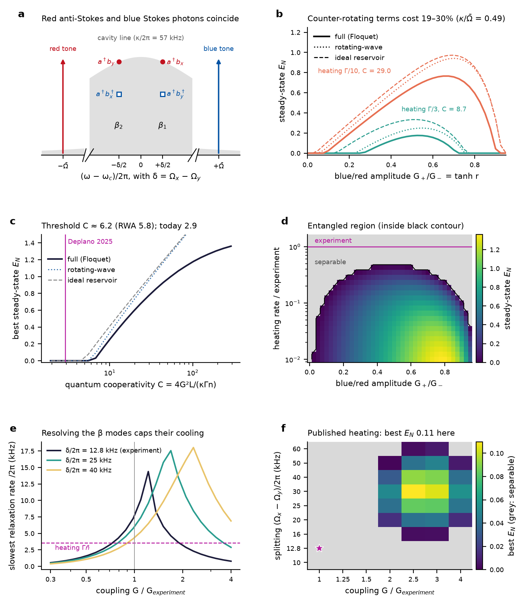
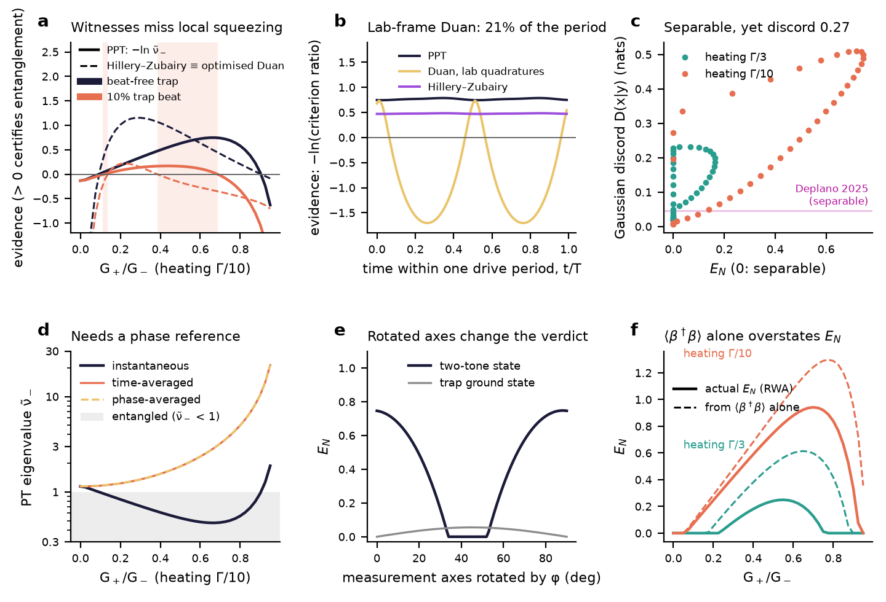
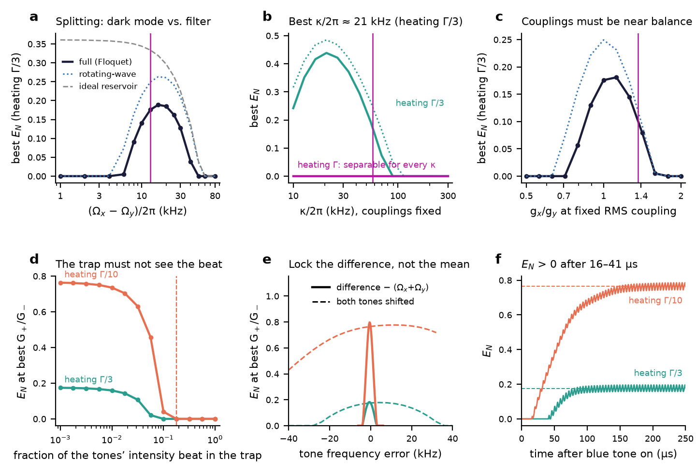

# Steady-state entanglement of a particle's two transverse motions with a two-tone coherent-scattering drive

**Question.** Can the $`x`$ and $`y`$ centre-of-mass motions of one levitated nanoparticle, coupled to one cavity mode by coherent scattering (CS), be entangled in the steady state? Starting from the parameters Deplano et al. measured in 2025 [1], this note works through the two-tone scheme step by step. It covers why the scheme works, what limits it, which entanglement measure to use and why the alternatives fail, and what would have to change in the experiment.

**Short answer.**

- One tweezer tone cannot do it. The $`x`$–$`y`$ state stays separable at the published parameters (smallest partially transposed symplectic eigenvalue $`\tilde\nu_- = 2.00`$), and it stays separable even with all thermal heating removed ($`\tilde\nu_- = 1.03`$).
- Adding a blue tone at $`\omega_c + \bar\Omega`$ next to the red one at $`\omega_c - \bar\Omega`$, with $`\bar\Omega = (\Omega_x + \Omega_y)/2`$, turns the cavity into a two-mode-squeezed reservoir for $`x`$ and $`y`$. The ideal steady state is a two-mode squeezed vacuum with $`E_N = 2r`$, where $`\tanh r = G_+/G_-`$.
- **At the published parameters it still does not entangle**: the quantum cooperativity there is $`C = 2.9`$. In the full model (all counter-rotating terms kept) the threshold is $`C \approx 6.2`$, i.e. the published heating rates divided by **2.1** (by 2.4 with the published, unbalanced couplings). At a third of the heating the best value is $`E_N = 0.18`$; at a tenth it is $`E_N = 0.77`$.
- Lowering the heating is the only single knob that works. At the published heating, no cavity linewidth in 10–300 kHz and no coupling up to 4× entangles. This is because the two Bogoliubov modes must stay spectrally resolved, which caps their cooling rate at roughly the $`x`$–$`y`$ splitting $`\delta`$. Raising $`\delta`$ to about 30 kHz *together with* 2.5× the coupling gives $`E_N = 0.11`$.
- Three requirements are specific to CS, because the drive is also the trap:
  - The trap must see less than about 3% of the two tones' intensity beat; at 18% the trap goes parametrically unstable.
  - The tones' frequency *difference* must match $`\Omega_x + \Omega_y`$ to within about 2 kHz, whereas their common frequency tolerates shifts of ±20 kHz.
  - Verification needs a phase reference locked to the tones, because without one the state looks separable.
- Use the logarithmic negativity from the PPT criterion. For two-mode Gaussian states it is necessary and sufficient, it is an entanglement monotone, and it does not depend on a choice of quadratures. The common alternatives fail for these states in specific, demonstrable ways (§3).

Everything below is computed with levisim by [`make_figures.py`](make_figures.py) (about 2 minutes). The numbers quoted are read from [`results.json`](results.json).

### Contents
1. [Model and parameters](#1-model-and-parameters)
2. [The argument, step by step](#2-the-argument-step-by-step)
3. [Which entanglement measure, and why the others fail](#3-which-entanglement-measure-and-why-the-others-fail)
4. [Practical requirements](#4-practical-requirements)
5. [Results at a glance](#5-results-at-a-glance)
6. [What this study does not include](#6-what-this-study-does-not-include)
7. [Code map](#7-code-map)
8. [References](#8-references)

---

## 1. Model and parameters

The linearised CS Hamiltonian is levisim's usual one (§ "Notes on notation" in the top-level README), with one cavity mode and the two transverse dimensions of one trap:

```math
\hat H/\hbar = -\Delta\,\hat a^\dagger\hat a + \sum_{j=x,y}\Omega_j\,\hat b_j^\dagger\hat b_j - \sum_{j=x,y}\left(G_j\hat a^\dagger + G_j^*\hat a\right)\left(\hat b_j + \hat b_j^\dagger\right)
```

The cavity decays at $`\kappa`$ (FWHM). Each motion is heated at $`\Gamma_j\bar n_j`$ phonons per second. With several tweezer tones, `MultiToneDrive` moves to the frame of the cavity resonance. There, every coupling $`G_j`$ picks up the common time dependence $`f(t) = \sum_k c_k e^{i\vartheta_k}e^{-i\Delta_k t}`$, and the covariance matrix is propagated exactly over one period. This is a Floquet treatment of the Lyapunov equation, with every counter-rotating term kept. For insight and fast scans, a time-independent rotating-wave (RWA) model is used alongside it.

| Deplano et al. 2025, Table 1 [1] | value / 2π |
|---|---|
| $`\Omega_x`$, $`\Omega_y`$ | 122.17 kHz, 109.37 kHz (so $`\bar\Omega`$ = 115.77 kHz, $`\delta = \Omega_x-\Omega_y`$ = 12.8 kHz) |
| $`g_x`$, $`g_y`$ | 14.13 kHz, 10.37 kHz (RMS 12.39 kHz, used for "balanced" couplings) |
| decoherence $`\Gamma_x\bar n_x`$, $`\Gamma_y\bar n_y`$ | 4.03 kHz, 3.05 kHz (fitted totals) |
| $`\kappa`$, $`\Delta`$ | 57 kHz, −111 kHz ($`\kappa/\bar\Omega`$ = 0.49: sidebands are *not* resolved) |

levisim's bath is gas damping at temperature $`T`$, so the fitted decoherence is reproduced as $`\Gamma_j = \Gamma_{\mathrm{dec},j}/\bar n_j(300\,\mathrm{K})`$. With levisim's own single-tone drift matrix this reproduces the published state: the covariance diagonal is within 1%, the purity is 0.209, and the Gaussian discords are 0.0425/0.0472 against the published 0.0423/0.0471 (`test_single_tone_steady_state_reproduces_deplano2025`). "Heating Γ/3" below means both decoherence rates divided by 3, whatever their physical origin. Throughout, the total tweezer power is fixed ($`c_-^2 + c_+^2 = 1`$), so adding blue power removes red power and the trap frequencies do not change.

## 2. The argument, step by step



### Step 1 — One tone exchanges phonons; it does not create pairs

With one red-detuned tone, the cavity mediates two kinds of $`x`$–$`y`$ process.

- **Exchange**, $`\hat b_x^\dagger\hat b_y`$: an $`x`$ phonon becomes a $`y`$ phonon. This costs $`\hbar\delta`$, which the cavity line easily supplies.
- **Pair creation**, $`\hat b_x^\dagger\hat b_y^\dagger`$: this costs $`\hbar(\Omega_x+\Omega_y)`$. A single tone can supply it only through its Stokes sideband, at $`\omega_L - \Omega_j`$, which lies $`2\bar\Omega`$ from the cavity resonance. That sideband is suppressed by the Lorentzian factor $`1/(1+(4\bar\Omega/\kappa)^2) = 0.015`$.

Without pair creation the dynamics conserve phonon number. The steady state then has no anomalous moments ($`\langle\hat b_x\hat b_y\rangle = 0`$), its covariance matrix satisfies $`V \ge \mathbb 1`$, and such a state has a positive Glauber–Sudarshan $`P`$ function, so it is separable. The small pair-creation term that remains is inseparable from the Stokes heating that comes with it, so it never wins. In levisim, a single tone at $`\Delta = -\bar\Omega`$ gives $`\tilde\nu_- = 2.00`$ at the published parameters, 1.37 at heating Γ/3, 1.14 at Γ/10, and 1.03 with the heating essentially switched off ($`\Gamma\times10^{-6}`$). It is never below 1. The correlations the experiment did measure (discord ≈ 0.04) are exchange correlations of a separable state; see §3.

### Step 2 — A second tone makes pair creation resonant, and indistinguishable from cooling

Put the red tone at $`\omega_c - \bar\Omega`$ and a blue tone at $`\omega_c + \bar\Omega`$. Each process then emits its photon at one of two frequencies, panel (a):

| process | emitted photon | lands at |
|---|---|---|
| red tone, anti-Stokes, **annihilates** an $`x`$ phonon | $`\omega_c - \bar\Omega + \Omega_x`$ | $`\omega_c + \delta/2`$ |
| blue tone, Stokes, **creates** a $`y`$ phonon | $`\omega_c + \bar\Omega - \Omega_y`$ | $`\omega_c + \delta/2`$ |
| red tone, anti-Stokes, annihilates a $`y`$ phonon | | $`\omega_c - \delta/2`$ |
| blue tone, Stokes, creates an $`x`$ phonon | | $`\omega_c - \delta/2`$ |

Both photons sit inside the cavity line. A photon leaving at $`\omega_c + \delta/2`$ does not reveal whether an $`x`$ phonon was removed or a $`y`$ phonon was added. Because the two histories are indistinguishable, the cavity's decay does not act on $`\hat b_x`$ or $`\hat b_y^\dagger`$ separately, but on their coherent superposition:

```math
\hat\beta_1 \propto c_-G_x\,\hat b_x + c_+G_y\,\hat b_y^\dagger, \qquad \hat\beta_2 \propto c_-G_y\,\hat b_y + c_+G_x\,\hat b_x^\dagger .
```

This is the reservoir-engineering scheme of Woolley and Clerk [2], which has been used to entangle a pair of microwave drum resonators [3]. Related two-tone schemes have done the same [4, 5]. The new elements here are that the two "resonators" are two directions of motion of the same particle, and that the tones are tweezer tones, which also form the trap (Step 8).

### Step 3 — In the rotating frame the cavity sees two Bogoliubov modes

In the frame rotating at $`\bar\Omega`$ for both motions, dropping terms that oscillate at $`2\bar\Omega`$, and for balanced couplings ($`G_x = G_y = G`$, $`G_\mp = c_\mp G`$):

```math
\hat H_{\mathrm{RWA}}/\hbar = \tfrac{\delta}{2}\left(\hat b_x^\dagger\hat b_x - \hat b_y^\dagger\hat b_y\right) - \left[\hat a^\dagger\left(G_-(\hat b_x + \hat b_y) + G_+(\hat b_x^\dagger + \hat b_y^\dagger)\right) + \mathrm{h.c.}\right].
```

With $`\tanh r = G_+/G_-`$, $`G_{\mathrm{eff}} = \sqrt{G_-^2 - G_+^2}`$, and the Bogoliubov modes $`\hat\beta_1 = \cosh r\,\hat b_x + \sinh r\,\hat b_y^\dagger`$, $`\hat\beta_2 = \cosh r\,\hat b_y + \sinh r\,\hat b_x^\dagger`$, this becomes exactly

```math
\hat H_{\mathrm{RWA}}/\hbar = \tfrac{\delta}{2}\left(\hat\beta_1^\dagger\hat\beta_1 - \hat\beta_2^\dagger\hat\beta_2\right) - G_{\mathrm{eff}}\left[\hat a^\dagger(\hat\beta_1 + \hat\beta_2) + \mathrm{h.c.}\right].
```

This holds because $`\hat n_x - \hat n_y`$ commutes with the two-mode squeezer. The result is formally ordinary two-dimensional sideband cooling, with the Bogoliubov modes in place of $`x`$ and $`y`$. The blue tone must be weaker than the red one: for $`G_+ \ge G_-`$, $`\hat\beta`$ is no longer an annihilation operator, the cavity amplifies instead of cooling, and there is no steady state (`test_blue_tone_stronger_than_red_amplifies`).

### Step 4 — Cooling the Bogoliubov modes prepares a two-mode squeezed vacuum

The cavity is a zero-temperature bath, so it drives $`\hat\beta_1`$ and $`\hat\beta_2`$ towards their joint vacuum. The unique state annihilated by both is the two-mode squeezed vacuum of $`x`$ and $`y`$, which has $`E_N = 2r`$. In levisim's ideal limit (heating ×10⁻⁴, resolved sidebands), $`E_N`$ = 1.097 against $`2\,\mathrm{artanh}(0.5)`$ = 1.099, with $`\langle\hat\beta^\dagger\hat\beta\rangle < 0.001`$ (`test_ideal_limit_is_the_two_mode_squeezed_vacuum`). Because this is dissipative preparation, the entanglement is a steady state: it does not decay, and it does not depend on initial conditions.

### Step 5 — The splitting is essential, and it caps the cooling rate

If $`\Omega_x = \Omega_y`$, the cavity couples only to the bright combination $`\hat\beta_1 + \hat\beta_2`$. The dark combination $`\hat\beta_1 - \hat\beta_2`$ is never cooled, and it heats to the bath: about $`10^7`$ phonons, with a Floquet multiplier of 1 and $`E_N = 0`$ (`test_degenerate_modes_leave_a_dark_bogoliubov_mode`). A tweezer's natural anisotropy breaks this degeneracy. The term $`(\delta/2)(\hat\beta_1^\dagger\hat\beta_1 - \hat\beta_2^\dagger\hat\beta_2)`$ rotates bright into dark at rate $`\delta/2`$, so both get cooled, but only if the cavity does not outpace that rotation. When the optical cooling rate $`\Gamma_c = 4G_{\mathrm{eff}}^2/\kappa`$ exceeds $`\delta`$, the dark combination is cooled only at a rate of order $`\delta^2/\Gamma_c`$. The slower of the two rates therefore peaks at roughly $`\delta`$, panel (e): its maximum is 14 kHz for $`\delta`$ = 12.8 kHz, reached at 1.2× the experimental coupling, beyond which it falls.

This is why, at the published heating, no choice of coupling (up to 4×) or of cavity linewidth (10–300 kHz) entangles at $`\delta`$ = 12.8 kHz. The published coupling already sits near the optimum $`\Gamma_c\approx\delta`$. Raising $`\delta`$ together with the coupling does help, panel (f): $`\delta`$ = 30 kHz and 2.5× the coupling give $`E_N`$ = 0.11 at the published heating. At the other extreme, a $`\delta`$ much larger than $`\kappa`$ pushes the sidebands at $`\pm\delta/2`$ out of the cavity line. At heating Γ/3, the best splitting is 16 kHz, and there is no entanglement for $`\delta \le 4`$ kHz or $`\ge 50`$ kHz ([constraints](#4-practical-requirements), panel a).

### Step 6 — The noise penalty, and the threshold cooperativity

Thermal noise on $`x`$ and $`y`$ reaches the Bogoliubov modes amplified: $`\hat\beta_1`$ collects $`\cosh^2 r`$ of $`x`$'s heating and $`\sinh^2 r`$ of $`y`$'s, $`\cosh 2r`$ in total. At fixed total power the cooling rate also falls: $`G_{\mathrm{eff}}^2 = G^2(c_-^2 - c_+^2) = G^2/\cosh 2r`$. The clean way to combine the two effects is to note that the engineered dissipator damps $`x`$ and $`y`$ towards the two-mode squeezed vacuum, $`\dot V = -\Gamma_c(V - V_{\mathrm{TMS}}) + 2\Gamma\bar n\,\mathbb 1`$. Its steady state is $`V = V_{\mathrm{TMS}}(r) + 2n_{\mathrm{add}}\mathbb 1`$ with $`n_{\mathrm{add}} = \Gamma\bar n/\Gamma_c = \cosh(2r)/C`$, which gives

```math
\tilde\nu_- = e^{-2r} + \frac{2\cosh 2r}{C}, \qquad C = \frac{4G^2}{\kappa\,\Gamma\bar n}\,\frac{1}{1+(\delta/\kappa)^2}.
```

Optimising over $`r`$ gives $`e^{4r^*} = 1 + C`$ and

```math
E_N^* = \ln\frac{C}{2\sqrt{1+C}} \quad\Rightarrow\quad C_{\mathrm{th}} = 2 + 2\sqrt2 \approx 4.83,
```

so $`E_N^* \approx \tfrac12\ln(C/4)`$ at large $`C`$: each factor $`e^2 \approx 7.4`$ in cooperativity buys one nat. If the blue tone is instead *added* on top of an unchanged red tone, $`n_{\mathrm{add}} = \cosh^2 r/C`$, $`E_N^* = \ln[C/(1+\sqrt{1+2C})]`$, and $`C_{\mathrm{th}} = 4`$ exactly. In CS that option also changes the trap, which the fixed-power convention avoids.

A tempting shortcut is to treat $`\hat\beta_{1,2}`$ as independent thermal modes, read off $`n_\beta = \langle\hat\beta^\dagger\hat\beta\rangle`$, and write $`E_N = 2r - \ln(2n_\beta+1)`$. That is wrong, because the $`\hat\beta`$ noise is correlated (it is the image of *uncorrelated* $`x`$, $`y`$ noise). The shortcut overstates $`E_N`$, for example 1.29 against the true 0.84 at heating Γ/10 and $`G_+/G_-`$ = 0.8; see §3, panel (f) of the measures figure.

### Step 7 — What the full model adds: counter-rotating terms and unequal couplings

The RWA drops the red tone's Stokes and the blue tone's anti-Stokes sidebands near $`\omega_c \mp 2\bar\Omega`$. With $`\kappa/\bar\Omega`$ = 0.49 they are suppressed but not absent. In the full Floquet model they cost **19–30%** of the RWA entanglement at heating Γ/3 to Γ/10 (panel b), and more at large $`C`$: at $`C`$ = 290 the RWA gives 2.13 but the full model only 1.36, because this noise does not shrink with the heating. When the sidebands are resolved ($`\Omega\times10`$, $`\kappa/\bar\Omega`$ = 0.05), RWA and Floquet agree to 1% (`test_rwa_is_exact_when_sidebands_are_resolved`), so the gap is entirely these terms. The counter-rotating terms also make the steady state periodic: at Γ/10, $`E_N`$ oscillates between 0.744 and 0.786 over the drive period.

Unequal couplings spoil the indistinguishability of Step 2. $`\hat\beta_1`$ then corresponds to squeezing $`\tanh r_1 = c_+G_y/(c_-G_x)`$, while $`\hat\beta_2`$ corresponds to $`\tanh r_2 = c_+G_x/(c_-G_y)`$. No single two-mode squeezed vacuum is annihilated by both, so the steady state is a compromise. At heating Γ/3, the best $`E_N`$ is 0.181 at $`g_x/g_y`$ ≈ 1.12. Half of that is lost at 0.84 or 1.39. The published 1.36 gives 0.10 instead of the balanced 0.18, and it raises the threshold from heating ÷2.14 to ÷2.38. In this geometry the ratio is set by the orientation of the tweezer polarisation relative to the cavity axis. That orientation also sets the overall scattering into the cavity, so balancing the couplings is not entirely free; that trade-off is not modelled here.

### Step 8 — The CS-specific obstacle: the drive is the trap

In membrane and microwave experiments, the tones drive the cavity. In CS the tones *are* the tweezer, and two co-propagating tones of the same polarisation interfere in intensity at their difference frequency, $`2\bar\Omega = \Omega_x + \Omega_y`$. That modulates both trap stiffnesses near $`2\Omega_j`$, i.e. at parametric resonance. In the rotating frame this is a local squeezing term $`\hat b_j^2`$ for each motion. For co-polarised tones at $`G_+/G_-`$ = 0.525, the stiffness modulation depth is 82%, far beyond the instability. `MultiToneDrive(beat_visibility=v)` scales the beat seen by the trap ($`v`$ = 1 means co-polarised, $`v`$ = 0 a perfectly suppressed beat); the results are in panel (d) of the constraints figure. The trap becomes unstable at $`v \ge 0.18`$. Entanglement survives only for $`v \lesssim 0.03`$: at heating Γ/3, $`E_N`$ is 0.159 at $`v`$ = 0.01, 0.107 at 0.032, 0.021 at 0.056, and 0 at 0.1.

Orthogonally polarised tones remove the interference term in the paraxial approximation. Two things are not computed here. First, how much residual beat the cross-polarised and longitudinal focal fields of a high-NA tweezer leave; it is plausibly at the percent level, which is exactly where it starts to matter. Second, how an orthogonally polarised second tone changes the trap anisotropy ($`\delta`$) and its own scattering into the cavity mode. This step is the main open engineering question for the scheme.

**Follow-up:** [`polarisation_and_two_particles.md`](polarisation_and_two_particles.md) works both out from the focal field. Orthogonal tones leave no intensity beat at any NA. What is left is a *polarisation* beat, which in the rotating frame is a resonant two-mode squeezing term. Despite a 40% smaller splitting, that term entangles more than the beat-free drive assumed here: $`E_N`$ = 0.40 at Γ/3 and a threshold of heating ÷1.5, at θ = 45° with a 1 kHz stability margin.

### Step 9 — Building up the entanglement

Starting from the red-only cooled state and switching the blue tone on (panel f of the constraints figure), $`E_N`$ becomes positive after 16 μs (heating Γ/10) or 41 μs (Γ/3), and reaches 90% of its steady value after about 100 μs or 70 μs respectively. These are a few inverse Bogoliubov cooling times. The single-mode occupation *rises* while this happens, from 0.09 to 1.0 phonons at Γ/10, because each half of a two-mode squeezed state is locally thermal. An entangled two-tone state therefore looks *hotter* to a single-mode thermometry measurement than the ground-state-cooled one it came from.

## 3. Which entanglement measure, and why the others fail



The states are Gaussian, because the dynamics are linear and the noise is Gaussian, and the first moments are irrelevant to entanglement. So everything is in the 4×4 covariance matrix $`V`$ of $`(X_x, P_x, X_y, P_y)`$ (with vacuum $`= \mathbb 1`$).

**Choice: PPT, quantified by the logarithmic negativity.** Partially transposing a Gaussian state flips $`P_x \to -P_x`$. For two modes the state is entangled **if and only if** the smallest symplectic eigenvalue $`\tilde\nu_-`$ of the transposed matrix is below 1 [6]. The quantifier is

```math
E_N = \max(0, -\ln\tilde\nu_-) \quad\text{(nats; divide by ln 2 for ebits)}.
```

- It is an entanglement monotone [7] and an upper bound on the distillable entanglement [12].
- It is invariant under local unitaries. Hence it does not depend on which quadratures one looks at, and it is constant over the drive period in the RWA.
- It is computable in closed form, and it is the standard quantity in optomechanics, so these numbers can be compared directly with the literature.
- For the target state it is simply $`2r`$.

`levisim.analysis.gaussian_states.log_negativity` implements it. `negativity`, $`(1/\tilde\nu_- - 1)/2`$, is a monotonic function of it and carries the same information.

**Why not the alternatives.** Each failure below is shown on the actual two-tone states, or pinned in `tests/test_gaussian_states.py`.

| quantity | why it does not do the job here |
|---|---|
| **Duan criterion in lab quadratures** [8] | Only sufficient, and it depends on which quadratures are combined. The two-tone state's pair correlation rotates at $`\Omega_x+\Omega_y`$ in the lab frame, so a fixed-quadrature test certifies the Γ/10 state for only **21%** of each drive period, while $`\tilde\nu_-`$ stays between 0.456 and 0.475 (panel b). |
| **Duan, optimised over local phases and weight** | Still only sufficient. It is *exactly* the Hillery–Zubairy test. With $`u = aX_x + X_y/a`$, $`v = aP_x - P_y/a`$, one has $`\mathrm{Var}\,u + \mathrm{Var}\,v = a^2(4n_x+2) + (4n_y+2)/a^2 + 8\,\mathrm{Re}(\langle\hat b_x\hat b_y\rangle e^{-i\theta})`$. This contains neither local squeezing nor the exchange correlation $`\langle\hat b_x^\dagger\hat b_y\rangle`$, and minimising over $`\theta`$ and $`a`$ gives entanglement iff $`|\langle\hat b_x\hat b_y\rangle|^2 > n_xn_y`$ (`test_optimised_duan_and_hillery_zubairy_are_the_same_test`). For beat-free two-tone states, which are close to symmetric two-mode squeezed thermal states, it agrees with PPT. With a 10% trap beat, which adds local squeezing, PPT certifies $`G_+/G_-`$ = 0.125–0.675 but this test only 0.15–0.375 (panel a, shaded). (Duan's criterion becomes necessary only after local squeezing brings the state to standard form [8], and then it is equivalent to PPT.) |
| **Hillery–Zubairy** [9] | As above: sufficient only, and blind to entanglement that local squeezing hides. Its advantage is phase insensitivity: it is constant over the period (1.60–1.62), and it needs only the reference *frequency*, not a calibrated phase. |
| **Gaussian quantum discord** [10] | Positive for every correlated non-product state, separable ones included. Separable two-tone states here reach $`D(x\vert y)`$ = **0.27**, while an entangled one has 0.016 ($`E_N`$ = 0.013) (panel c). The value Deplano et al. measured, 0.042–0.047, belongs to a separable state ($`\tilde\nu_-`$ = 2.0). Gaussian discord above 1 does imply entanglement [10], but every state in this study is below 1, where discord is inconclusive. |
| **Mutual information** | Counts all correlations, classical ones included: 0.93 nats in a separable state (heating Γ/3, $`G_+/G_-`$ = 0.8). |
| **Entropy of entanglement** | A measure only for pure states. The entangled states here have purity 0.1–0.7 (0.31 and 0.39 at the best $`G_+/G_-`$ for heating Γ/3 and Γ/10). |
| **Entanglement of formation** | A closed Gaussian form exists only for symmetric states [11]. These states are not symmetric ($`\Omega_x\ne\Omega_y`$, $`\Gamma_x\ne\Gamma_y`$), so it would need a numerical optimisation, which in general yields only an upper bound. It adds nothing to the question of whether entanglement is present. |
| **Purity, occupations, effective temperature** | Not tied to the $`x`$/$`y`$ partition. Low occupation is neither necessary (an entangled state here has $`n_x`$ ≈ 1) nor sufficient (the single-tone state has $`n_x`$ = 0.55 and is separable). |
| **Bogoliubov occupations $`\langle\hat\beta^\dagger\hat\beta\rangle`$** | They ignore the correlations between the $`\hat\beta`$ noises (Step 6), and so overstate $`E_N`$: at heating Γ/10 and $`G_+/G_-`$ = 0.9 they predict 0.96 against the true 0.34 (panel f). |
| **A time- or phase-averaged covariance matrix** | Averaging over the drive period, or over an unknown common phase, erases the pair correlation, so the state looks separable: $`\tilde\nu_-`$ 0.48 → 3.2 at heating Γ/10, $`G_+/G_-`$ = 0.7 (panel d; `test_entanglement_needs_a_phase_reference`). This is a measurement requirement as much as a measure problem: demodulate with references derived from the tones themselves. |
| **Motion along rotated axes** | "$`x`$–$`y`$ entanglement" is only defined relative to a partition. Along axes rotated by 45°, the trap ground state looks entangled ($`E_N = \tfrac12\ln(\Omega_x/\Omega_y)`$ = 0.055) because the two zero-point widths differ, while the two-tone state looks separable, since its correlations become local squeezing of the rotated modes (panel e). The physically meaningful partition is the trap's principal axes. |

## 4. Practical requirements



Panels (a)–(c) are at heating Γ/3 and are covered in Steps 5 and 7. They give the best splitting (16 kHz), the best linewidth ($`\kappa`$/2π ≈ 21 kHz with fixed couplings, $`E_N`$ = 0.44), and the coupling balance. At the published heating, no $`\kappa`$ in 10–300 kHz entangles. Panel (d) is the trap beat (Step 8) and panel (f) the build-up (Step 9).

**Panel (e): lock the tones' difference frequency.** The tones' difference must equal $`\Omega_x + \Omega_y`$. If it is off by $`2\epsilon`$, the photons of Step 2 are no longer degenerate. In the rotating frame this adds $`-\epsilon(\hat n_x + \hat n_y)`$, which in the Bogoliubov basis contains a pair-creation term $`\epsilon\sinh 2r\,(\hat\beta_1\hat\beta_2 + \mathrm{h.c.})`$ that the cavity has to outpace. Half of $`E_N`$ is lost at a difference error of −2.4 or +1.5 kHz (heating Γ/10; −2.9/+1.7 kHz at Γ/3). The optimum sits about 0.5 kHz below $`\Omega_x + \Omega_y`$, because the optical spring shifts the frequencies. Since $`\Omega \propto \sqrt P`$, a 1% drift in tweezer power moves $`\Omega_x+\Omega_y`$ by 1.2 kHz. So either the power is stabilised to a few 0.1%, or the difference frequency (which, for AOM-generated tones, is an RF frequency) is servoed to the measured mode frequencies. Moving *both* tones together, i.e. the cavity drifting relative to the laser, only slides the sidebands within the cavity line. Half of $`E_N`$ is lost only after −18/+26 kHz at Γ/3, and at Γ/10 beyond −40 kHz, with the drive becoming unstable above +34 kHz. The relative optical phase of the two tones does not matter for $`E_N`$ (it is a local rotation; `test_entanglement_does_not_depend_on_the_relative_tone_phase`), but it must be stable during a measurement and known to whoever demodulates.

**Verifying it.** Reconstruct the rotating-frame covariance matrix from demodulated $`x`$ and $`y`$ quadratures, with local oscillators phase-locked to the tones, and compute $`\tilde\nu_-`$. With detection efficiency 0.32 [1], the detection noise must be calibrated and subtracted, and errors in that calibration push the inferred $`\tilde\nu_-`$ in either direction. A model-based reconstruction from the cavity-output spectrum, as used for the published state, assumes the model being tested. A model-independent test needs time-domain access to both motions.

## 5. Results at a glance

Couplings are balanced unless stated; full Floquet model; best $`G_+/G_-`$ in each case.

| situation | result |
|---|---|
| one tone, published parameters | $`\tilde\nu_-`$ = 2.00: separable |
| one tone, heating switched off | $`\tilde\nu_-`$ = 1.03: separable |
| two tones, published parameters ($`C`$ = 2.9) | $`E_N`$ = 0 for every $`G_+/G_-`$ |
| threshold: ideal reservoir / RWA / full model | $`C`$ = 4.83 / 5.85 / 6.21, i.e. heating ÷1.67 / 2.02 / 2.14 |
| threshold with the published couplings ($`g_x/g_y`$ = 1.36) | heating ÷2.38 ($`C`$ = 6.91) |
| heating Γ/3 ($`C`$ = 8.7) | $`E_N`$ = 0.18 at $`G_+/G_-`$ = 0.525 (RWA 0.25, ideal 0.33); published couplings 0.10 |
| heating Γ/10 ($`C`$ = 29) | $`E_N`$ = 0.77 at 0.675 (RWA 0.94, ideal 0.97); published couplings 0.61 |
| published heating, other knobs | separable for any $`\kappa`$ (10–300 kHz) or coupling (≤ 4×); $`\delta`$ = 30 kHz with 2.5× coupling gives 0.11 |
| trap beat | $`v \lesssim 0.03`$ needed; unstable for $`v \ge 0.18`$ |
| tone difference vs. common shift | half-$`E_N`$ window −2.4…+1.5 kHz vs. ≈ ±20–35 kHz |
| build-up after switching on the blue tone | $`E_N`$ > 0 after 16–41 μs; 90% after 70–100 μs |

## 6. What this study does not include

- **Linearised Gaussian dynamics of two modes.** The $`z`$ motion, which the experiment also sees, and the particle's rotation are left out. So are nonlinear trap terms, and the dependence of $`G_j`$ and of $`\Omega_j`$ on each tone's polarisation.
- **Heating as fitted totals.** "Γ/3" does not say how to get there. If photon recoil dominates, then both $`G^2`$ and the recoil rate scale with tweezer power, so neither more power nor lower pressure raises $`C`$. The gain would have to come from the cavity (smaller mode volume) or from a larger splitting (Step 5).
- **The residual beat for orthogonally polarised tones** at high NA is not computed here (Step 8); the main results assume $`v = 0`$. [`polarisation_and_two_particles.md`](polarisation_and_two_particles.md) computes it, along with mech-mech coupling, the node position and a second particle.
- **Laser phase noise and tone phase noise** are not modelled beyond what the fitted $`\Gamma_j`$ already contain. Relative phase jitter between the tones acts like the phase averaging in §3.
- **Detection** is idealised: the covariance matrix is assumed known. Conditional (filtered) states, which can do better, are not considered here.
- **Uncertainties.** The thresholds scale as $`C \propto g^2/\Gamma`$. With the published uncertainties (±1.6% on $`g`$, ±5% on $`\Gamma`$), they are uncertain at roughly the ±6–10% level.

## 7. Code map

| what | where |
|---|---|
| Gaussian-state toolkit: PPT, $`E_N`$, discord, Duan, Hillery–Zubairy, phase averaging, rotated axes | `levisim/analysis/gaussian_states.py` |
| Real (quadrature) drift/diffusion matrices and the Lyapunov steady state of any `MultiTrap` | `levisim/multiphysics/covariance.py` |
| Several tweezer tones: exact periodic steady state (Floquet), time evolution, trap beat | `levisim/multiphysics/multitone.py` (`Tone`, `MultiToneDrive`) |
| The two-tone scheme: Deplano 2025 parameters, Floquet and RWA steady states, Bogoliubov modes, cooperativity, analytic estimate | `levisim/multiphysics/two_tone.py` |
| Tests (closed-form limits, published data, every claim above that has a test name) | `tests/test_gaussian_states.py`, `tests/test_two_tone.py` |
| This study | `docs/two_tone_entanglement/make_figures.py [--plot-only]` |
| Tones' polarisations, cavity geometry and node position; a second tweezer (follow-up study) | `levisim/physics/focal_expansion.py`, `levisim/multiphysics/two_tone_traps.py`, `docs/two_tone_entanglement/polarisation_and_two_particles.py` |

```python
from levisim.multiphysics.two_tone import deplano2025_multitrap, two_tone_steady_state
mtrap = deplano2025_multitrap(Γ_scale=1/3, balanced=True)   # published parameters, heating ÷ 3
print(two_tone_steady_state(mtrap, ratio=0.525).summary_str)  # E_N ≈ 0.18
```

## 8. References

1. M. Deplano, F. Pontin, A. Ranfagni, F. Marino, F. Marin, *High purity two-dimensional levitated mechanical oscillator*, Nat. Commun. **16**, 4215 (2025).
2. M. J. Woolley, A. A. Clerk, *Two-mode squeezed states in cavity optomechanics via engineering of a single reservoir*, Phys. Rev. A **89**, 063805 (2014).
3. C. F. Ockeloen-Korppi *et al.*, *Stabilized entanglement of massive mechanical oscillators*, Nature **556**, 478 (2018).
4. S. Kotler *et al.*, *Direct observation of deterministic macroscopic entanglement*, Science **372**, 622 (2021).
5. L. Mercier de Lépinay *et al.*, *Quantum mechanics–free subsystem with mechanical oscillators*, Science **372**, 625 (2021).
6. R. Simon, *Peres-Horodecki separability criterion for continuous variable systems*, Phys. Rev. Lett. **84**, 2726 (2000).
7. M. B. Plenio, *Logarithmic negativity: a full entanglement monotone that is not convex*, Phys. Rev. Lett. **95**, 090503 (2005).
8. L.-M. Duan, G. Giedke, J. I. Cirac, P. Zoller, *Inseparability criterion for continuous variable systems*, Phys. Rev. Lett. **84**, 2722 (2000).
9. M. Hillery, M. S. Zubairy, *Entanglement conditions for two-mode states*, Phys. Rev. Lett. **96**, 050503 (2006).
10. G. Adesso, A. Datta, *Quantum versus classical correlations in Gaussian states*, Phys. Rev. Lett. **105**, 030501 (2010).
11. G. Giedke, M. M. Wolf, O. Krüger, R. F. Werner, J. I. Cirac, *Entanglement of formation for symmetric Gaussian states*, Phys. Rev. Lett. **91**, 107901 (2003).
12. G. Vidal, R. F. Werner, *Computable measure of entanglement*, Phys. Rev. A **65**, 032314 (2002).

---

*Provenance: this study and the code it uses were written by Claude (Anthropic) at Julian Iacoponi's request, in October 2026; see the note at the end of the top-level README.*
