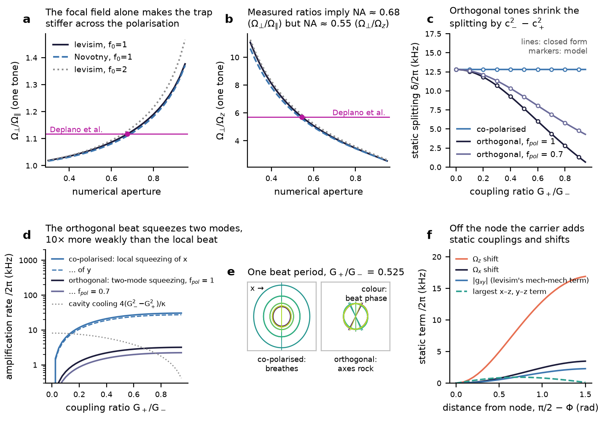
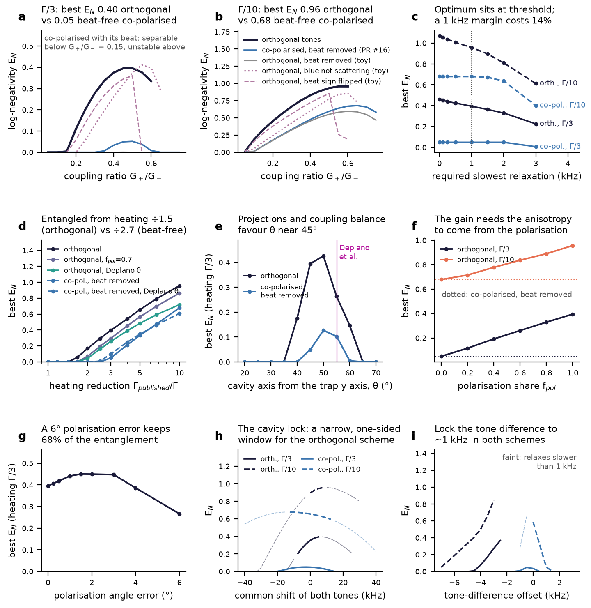
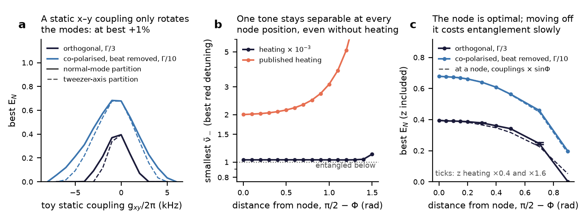
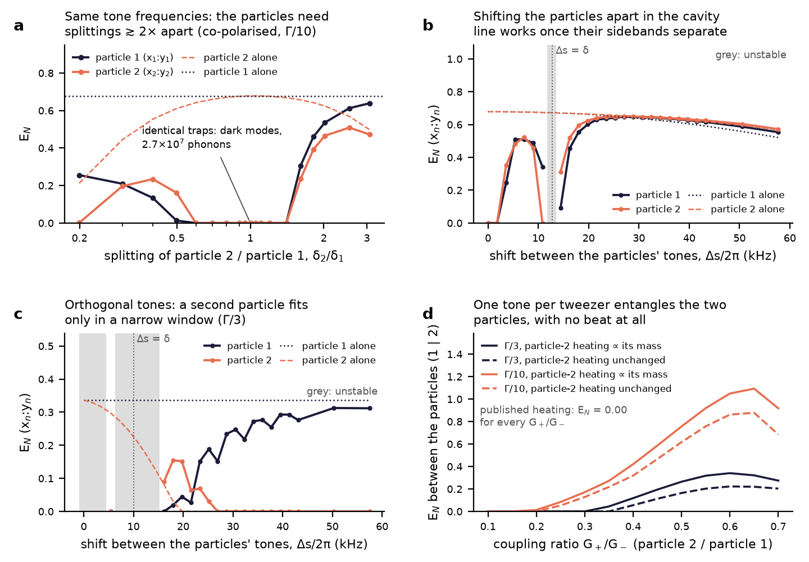

# Two-tone traps: polarisation, mech-mech coupling, the node, and a second particle

**Questions.** This note follows up the [two-tone study](README.md), whose Step 8 left the tones' polarisation open. It asks four things:

1. What happens if the red and blue tones are polarised orthogonally?
2. Does mechanical (mech-mech) coupling between $`x`$ and $`y`$ play a role? Does the particle need to sit off a node?
3. What happens with a second particle, in its own two-tone tweezer, in the same cavity?
4. How exactly is the trapping potential shaped in each case? This is answered analytically from the focal field.

Everything is computed with levisim by [`polarisation_and_two_particles.py`](polarisation_and_two_particles.py), about ten minutes on eight cores. Numbers are read from [`polarisation_results.json`](polarisation_results.json). Unless stated otherwise:

- Every steady state is the exact periodic (Floquet) solution, with all counter-rotating terms and all beats.
- Every optimum is over the coupling ratio $`G_+/G_-`$, the tone-difference offset and the common shift of the tones.
- Every optimum is restricted to operating points whose slowest $`x`$–$`y`$ Floquet mode relaxes at $`\ge 2\pi\times1`$ kHz (§2.2 explains why this matters).

### Short answers

- **The analytic trap.** To second order about the focus, two tones polarised at $`\psi_1`$, $`\psi_2`$ interfere with a stiffness
  ```math
  K(\psi_1,\psi_2) = \cos(\psi_1-\psi_2)\,\big[\bar\Omega^2\mathbb 1 + \tfrac12\Delta\Omega_s^2\,\mathrm{diag}(1,-1)\big] + \tfrac12\Delta\Omega_p^2\,\sigma(\psi_1+\psi_2),
  ```
  where $`\Delta\Omega_p^2`$ is the part of the anisotropy that rotates with the polarisation and $`\Delta\Omega_s^2`$ a fixed beam ellipticity. This holds at any NA; it follows from the Richards–Wolf integrals and rotational symmetry (§1). Two regimes follow:
  - **Co-polarised tones** beat in **intensity**. The trap *breathes* at the tones' difference frequency, which is a local squeezing drive of 25 kHz per mode.
  - **Orthogonal tones** have **no intensity beat at all**, at any NA. Instead the total field's polarisation rotates at the difference frequency, and the trap's axes *rock* with it, by $`\pm\arctan(c_+/c_-)`$ (28° at $`G_+/G_-`$ = 0.525). In the rotating frame this is a **resonant two-mode squeezing term** $`\chi(\hat b_x\hat b_y + \mathrm{h.c.})`$ with $`\chi = c_-c_+\Delta\Omega_p^2/(4\sqrt{\Omega_x\Omega_y}) \approx c_-c_+\delta/2`$. That is 2.6 kHz here: ten times weaker than the co-polarised beat, and comparable to the cavity's cooling rate (4.6 kHz).
- **Orthogonal polarisation works, but by a different mechanism.**
  - Its price is a smaller static splitting, reduced by $`c_-^2-c_+^2`$ (12.8 → 7.3 kHz at $`G_+/G_-`$ = 0.525). This alone kills the reservoir-engineering route: at heating Γ/3, $`E_N`$ = 0.0005 with the beat removed.
  - The beat's coherent two-mode squeezing more than makes up for it. At θ = 45°, $`E_N`$ = **0.40 at Γ/3** against 0.05 for an idealised beat-free co-polarised drive in the same geometry, and **0.96 at Γ/10** against 0.68.
  - The threshold drops from heating ÷2.7 to **÷1.5** (÷1.8 in Deplano et al.'s geometry). The published parameters are still not enough.
  - The blue tone's own scattering into the cavity hardly matters (0.41 without it). The entangler is the tweezer's polarisation beat, and the cavity's job is to cool.
  - Its own optimum sits on the parametric-instability threshold, which is why a stability margin is imposed throughout.
- **Mech-mech coupling.**
  - At a node, the cavity-mediated static coupling $`g_{xy}`$ (levisim's `mech_mech_coupling`, $`\propto\cos\Phi`$) is exactly zero, so it plays no role in the co-polarised scheme.
  - In the orthogonal scheme a mech-mech coupling *is* the resource. It is not the cavity's static one, but the tweezer's own x–y coupling modulated at $`\Omega_x+\Omega_y`$.
  - A static x–y coupling never gains more than 1%. It rotates the normal modes, which unbalances their couplings to the cavity. A single tone with any static coupling stays separable even without heating ($`\tilde\nu_- \ge 1.03`$).
- **The trap does not need to be off a node; the node is optimal.** $`E_N`$ falls monotonically with distance from the node: 0.40 → 0.34 at 0.5 rad → 0 at 0.9 rad (orthogonal, Γ/3). This is almost entirely because the $`x`$, $`y`$ couplings fall as $`\sin\Phi`$. The carrier field's own terms (the static $`g_{xy}`$, kHz-scale frequency shifts, coupling to $`z`$) change $`E_N`$ by at most 0.05.
- **A second particle in its own two-tone trap.**
  - Each particle scatters into the cavity at $`s_n\pm\delta_n/2`$ (common tone shift $`s_n`$, splitting $`\delta_n`$). If any two of these lines coincide, collective **dark modes** appear. With identical traps they are not cooled at all: $`2.7\times10^7`$ phonons and $`E_N`$ = 0 for every partition, at either node sign.
  - Separating the lines by more than the cooling rate recovers at least 90% of the single-particle $`E_N`$ (co-polarised, Γ/10). This needs a shift of the tone frequencies between the tweezers of $`\gtrsim`$ 20 kHz (not $`\approx\delta`$, where the inner lines collide), or splittings that differ by $`\gtrsim 2\times`$.
  - The orthogonal scheme is far more fragile: it is unstable when the particles share tone frequencies, and gives at best 0.16 and 0.22 against 0.34 alone.
  - No two-tone configuration entangles one particle with the other.
- **What a second particle is good for.** One red tone on particle 1 and one blue tone on particle 2 entangles $`x_1`$ with $`y_2`$ and $`y_1`$ with $`x_2`$, with **no beat in either tweezer**. This gives $`E_N(1|2)`$ = 0.34 at Γ/3 and 1.09 at Γ/10, and 0 at the published heating.

### Contents
1. [The trap from the focal field](#1-the-trap-from-the-focal-field)
2. [Orthogonally polarised tones](#2-orthogonally-polarised-tones)
3. [Mech-mech coupling and the node](#3-mech-mech-coupling-and-the-node)
4. [A second particle in the same cavity](#4-a-second-particle-in-the-same-cavity)
5. [Results at a glance](#5-results-at-a-glance)
6. [Assumptions and what is not included](#6-assumptions-and-what-is-not-included)
7. [Two things found in levisim along the way](#7-two-things-found-in-levisim-along-the-way)
8. [Code map](#8-code-map)

---

## 1. The trap from the focal field



**Single tone.** levisim's `FocussingOptics` evaluates the Richards–Wolf focal field by quadrature (Novotny & Hecht, §3.6). Near the focus, its Bessel integrals have Taylor coefficients that are single θ-integrals (moments) $`\langle g\rangle = \int_0^{\theta_{max}} f_w\cos^{1/2}\theta\, g\, d\theta`$. For light polarised along $`x`$,
```math
|\mathbf E|^2/|\Sigma|^2 \approx a_0^2 - k^2(\kappa_\parallel x^2 + \kappa_\perp y^2 + \kappa_z z^2),\qquad
\kappa_\parallel = \tfrac{a_0b_0}{2} - \tfrac{a_0d_0}{4} - e_0^2,\quad \kappa_\perp = \tfrac{a_0b_0}{2} + \tfrac{a_0d_0}{4},\quad \kappa_z = a_0a_2 - a_1^2,
```
with $`a_n = \langle\sin\theta(1+\cos\theta)\cos^n\theta\rangle`$, $`b_0 = \langle\sin^3\theta(1+\cos\theta)\rangle`$, $`d_0 = \langle\sin^3\theta(1-\cos\theta)\rangle`$ and $`e_0 = \langle\sin^3\theta\rangle`$. The trap is softer along the polarisation because of the longitudinal field ($`-e_0^2`$) and the cross-polarised $`I_{02}`$ term ($`\mp a_0d_0/4`$). These closed forms match finite differences of the full focal field to $`2\times10^{-4}`$ (`tests/test_focal_expansion.py`).
- Panel (a): at NA 0.775 and filling factor 1, $`\Omega_\perp/\Omega_\parallel`$ = 1.17.
- Panel (b): Deplano et al.'s two measured ratios **disagree** on the NA. $`\Omega_X/\Omega_Y`$ = 1.117 needs NA ≈ 0.68. $`\Omega_X/\Omega_Z`$ = 5.71 needs NA ≈ 0.55, where polarisation alone gives only 1.069. So either part of their anisotropy is a fixed beam ellipticity, or the axial frequency is not the ideal-focus value.

The model therefore writes the measured anisotropy as $`\Omega_\perp^2-\Omega_\parallel^2 = \Delta\Omega_p^2 + \Delta\Omega_s^2`$. $`f_{pol} = \Delta\Omega_p^2/(\Omega_\perp^2-\Omega_\parallel^2)`$ is the share that turns with the polarisation, and lies between 0.58 and 1 on this evidence.

**Two tones.** The interference term of two fields polarised at $`\psi_1`$ and $`\psi_2`$ (from $`x`$) has, at this order, the Hessian
```math
\partial^2\,\mathrm{Re}\big(\mathbf E^{(\psi_1)}\cdot\mathbf E^{(\psi_2)*}\big) \propto -\big[\cos(\psi_1-\psi_2)\,\bar\kappa\,\mathbb 1 + \tfrac12(\kappa_\perp-\kappa_\parallel)\,\sigma(\psi_1+\psi_2)\big]\ \oplus\ -\cos(\psi_1-\psi_2)\,\kappa_z,\qquad
\sigma(\Psi) = \begin{pmatrix}-\cos\Psi & -\sin\Psi\\ -\sin\Psi & \cos\Psi\end{pmatrix}.
```
This is exact for the quadratic expansion and forced by rotational symmetry. The 45°-polarised field is the $`x`$-polarised one rotated, so $`\mathbf E^{(x)}\cdot\mathbf E^{(y)*} \approx k^2(\kappa_\perp-\kappa_\parallel)\,xy`$: **a pure $`xy`$ term equal to the anisotropy**, with no $`x^2`$, $`y^2`$, $`z^2`$, $`xz`$ or $`yz`$ part. In units of measured frequencies this becomes the $`K(\psi_1,\psi_2)`$ of the short answer. For tones with amplitudes $`c_k`$ (with $`\sum|c_k|^2 = 1`$ at fixed power) and detunings $`\Delta_k`$,
```math
m^{-1}K(t) = \sum_k |c_k|^2K(\psi_k,\psi_k) + \sum_{k<l} 2\,\mathrm{Re}\big(c_kc_l^*\,K(\psi_k,\psi_l)\,e^{-i(\Delta_k-\Delta_l)t}\big).
```
| | static trap | beat at $`\Delta_r-\Delta_b = -(\Omega_x+\Omega_y)`$ | in the rotating frame |
|---|---|---|---|
| **co-polarised** ($`\psi_r=\psi_b`$) | unchanged, $`\delta`$ = 12.8 kHz | stiffness modulated by $`2c_-c_+`$ (82% at $`G_+/G_-`$ = 0.525): the trap **breathes** (panel e) | local squeezing of each mode, $`\epsilon(\hat b_j^2+\mathrm{h.c.})`$, amplification rate $`c_-c_+\Omega_j/2`$ = 25.1 kHz ($`x`$), 22.5 kHz ($`y`$) |
| **orthogonal** ($`\psi_r=\pi/2`$, $`\psi_b=0`$) | anisotropy $`\Delta\Omega_s^2 + (c_-^2-c_+^2)\Delta\Omega_p^2`$, so $`\delta`$ = 7.3 kHz ($`f_{pol}`$ = 1) or 8.9 kHz (0.7) | **no diagonal part**: only $`-c_-c_+\Delta\Omega_p^2\,xy`$; the total polarisation rotates, and the trap's axes **rock** by $`\pm\arctan(c_+/c_-)`$ = ±28° | two-mode squeezing $`\chi(\hat b_x\hat b_y+\mathrm{h.c.})`$, $`\chi = c_-c_+\Delta\Omega_p^2/(4\sqrt{\Omega_x\Omega_y})`$ = 2.6 kHz ($`f_{pol}`$ = 1), 1.8 kHz (0.7) |

Model and closed forms agree to machine precision (markers in panel c; `test_orthogonal_tones_give_the_closed_form_trap`).
- Panel (d) compares these rates with the cavity's cooling of the Bogoliubov modes, $`4(G_-^2-G_+^2)/\kappa`$ (4.6 kHz at 0.525). The co-polarised beat out-amplifies it 5-fold, which is why that trap goes unstable (PR #16, Step 8). The orthogonal one is of the same order, which is why it can be used.
- An intermediate angle mixes the two: a polarisation error η adds a diagonal beat $`\propto\sin\eta\,\bar\Omega^2`$ (§2.3).
- Each tone scatters into the cavity mode (polarisation $`\boldsymbol\varepsilon_c`$, in the focal plane, perpendicular to the cavity axis) with its own projection: $`-\sin\theta`$ for the red tone along $`y`$ and $`\cos\theta`$ for the blue one along $`x`$, θ being the angle of the cavity axis from $`y`$. The same θ sets the motional projections ($`\sin\theta`$ on $`x`$, $`\cos\theta`$ on $`y`$), so **θ = 45° balances both**.
- In Deplano et al.'s geometry (θ = 55.2°, inferred from their coupling ratio), the blue tone needs $`\tan\theta`$ = 1.44 times more amplitude per unit coupling, which costs more splitting.

**Off a node.** At cavity phase $`\Phi\neq\pi/2`$:
- The $`x`$, $`y`$ couplings fall as $`\sin\Phi`$.
- $`z`$ couples through the other quadrature ($`\propto\cos\Phi`$).
- Every tone's carrier scatters into the cavity, building a coherent field $`\alpha_l = i\omega_d(\mathbf e_l\cdot\boldsymbol\varepsilon_c)c_l\cos\Phi/(\kappa/2 - i\Delta_l)`$, with $`10^5`$ / $`9\times10^5`$ / $`2.3\times10^6`$ photons at $`\pi/2-\Phi`$ = 0.1 / 0.3 / 0.5 rad for one full-power tone.

Its interference with the tweezer adds
```math
H/\hbar \supset \mathrm{Re}[Z(t)]\big(\tfrac12\cos\Phi\,k^2(\mathbf u_c\cdot\mathbf r)^2 + \tfrac12\cos\Phi\,k_z^2z^2\big) + \mathrm{Re}[iZ(t)]\,kk_z\sin\Phi\, z\,(\mathbf u_c\cdot\mathbf r),\qquad Z(t) = \sum_{k,l}D_k\alpha_l^*e^{-i(\Delta_k-\Delta_l)t}.
```
Its static part is a **rank-one stiffness along the cavity axis**, $`\propto\mathbf u_c\mathbf u_c^{\mathsf T}`$ (`test_off_the_node_the_carrier_adds_a_rank_one_stiffness`). Its $`xy`$ entry is levisim's mech-mech coupling $`g_{xy}`$ (−0.21 / −0.54 kHz at 0.3 / 0.5 rad). It comes with frequency shifts of the same size: $`\Omega_x`$ +0.29 / +0.76 kHz, roughly $`\tan\theta`$ times $`|g_{xy}|`$, and $`\Omega_z`$ +2.0 / +4.9 kHz. There are also static $`x`$–$`z`$, $`y`$–$`z`$ terms of up to 0.8 kHz, and copies of all of it modulated at the tones' difference frequency (panel f).

**Two tweezers.** Two separate foci do not interfere at either particle, so at their nodes there is no cross-potential at all. The particles interact only through the cavity's fluctuations, which the Floquet model includes exactly. Off a node, each particle's carrier field acts on the other only through linear forces, i.e. displacements, which do not affect the covariance matrix.

## 2. Orthogonally polarised tones



### 2.1 What it gives

At θ = 45° and $`f_{pol}`$ = 1 (panels a, b):

| | heating Γ/3 | heating Γ/10 |
|---|---|---|
| **orthogonal tones** | **0.40** ($`G_+/G_-`$ = 0.50) | **0.96** (0.55) |
| co-polarised, beat removed (PR #16's idealisation $`v`$ = 0) | 0.05 (0.50) | 0.68 (0.65) |
| co-polarised, with its beat (the real thing) | separable for $`G_+/G_-\le0.1`$, unstable from 0.15 | same |
| orthogonal, beat removed (toy) | 0.0005 | 0.60 |
| orthogonal, blue tone not scattering (toy) | 0.41 | 0.85 |
| orthogonal, beat sign reversed (toy) | 0.36 | 0.85 |

The three toys take the scheme apart:
- **Without its beat**, the orthogonal scheme is a co-polarised one with a 40% smaller splitting. That pushes the Bogoliubov modes into the resolution limit of PR #16 Step 5: almost nothing survives at Γ/3.
- **Without the blue tone's scattering into the cavity**, nothing is lost at Γ/3 and 11% at Γ/10. So this is not reservoir engineering any more: the polarisation beat squeezes $`x`$ and $`y`$ coherently, and the red tone's cavity cooling keeps the squeezing below threshold.
- **With the beat's sign reversed** (the relative sign of the beat and the couplings is fixed by geometry, so this is a check on the model rather than an option), the optimum moves to the mirror-image common shift and $`E_N`$ drops by only 10%. The gain does not hinge on that sign. The relative optical phase of the tones still drops out exactly (`test_orthogonal_entanglement_does_not_depend_on_the_relative_tone_phase`).

### 2.2 Why a stability margin

Left unconstrained, the optimiser parks the orthogonal scheme **on its parametric threshold**. Every optimum has a Floquet multiplier $`|\mu|`$ = 0.99999–0.999999 per 8.6 μs period, i.e. relaxation times of seconds. There $`E_N`$ is largest (0.46 at Γ/3, 1.07 at Γ/10), but a 0.1% power drift would make the trap unstable, and the linearised model is not trustworthy that close to threshold. The beat-free co-polarised optima relax at 0.9–2.4 kHz without any constraint.

So every optimum here requires the slowest Floquet mode carrying $`x`$–$`y`$ motion to relax at $`\ge 2\pi\times1`$ kHz, i.e. in $`\le`$ 0.16 ms, comparable to the build-up times in PR #16. The cost is shown in panel (c):
- Orthogonal tones lose 14% at Γ/3 and 10% at Γ/10 with this margin, and 51% / 43% at 3 kHz.
- The co-polarised scheme loses at most 1% up to 1.5 kHz.
- **The 1 kHz margin is a judgement call.** The orthogonal numbers should be read with it in mind.

### 2.3 What it needs

- **Heating** (panel d). The orthogonal scheme first entangles at heating ÷**1.51**, against ÷**2.71** for the beat-free co-polarised drive at the same θ = 45°. For comparison, ÷2.45 at Deplano's θ = 55.2°, close to PR #16's ÷2.38 for their unbalanced couplings. With $`f_{pol}`$ = 0.7 it needs ÷1.77; at Deplano's θ, ÷1.80. **At the published heating nothing entangles.**
- **Cavity orientation** (panel e). The best is θ = 50° (0.43 at Γ/3), then 45° (0.40), 55° (0.26), 40° (0.18) and 60° (0.15); nothing at or below 35° or at or above 65°. The window is narrower than for the co-polarised drive because θ sets the dipole projections, the coupling balance and how much blue amplitude is needed.
- **The anisotropy must come from the polarisation** (panel e, f). $`E_N`$ rises linearly with $`f_{pol}`$, from 0.05 to 0.40 at Γ/3. At $`f_{pol}`$ = 0 it equals the beat-free co-polarised value, as it must: with no polarisation-dependent anisotropy there is no $`xy`$ beat and no splitting penalty. Since Deplano's data allow $`f_{pol}`$ anywhere in 0.58–1, this is the main uncertainty in the numbers above. At 0.6: 0.26 (Γ/3), 0.84 (Γ/10).
- **Polarisation purity** (panel g). A small error in the 90° between the polarisations hardly matters: $`E_N`$ = 0.39–0.45 up to 3°, 0.39 at 4° and 0.27 (68%) at 6°. This is more tolerant than PR #16's co-polarised visibility limit ($`v\lesssim0.03`$, i.e. 2° of leakage), because the strong two-mode squeezing term dominates.
- **Locks** (panels h, i).
  - The common shift of both tones (equivalently the cavity–laser detuning) has a **narrow, one-sided** window. Its optimum is at +5.6 kHz, with half of $`E_N`$ kept from −7.5 to about +6 kHz (on a 2.5 kHz grid). Above that the state relaxes ever more slowly and then goes unstable. The co-polarised drive keeps half of $`E_N`$ over ±12.5 kHz (Γ/10).
  - The tones' difference must be locked to about ±1 kHz in both schemes, as in PR #16. The optimum is 4.7 kHz below $`\Omega_x+\Omega_y`$ (orthogonal) against 0.7 kHz (co-polarised).

## 3. Mech-mech coupling and the node



**Static x–y coupling** (panel a). A toy static coupling $`H/\hbar\supset -g_{xy}X_xX_y`$, at the node, rotates the normal modes by about 4.4° per kHz and widens their splitting. Re-optimising the tones for each $`g_{xy}`$ gives:
- Co-polarised (beat removed, Γ/10): +0.7% at best (0.683 at −1 kHz against 0.678), falling to 0 beyond −8 and +6 kHz.
- Orthogonal (Γ/3): 0.40 at 0, 0.37 at −1 kHz, 0.23 at +1 kHz, and 0 beyond −4 and +3 kHz.

The rotation changes each normal mode's projection on the cavity axis, and so the coupling balance PR #16 Step 7 showed to matter. In the orthogonal scheme it also turns part of the $`xy`$ beat into local squeezing. Measured along the tweezer axes instead of the normal modes, $`E_N`$ is lower still (0.12 against 0.21 at −2 kHz). A static coupling is a passive exchange term: with one tone and essentially no heating, the state stays separable at every node position ($`\tilde\nu_-`$ = 1.032–1.12, panel b).

**The node** (panel c, with $`z`$ and the carrier field included). $`E_N`$ falls monotonically away from the node:

| distance from node, $`\pi/2-\Phi`$ (rad) | 0 | 0.3 | 0.5 | 0.7 | 0.9 |
|---|---|---|---|---|---|
| orthogonal, Γ/3 | 0.40 | 0.38 | 0.34 | 0.25 | 0.00 |
| … at the node with couplings × $`\sin\Phi`$ | 0.40 | 0.37 | 0.32 | 0.23 | 0.05 |
| co-polarised, beat removed, Γ/10 | 0.68 | 0.64 | 0.56 | 0.46 | 0.20 |
| … at the node with couplings × $`\sin\Phi`$ | 0.68 | 0.64 | 0.56 | 0.45 | 0.19 |

The dashed lines, i.e. the node with couplings reduced by $`\sin\Phi`$, show that the loss is almost entirely the weaker $`x`$, $`y`$ coupling. Everything else that comes with leaving the node changes $`E_N`$ by at most 0.05, mostly slightly upwards: $`z`$ and its coupling, the carrier's static $`g_{xy}`$, the frequency shifts, the $`x`$–$`z`$ terms and the modulated carrier terms. The answer is insensitive to the assumed $`z`$ heating: 0.38 vs 0.38 at 0.3 rad and 0.25 vs 0.24 at 0.7 rad for $`\Gamma_z`$ × 0.4 and × 1.6. **There is no reason to leave the node.**

## 4. A second particle in the same cavity



Both particles sit at nodes in their own tweezers, with the same optics and geometry. Particle $`n`$'s two tones are at $`\omega_c\mp(\bar\Omega_n+o_n)+s_n`$, so its anti-Stokes and Stokes photons, the ones that build its Bogoliubov modes, sit at $`s_n\pm\delta_n/2`$ (to within the offset $`o_n`$). Which particle scattered a photon at a given frequency is the whole story.

- **Identical traps, identical tones.** The four lines collapse onto two. Only the symmetric combinations of the two particles' Bogoliubov modes are cooled. The antisymmetric (dark) ones are heated by everything and damped by gas alone, so they settle at the 300 K occupation, $`2.6`$–$`2.9\times10^7`$ phonons ($`|\mu|`$ = 1 to $`10^{-10}`$). $`E_N`$ = 0 for every partition, at the same node or at adjacent ones, where the coupling sign flips. With orthogonal tones the drive is unstable ($`|\mu|`$ = 1.10).
- **Different splittings, same tone frequencies** (panel a, co-polarised, Γ/10). Nothing for $`\delta_2/\delta_1`$ in 0.6–1.4; occupations climb to 6 (0.9) and 18 (0.95). From $`\delta_2/\delta_1\gtrsim2`$ both recover: 0.54 / 0.47 at 2.0 and 0.64 / 0.47 at 3.0 (particle 2 alone: 0.50, its 39 kHz splitting being off-optimal). The orthogonal scheme is unstable at all 19 ratios.
- **Shifting one tweezer's tones** (panel b, co-polarised, Γ/10). The tones of the two tweezers are shifted symmetrically by Δs, e.g. with an AOM.
  - Δs ≤ 1.8 kHz: dark.
  - Δs = 5.4–9 kHz: 0.46–0.53.
  - Δs ≈ δ = 12.8 kHz: the inner lines meet again; unstable at 12.6 kHz, and 0.09 / 0.31 at 14.4 kHz.
  - Δs ≥ 20 kHz: ≥ 0.60 for both, 96% of their single-particle values at 22 kHz.

  With orthogonal tones (panel c, Γ/3, run at $`G_+/G_-`$ = 0.35 for stability margin), the drive is unstable for Δs < 16 kHz, apart from one separable point. The best case with both particles entangled is 0.16 / 0.22 at Δs ≈ 25 kHz, against 0.34 alone. Moving particle 2 far enough down to free particle 1 (0.31 at Δs ≥ 50 kHz) puts particle 2 outside its own narrow window (0).
- **Between the particles**: $`E_N(1|2)`$ = 0 in every two-tone configuration. Each particle's reservoir is its own, and cross-talk only adds noise.

**One tone per tweezer** (panel d). Put the red tone on particle 1 and the blue tone on particle 2. Particle 2 is a smaller sphere, so its trap frequencies are unchanged while its coupling scales as $`\sqrt m`$, giving $`G_+/G_-`$ as the coupling ratio. Then $`x_1`$'s anti-Stokes photon and $`y_2`$'s Stokes photon are both at $`+\delta/2`$, and $`y_1`$'s and $`x_2`$'s at $`-\delta/2`$. The cavity builds two inter-particle two-mode squeezed states (Chauhan et al. 2020 did this for one dimension per particle), and **neither tweezer carries a beat**.

| particle-2 heating | ÷1 | ÷2 | ÷3 | ÷10 |
|---|---|---|---|---|
| ∝ its mass (recoil-limited) | 0 | 0.16 | 0.34 | 1.09 |
| unchanged | 0 | 0.05 | 0.22 | 0.88 |

These are the best $`E_N(1|2)`$ in Deplano et al.'s geometry, with no intra-particle entanglement. At θ = 45°: 1.25 and 1.11 at ÷10.

## 5. Results at a glance

| question | result (θ = 45°, $`f_{pol}`$ = 1, 1 kHz margin unless stated) |
|---|---|
| orthogonal tones, Γ/3 / Γ/10 | $`E_N`$ = 0.40 / 0.96 (beat-free co-polarised: 0.05 / 0.68) |
| … without the margin (on threshold) | 0.46 / 1.07 |
| threshold heating | ÷1.51 orthogonal vs ÷2.71 beat-free co-polarised; ÷1.80 / ÷2.45 at Deplano's θ |
| published heating | no entanglement in any configuration studied |
| what entangles with orthogonal tones | the tweezer's polarisation beat: two-mode squeezing χ ≈ 2.6 kHz; the blue tone's cavity scattering adds ≤ 11% |
| tolerances (orthogonal) | polarisation angle: 68% kept at 6°; $`f_{pol}`$: linear, 0.05 → 0.40; common shift: −7.5…+5 kHz; tone difference: ~±1 kHz |
| static mech-mech coupling | never helps beyond +0.7%; zero at a node |
| off a node | monotonic loss, from the $`\sin\Phi`$ coupling alone; other terms ≤ 0.05 |
| identical second particle | dark modes, $`2.7\times10^7`$ phonons, $`E_N`$ = 0 |
| second particle, separated sidebands | ≥ 90% of single-particle $`E_N`$ for Δs ≥ 20 kHz (co-polarised); orthogonal ≤ 0.22 |
| inter-particle, one tone per tweezer | 0.34 (Γ/3), 1.09 (Γ/10), 0 at published heating |

## 6. Assumptions and what is not included

- **Frequency-unit trap model.** Trap stiffnesses are taken from the measured single-tone frequencies, split into a polarisation part ($`f_{pol}`$) and a fixed part, and combined with the exact cross-term structure of §1. Higher orders in the focal expansion, and the cavity field's own dipole potential, are left out. So is the interference of the cavity field with the tweezer's curvature, which is about 3% of the carrier terms kept.
- **Calibration.** The CS drive rate ω_d/2π = 459 MHz comes from $`g_x`$ in Deplano et al.'s geometry and is held fixed when θ is changed. That amounts to rotating the tweezer polarisation basis at constant power and cavity. The particle mass, a 100 nm silica sphere, matters only off a node.
- **Heating** is the fitted totals, scaled together. Total power is fixed, so the recoil heating is the same for co-polarised and orthogonal tones. The $`z`$ decoherence rate is not published; 50 kHz at the published heating was assumed, and ×0.4 and ×1.6 tested.
- **Linear Gaussian dynamics.** Near the orthogonal scheme's parametric threshold, nonlinear trap terms could matter; that is part of why the margin is imposed. Rotations, the $`z`$ motion at a node, and particle–particle forces other than through the cavity mode (optical binding, dipole–dipole) are not modelled.
- **Two particles** share one cavity mode. Using two cavity modes, e.g. one free spectral range apart, would decouple them trivially.
- **The stability margin** (1 kHz) and the search grids are choices. Panel 2(c) shows how the margin trades against $`E_N`$.

## 7. Two things found in levisim along the way

Neither is fixed here.

1. **`FocussingOptics._fw` apodisation.** It uses $`\exp(-\sin^2\theta/(f_0^2\sin\theta_{max}))`$, where Novotny & Hecht (Eq. 3.52) have $`\sin^2\theta_{max}`$. This is equivalent to an effective filling factor $`f_0\sqrt{\sin\theta_{max}}`$, 12% lower than stated at NA 0.77. Its effect on the trap is small: $`\Omega_\perp/\Omega_\parallel`$ = 1.172 vs 1.164 at NA 0.775. `FocalExpansion(apodisation='novotny')` gives the textbook form for comparison.
2. **Off-node CS frequency corrections.** `Dimension.mech_mech_coupling` gives the carrier field's $`xy`$ (and $`xz`$, $`yz`$) coupling but not the diagonal frequency shifts of the same rank-one stiffness. Those are as large ($`\tan\theta`$ and $`\cot\theta`$ times $`g_{xy}`$ for $`x`$ and $`y`$) and are the `TODO: sort CS frequency corrections` in `dimension.py`. `two_tone_traps` includes both.

## 8. Code map

| what | where |
|---|---|
| Second-order focal-field expansion: moments, curvatures, interference Hessians for any polarisations, full-field check | `levisim/physics/focal_expansion.py` (`FocalExpansion`, `polarisation_matrix`) |
| Multi-tone traps from polarisation, cavity axis and node position: static trap and principal axes, per-tone couplings, beats, carrier-field terms; several tweezers in one cavity; Deplano calibration | `levisim/multiphysics/two_tone_traps.py` |
| Per-tone couplings, extra quadratic terms (static or modulated), the monodromy on the steady state | `levisim/multiphysics/multitone.py` (`Tone.couplings`, `QuadraticPotential`, `MultiToneDrive(potentials=…)`, `PeriodicSteadyState.monodromy`) |
| Tests | `tests/test_focal_expansion.py`, `tests/test_two_tone_traps.py` |
| This study | `docs/two_tone_entanglement/polarisation_and_two_particles.py [--plot-only \| --recompute mech_mech,…]` |

```python
import numpy as np
from levisim.core.units import kHz
from levisim.core.constants import π
from levisim.analysis.gaussian_states import log_negativity
from levisim.multiphysics.covariance import dimension_covariance
from levisim.multiphysics.two_tone import DEPLANO2025 as P
from levisim.multiphysics.two_tone_traps import CavityGeometry, deplano2025_tweezer, multitone_drive, tweezer_trap, two_tone_tones

optics, _, ω_d, m = deplano2025_tweezer()                      # one tone reproduces Deplano et al.
geometry = CavityGeometry(θ=π/4)                                # cavity axis at 45° to the trap axes
tones = lambda ν: two_tone_tones(ν, 0.5, ψ_red=π/2, ψ_blue=0.0,  # red along y, blue along x
                                 offset=-2.33*kHz, common_shift=5.60*kHz)
trap = tweezer_trap(optics, tones(115.8*kHz), geometry, ω_d, m, κ=P['κ'])
trap = tweezer_trap(optics, tones(np.mean(list(trap.frequencies.values()))), geometry, ω_d, m, κ=P['κ'])
heating = {'x1': P['Γx_decoherence'] / 3, 'y1': P['Γy_decoherence'] / 3}
mtrap, drive = multitone_drive([trap], P['κ'], heating, frame_offset=5.60*kHz)
ss = drive.periodic_steady_state(8)
print(np.mean([log_negativity(dimension_covariance(mtrap, V, ['x1', 'y1'])) for V in ss.covariances]))  # ≈ 0.40
```

### References
1. M. Deplano, F. Pontin, A. Ranfagni, F. Marino, F. Marin, *High purity two-dimensional levitated mechanical oscillator*, Nat. Commun. **16**, 4215 (2025).
2. L. Novotny, B. Hecht, *Principles of Nano-Optics*, 2nd ed., §3.6 (Cambridge, 2012).
3. M. J. Woolley, A. A. Clerk, *Two-mode squeezed states in cavity optomechanics via engineering of a single reservoir*, Phys. Rev. A **89**, 063805 (2014).
4. A. K. Chauhan, O. Černotík, R. Filip, *Stationary Gaussian entanglement between levitated nanoparticles*, New J. Phys. **22**, 123021 (2020).
5. H. Rudolph, K. Hornberger, B. A. Stickler, *Entangling levitated nanoparticles by coherent scattering*, Phys. Rev. A **101**, 011804 (2020).
